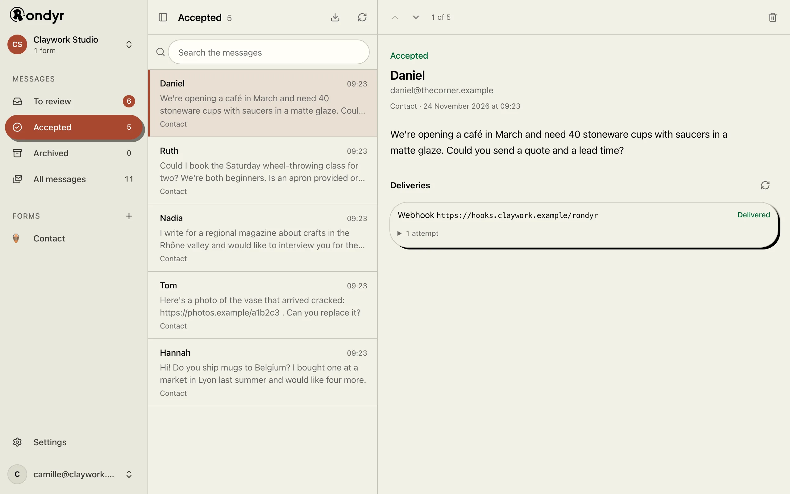
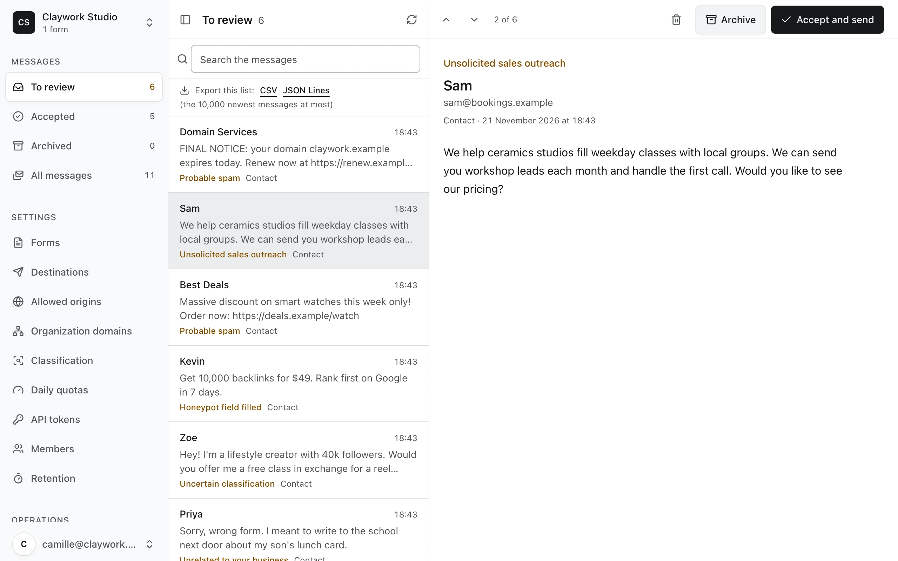

<h1 align="center">
  <picture>
    <source media="(prefers-color-scheme: dark)" srcset="./docs/brand/rondyr-dark-mode.svg">
    
  </picture>
</h1>

<p align="center">A self-hosted form backend for your website that filters spam and runs in your own Cloudflare account.</p>

<p align="center">
  
  <a href="https://github.com/basaltbytes/rondyr/actions/workflows/ci.yml"></a>
  <a href="./LICENSE"></a>
</p>

<p align="center">
  <a href="https://deploy.workers.cloudflare.com/?url=https://github.com/basaltbytes/rondyr"></a>
</p>

<p align="center">
  
</p>

> [!WARNING]
> Rondyr is pre-alpha software. The data model and HTTP API can change between commits.

Point your website's `<form>` at Rondyr and it saves every message in your own Cloudflare account, checks it for spam, sales pitches, and relevance to your business, and forwards accepted messages by email or webhook. Rondyr never deletes a message on an AI model's guess: anything doubtful waits in **To review** with a plain reason until a person accepts or archives it.

## Deploy in a few minutes

You need a Cloudflare account on **Workers Paid** ($5/month per account; [Costs and limits](./docs/costs.md) explains why) and a GitHub or GitLab account. A custom domain is optional.

1. Select **Deploy to Cloudflare** above, sign in to Cloudflare, and connect your GitHub or GitLab account.
2. Keep the default names (`rondyr`), and enter a random passphrase of at least 32 characters for `RONDYR_SETUP_TOKEN` (for example from your password manager or `openssl rand -hex 32`). Keep it for step 4.
3. Select **Deploy**. Cloudflare copies the repository to your account, sets up the resources, and deploys Rondyr.
4. Open your new Rondyr URL from **Workers & Pages → rondyr**, paste your setup token, and create the owner account.
5. Create an organization and a form, then paste the form's URL into your site:

```html
<form action="https://YOUR_RONDYR_HOST/f/YOUR_PUBLIC_ID" method="post">
  <label>Name <input name="name" required /></label>
  <label>Email <input type="email" name="email" required /></label>
  <label>Message <textarea name="message" required></textarea></label>
  <button type="submit">Send</button>
</form>
```

The visitor gets a confirmation page (or redirects to your own thank-you page), and the message shows up in **Accepted** or **To review** seconds later. Add an [email destination](./docs/email.md) or [webhook](./docs/webhooks.md) so accepted messages reach your team automatically.

For custom domains, updates, and deploying from a fork with Alchemy and GitHub Actions, see [Deploy Rondyr](./docs/deployment.md).

<p align="center">
  
</p>

## Features

- **Spam and sales-pitch filtering:** classifies every message for spam, unsolicited outreach, and business relevance with Jev (default) or OpenAI Decisions, with optional second-model escalation for uncertain messages.
- **Bot defenses before AI:** per-visitor and per-form rate limits, honeypot fields, Cloudflare Turnstile, allowed origins, repeat detection, and per-organization daily quotas.
- **Email and webhook forwarding:** sends accepted messages via Resend or Cloudflare Email Sending (to confirmed recipients only) and to HMAC-SHA-256 signed webhooks, with automatic retries and delivery history.
- **Team inbox:** **Admin** and **Reviewer** roles, invitation links, inbox search, CSV and JSON Lines export, message deletion, and automatic retention.
- **Integrations:** plain HTML forms, cross-origin JSON `fetch`, server intake with idempotency keys and API tokens, and an [EmDash plugin](./docs/emdash.md) in [`packages/emdash-plugin/`](./packages/emdash-plugin/).

## Documentation

| Task | Guide |
| --- | --- |
| Deploy with the button or Alchemy, add a custom domain, update | [Deploy Rondyr](./docs/deployment.md) |
| Invite teammates, manage roles, reset passwords | [Team and accounts](./docs/team.md) |
| Understand Cloudflare plan requirements, email costs, and daily quotas | [Costs and limits](./docs/costs.md) |
| Add an HTML or JavaScript form, set redirects and allowed origins | [Put a form on your site](./docs/forms.md) |
| Configure honeypot, Turnstile, business context, and spam thresholds | [Fight spam](./docs/spam-protection.md) |
| Review quarantined messages, search, check deliveries, export, delete | [Read and sort messages](./docs/inbox.md) |
| Set up Resend or Cloudflare Email Sending and confirm recipients | [Send messages by email](./docs/email.md) |
| Forward messages to webhooks and verify signatures | [Send messages to a webhook](./docs/webhooks.md) |
| Connect an EmDash site | [Connect an EmDash site](./docs/emdash.md) |
| Submit forms or review messages over HTTP with API tokens | [HTTP API](./docs/api.md) |

## Contributing

Contributor documentation stays in this repository:

- [CONTRIBUTING.md](./CONTRIBUTING.md) and [docs/local-development.md](./docs/local-development.md) for local setup, tests, and pull requests
- [architecture.md](./architecture.md) for the technical design
- [docs/evaluation.md](./docs/evaluation.md) for classifier evaluation on labeled corpora
- [docs/operations.md](./docs/operations.md) for the operations runbook
- [AGENTS.md](./AGENTS.md) for coding and writing rules

Report security vulnerabilities privately through [GitHub security advisories](https://github.com/basaltbytes/rondyr/security/advisories/new); see [SECURITY.md](./SECURITY.md).

## License

Rondyr is licensed under the [GNU Affero General Public License v3.0](./LICENSE). You can run it, change it, and deploy it for your own forms. If you offer Rondyr, or software that includes it, to others over a network, you have to publish the complete source of that software under the same license.

These parts are under other licenses, each with its license file in the same directory:

- [`packages/emdash-plugin/`](./packages/emdash-plugin/): MIT, so that sites can compile the plugin into their own Worker.
- [`tooling/oxlint/`](./tooling/oxlint/): the 16 rules and 3 shared modules from [dmmulroy/anti-slop](https://github.com/dmmulroy/anti-slop) listed in its README are under MIT, in `LICENSE-ANTI-SLOP`. The rest of the directory comes from usine and is under AGPL-3.0.
- [`apps/rondyr/dashboard/src/components/ui/`](./apps/rondyr/dashboard/src/components/ui/): the components derive from [shadcn/ui](https://github.com/shadcn/ui), whose MIT notice is in `LICENSE-SHADCN`.
- [`.agents/skills/alchemy-domain/`](./.agents/skills/alchemy-domain/): copied from [Alchemy](https://github.com/alchemy-run/alchemy) under Apache-2.0, with its `LICENSE` and `NOTICE`.
- [`.agents/skills/effect-ts/references/schema-decisions.md`](./.agents/skills/effect-ts/references/schema-decisions.md): adapted from [artimath/effect-skills](https://github.com/artimath/effect-skills), whose MIT notice is in `LICENSE-EFFECT-SKILLS` next to it.

## Author

Rondyr is built by [Basaltbytes](https://basaltbytes.com).
