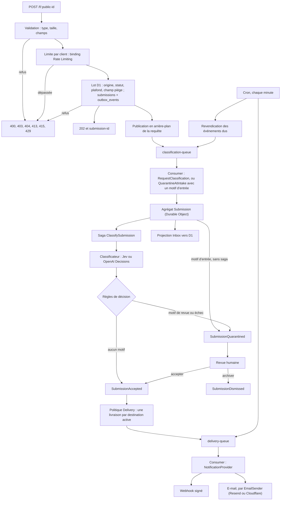

# Rondyr : architecture technique

> **Signature :** *The gatekeeper for your forms.*
> **Statut :** v0.1 en cours, document mis à jour le 20 novembre 2026.
> **Production :** `https://rondyr.basaltbytes.com` (stage `prod`).

Ce document décrit ce qui est construit et ce qui reste à faire pour la v0.1. Chaque écart entre les deux renvoie à une issue GitHub. La section 12 donne l’ordre des travaux.

## 1. Vision et périmètre

Rondyr est un backend de formulaires que l’on déploie dans son propre compte Cloudflare. Il reçoit les messages d’un site, écarte les indésirables sans supprimer les demandes réelles, et garde tout message douteux en quarantaine pour une revue humaine. Le nom vient du rondier, le gardien qui filtre les entrées.

Un administrateur déploie l’application, crée une organisation, puis des formulaires. Chaque formulaire a une URL publique utilisable depuis un formulaire HTML ou une application. Une organisation peut décrire son activité (par exemple « studio de poterie proposant des ateliers ») ; le classificateur s’en sert pour juger si un message est lié à cette activité.

Ce qui distingue Rondyr d’un SaaS de formulaires : le filtrage tient compte du métier de l’organisation, et les données restent dans l’infrastructure de l’opérateur.

### État de la v0.1

| Capacité | État | Suivi |
| --- | --- | --- |
| Déploiement Alchemy, stages `staging` et `prod`, CI | Fait | #12 pour un compte vierge |
| Premier compte, sessions, inscriptions fermées | Fait | |
| Organisations et formulaires | Fait : ajout, nom, contexte métier, suspension, redirection de succès et origines autorisées par formulaire | #11 pour les rôles |
| Réception JSON, `application/x-www-form-urlencoded` et `multipart/form-data` sans fichier | Fait, y compris JSON depuis un navigateur sur une autre origine | |
| Limites à l’entrée | Taille, schéma, 5 par minute et par client sur un formulaire, 30 par minute et par formulaire, champ piège | #7 pour Turnstile et les quotas |
| Enregistrement durable et outbox | Fait | |
| Classification et quarantaine | Seuils par classificateur, politique par organisation | #15 |
| Inbox et revue humaine | Fait | #9 |
| Livraisons : tables, file, tentatives et reprises | Fait | |
| Historique des livraisons, relance manuelle, envoi d’essai | Fait, dans le dashboard | #11 pour les rôles |
| Livraison par webhook signé | Fait | |
| Livraison par e-mail | Resend par défaut, Cloudflare Email Sending sur les stages qui le choisissent | Confirmation des destinataires (#36) |
| État du traitement et procédures de reprise | Compteurs par organisation, dernier Cron réussi et runbook | #43 pour le passage en staging, #10 pour les traitements bloqués |

Un formulaire peut avoir des destinations webhook et des destinations e-mail, configurées depuis le dashboard ou l’API d’administration. Une destination e-mail a de 1 à 10 destinataires ; le message part en texte brut par le fournisseur d’e-mail du stage (Resend ou Cloudflare Email Sending). Un formulaire sans destination garde ses messages acceptés dans l’Inbox seulement. Sous les champs d’un message accepté, le dashboard affiche ses livraisons et leurs tentatives, et permet de relancer une livraison en échec ; chaque destination peut recevoir un message d’essai.

Un formulaire peut aussi avoir une liste d’origines autorisées. Une page servie depuis une autre origine peut alors l’appeler avec `fetch`, et un navigateur d’un site absent de la liste reçoit `403`. Une liste vide autorise toutes les origines.

Le dashboard ajoute un formulaire à une organisation, le renomme, modifie son contexte métier, le suspend et le réactive ; l’identifiant public ne change jamais. Un formulaire suspendu refuse les nouveaux messages et garde les siens. Un formulaire peut aussi avoir une URL de succès, vers laquelle Rondyr redirige un envoi HTML accepté ; son origine doit figurer dans la liste des origines autorisées. Il peut enfin nommer un champ piège, que les visiteurs laissent vide et que les robots remplissent (section 8).

### Hors périmètre de la v0.1

Form builder, CRM, pièces jointes, automatisations visuelles, moteur de templates, facturation SaaS, analytics marketing et modèle entraîné sur les données des clients.

## 2. Stack et conventions

| Responsabilité | Choix |
| --- | --- |
| Runtime, API, assets | Un seul Cloudflare Worker, `rondyr-<stage>` |
| Métier, erreurs, concurrence | Effect 4 et Effect Schema |
| Modèle de domaine | Alchemy Domain (`@alchemy.run/domain`) : agrégat, politique, saga et projection hébergés dans des Durable Objects |
| Infrastructure as Code | Alchemy 2 (`alchemy-run.ts`) |
| Persistance des messages et de la configuration | Cloudflare D1 |
| Schéma et migrations | Drizzle Kit. Les requêtes d’exécution sont du SQL préparé, et Effect Schema décode chaque ligne lue |
| Authentification du dashboard | Better Auth, sessions en D1 |
| Asynchronisme | Cloudflare Queues et un Cron chaque minute |
| Classificateur | Jev (`typesafe/jev`, binding Workers AI) ou OpenAI Decisions (`openai/decisions`, via AI Gateway), choisi par stage |
| Dashboard | React 19 et Vite, servi comme assets du Worker |
| Qualité | Oxlint avec un plugin local, Oxfmt, `effect-tsgo`, Knip, Vitest dans workerd |

Les fichiers et dossiers du projet sont en kebab-case, sauf les noms imposés par les outils. Les fichiers du domaine ont un suffixe par type : `.aggregate.ts`, `.command.ts`, `.event.ts`, `.policy.ts`, `.saga.ts`, `.projection.ts`, `.query.ts`, `.external.ts`, `.api.ts`. Les colonnes SQL sont en `snake_case`.

### Principes de conception

1. **Monolithe modulaire.** Un Worker, pas de microservices.
2. **Domaine isolé de la plateforme.** `src/domain` n’importe ni `cloudflare:*`, ni Drizzle, ni l’IaC Alchemy ; une règle Oxlint le vérifie. Il dépend d’Effect et de l’API de modélisation d’Alchemy Domain.
3. **Ports et adaptateurs.** Les ports de `src/ports` déclarent les services Effect, les adaptateurs fournissent les layers, et `src/worker-implementation.ts` les compose. Les routes et les jobs n’utilisent que des ports : une règle Oxlint leur interdit d’importer `src/adapters`, sauf dans les tests. Le domaine déclare lui-même `InboxStore` et le système externe `Classifier`, puisqu’il ne peut pas importer `src/ports`.
4. **IA non destructive.** Un doute, une erreur technique ou un message hors sujet mène à la quarantaine, jamais à une suppression.
5. **Au moins une fois, avec idempotence.** Queues peut remettre deux fois le même message ; chaque consumer le tolère.
6. **Coût borné.** Les protections s’appliquent avant l’appel au modèle : la limite par client et le plafond par formulaire avant tout enregistrement, le champ piège avant la classification. Les plafonds par organisation restent à faire (#7).

## 3. Parcours d'une soumission



`202 Accepted` signifie que D1 a enregistré la soumission et son événement outbox dans la même transaction. La réponse ne dit rien de la classification ni d’une livraison. Une requête refusée avant cet enregistrement n’entre pas dans la garantie, y compris un `429`.

Une soumission dont le champ piège est rempli suit le même chemin jusqu’au `202`, et la réponse est identique : le robot n’apprend rien. Le lot D1 enregistre avec elle le motif d’entrée `honeypot`, puis le consumer envoie `QuarantineAtIntake` au lieu de `RequestClassification`, et l’agrégat la met en quarantaine sans démarrer la saga.

Un envoi `application/x-www-form-urlencoded` ou `multipart/form-data` dont l’en-tête `Accept` contient `text/html` reçoit une page de confirmation en HTML avec le statut `202`, au texte fixe, en français ou en anglais selon l’en-tête `Accept-Language` du visiteur. Si le formulaire a une URL de succès, il reçoit à la place `303` vers cette URL.

## 4. Fiabilité : transactional outbox

D1 et Queues ne partagent pas de transaction, et Queues remet les messages au moins une fois. Rondyr écrit donc l’intention de publier dans D1, puis la rejoue jusqu’à ce que le modèle de domaine l’ait prise en charge.

### Ingestion

L’adaptateur D1 du port `SubmissionIntake` exécute un seul `db.batch`. Il lit les conditions d’accès du formulaire, insère la soumission si elles le permettent et si le plafond de 30 messages par minute est respecté, puis insère l’événement dans `outbox_events`. L’insertion retire un champ piège vide, en gardant l’ordre des autres champs, et calcule les compteurs de répétition et le motif d’entrée (section 5). D1 exécute le lot dans une transaction. Un test force l’échec de l’insertion dans l’outbox avec un trigger et vérifie que la soumission n’existe pas et que la route répond `503`.

### Publication

`outbox_events` contient une ligne par soumission, avec trois colonnes d’état : `lease_until`, `published_at` et `handed_off_at`. Un événement est dû quand il n’est pas remis, que son bail a expiré et qu’il n’a jamais été publié, ou l’a été depuis plus de 5 minutes. Deux chemins le publient avec la même revendication : ils posent un bail de 60 secondes sur l’événement dû, l’envoient à `classification-queue`, puis renseignent `published_at` et libèrent le bail. Tant que l’un tient le bail, l’autre ne peut pas revendiquer l’événement.

- Après le lot D1, la route d’ingestion publie l’événement de sa soumission en arrière-plan, avec `waitUntil` derrière le port `BackgroundTasks`. La réponse `202` n’attend pas cette publication, et un échec n’apparaît que dans les journaux.
- Chaque minute, le Cron revendique jusqu’à 100 événements dus. C’est le chemin de reprise : après un échec d’envoi, le bail reste posé et le Cron reprend l’événement à son expiration, soit au plus deux minutes plus tard.

### Remise au modèle

Le consumer lit des lots de 10 messages. Pour chacun, il lit l’événement non remis et le motif d’entrée de la soumission, envoie à l’agrégat `RequestClassification`, ou `QuarantineAtIntake` si un motif d’entrée est enregistré, avec le `commandId` `submission-received:<id>`, puis renseigne `handed_off_at` et acquitte le message. Un échec relance le message ; après 3 reprises, Queues le place dans la DLQ. Un motif que le Worker ne connaît pas fait échouer la lecture : le message est relancé puis placé dans la DLQ, sans classification.

Le motif d’entrée est une colonne de `submissions`, écrite par la même instruction que la soumission. Un message redistribué par Queues ou republié par le Cron relit donc la même valeur et envoie la même commande, avec le même `commandId`. Deux mécanismes absorbent les doublons : Alchemy Domain ignore une commande dont le `commandId` est déjà connu, et l’agrégat n’émet `ClassificationRequested` ou la quarantaine d’entrée que depuis l’état `Unrecorded`.

### Classification durable

La politique `Classification` démarre la saga `ClassifySubmission` à chaque `ClassificationRequested`. La saga lit la politique de classification de l’organisation, puis appelle le classificateur avec un délai maximal de 12 secondes par appel. Elle tente chacune de ces deux étapes jusqu’à 3 fois, avec 10 puis 30 secondes d’attente. Une panne de D1 pendant la lecture de la politique se réessaie ; une valeur inconnue de `RONDYR_CLASSIFIER` ou une politique enregistrée illisible ne se réessaie pas. Une erreur non réessayable ou l’épuisement des tentatives produit `SubmissionQuarantined` avec le motif `classification-error`. Les étapes sont des activités durables : un redémarrage du Durable Object reprend la saga là où elle s’est arrêtée.

### Livraison

La politique `Delivery` du modèle `Submissions` réagit à chaque `SubmissionAccepted`, que l’acceptation soit automatique ou manuelle. Elle appelle le système externe `DeliveryScheduler`, dont l’adaptateur fait deux choses dans l’ordre :

1. Il crée dans `deliveries` une ligne par destination active du formulaire, de la même organisation que la soumission, et créée au plus tard à l’acceptation. La contrainte d’unicité sur `(submission_id, target_id)` rend la création idempotente ; chaque livraison reçoit un UUID v4, son identifiant stable.
2. Il publie ces livraisons dans `delivery-queue` avec la même revendication que l’outbox de soumission (bail de 60 secondes, puis `published_at`). Un échec de publication est journalisé ; le Cron reprend la livraison.

Sans destination active, la politique ne crée rien et ne publie rien. Une politique Alchemy Domain ne traite que les nouveaux événements : un déploiement ne rejoue pas les acceptations passées, et une destination ajoutée plus tard ne reçoit pas les messages acceptés avant sa création, même si la politique s’exécute une seconde fois. Une projection aurait été rejouée par le backfill, ce qui aurait envoyé d’anciens messages. Si D1 échoue, l’exécution de la politique échoue et la plateforme la relance (30 secondes, puis un délai doublé, puis toutes les heures).

Chaque minute, le Cron publie jusqu’à 100 livraisons dues : en attente, en reprise dont le délai est écoulé, ou en cours dont le bail a expiré. Une livraison publiée qu’aucune tentative n’a prise après 5 minutes est republiée.

Le consumer lit des lots de 10 messages et traite chaque livraison séparément. Pour une livraison, il exécute un lot D1 qui démarre la tentative : il passe la livraison à `processing`, incrémente `attempt_count`, pose un bail de 2 minutes et insère la tentative dans `delivery_attempts`. Une livraison terminée, en attente de reprise ou déjà en cours n’est pas démarrée, et le message est acquitté. Le consumer appelle ensuite le port `NotificationProvider` avec la destination, les champs du message et l’identifiant de livraison, avec un délai maximal de 30 secondes, puis enregistre le résultat :

| Résultat | Effet |
| --- | --- |
| Succès | `delivered` |
| Échec permanent | `failed`, avec le résumé d’erreur |
| Échec réessayable | `retrying`, nouvelle tentative après 1 min, 5 min, 30 min, 2 h puis 6 h ; `failed` après la sixième |
| Pas de réponse en 30 secondes | Échec réessayable |
| Aucun fournisseur pour le type de destination | Échec permanent : `No notification provider for target type "…".` |

Si le Worker s’arrête entre l’envoi et l’enregistrement du résultat, la tentative reste ouverte. À l’expiration de son bail, le Cron republie la livraison ; la tentative suivante marque la précédente `interrupted` et renvoie le message avec le même identifiant. Une tentative interrompue compte dans les six ; si c’était la dernière, la livraison passe à `failed`. Le consumer ne relance un message de file que si D1 échoue ; après 3 reprises, Queues le place dans la DLQ de livraison.

Le destinataire peut donc recevoir deux fois la même livraison. Rondyr promet une reprise fiable et un identifiant de déduplication, pas un envoi unique de bout en bout. Le résumé d’erreur, borné à 300 caractères, vient du fournisseur, qui ne doit pas y mettre les champs du message ; les journaux du consumer ne contiennent que les identifiants, le type de destination et le résultat.

La composition du Worker déclare deux fournisseurs, pour les types `webhook` et `email` ; la section 8 décrit leurs règles. Un type sans fournisseur échoue toujours sans reprise.

#### Relance manuelle

Une livraison `failed` peut être relancée depuis le dashboard. La relance garde l’identifiant de livraison et ouvre une nouvelle série de six tentatives. Une seule instruction D1 la fait passer de `failed` à `pending`, remet `attempt_count` à zéro, efface `last_error` et la rend due tout de suite ; elle ne touche pas `delivery_attempts`. Toute autre livraison répond `409`, et deux relances simultanées n’en font qu’une, puisque la seconde ne trouve plus le statut `failed`. La route publie ensuite la livraison avec la revendication habituelle, et le Cron la reprend si cette publication échoue. La relance passe donc par la même file et le même démarrage qu’une tentative automatique : si elle croise le Cron ou un message en double, une seule tentative démarre.

`attempt_count` compte les tentatives de la série en cours ; il décide du délai de reprise et du passage à `failed`. Les lignes de `delivery_attempts` sont numérotées sur tout l’historique : la première tentative après une relance porte le numéro qui suit la dernière, et le nombre de tentatives affiché est le nombre de ces lignes. Avec Resend, l’identifiant de livraison reste la clé d’idempotence, si bien qu’une relance moins de 24 heures après la première tentative, avec d’autres destinataires, reçoit `409 invalid_idempotent_request`.

#### Envoi d’essai

L’envoi d’essai passe par la méthode `sendTest` du port `NotificationProvider`, avec le fournisseur du type de la destination et les mêmes vérifications qu’une livraison : configuration, URL, secrets, fournisseur d’e-mail. Chaque essai reçoit un nouvel identifiant et ne crée ni soumission, ni livraison, ni tentative ; la route attend la réponse au plus 30 secondes, sans reprise. Le webhook reçoit la charge utile version 1 avec le type `test`, et l’e-mail porte « Test message » (« Message d’essai » en français) dans son objet et son texte. Un seul essai à la fois par destination : la route garde en mémoire les destinations en cours d’essai, ce qui ne vaut que pour une instance du Worker.

Le fournisseur `email` construit le message et appelle le port `EmailSender`, qui ne connaît aucun fournisseur d’e-mail : il reçoit l’expéditeur, les destinataires, le `Reply-To` éventuel, l’objet, le texte et la clé d’idempotence, et distingue un succès, un rejet définitif (`EmailRejected`) et un échec à réessayer (`EmailUnavailable`). `RONDYR_EMAIL_PROVIDER` choisit l’adaptateur du stage dans `src/adapters/email/email-sender.ts`. Il vaut `resend` par défaut et accepte aussi `cloudflare`. Resend utilise l’identifiant de livraison comme clé d’idempotence pendant 24 heures, ce qui couvre les six tentatives automatiques. Avec Cloudflare, une tentative interrompue après acceptation peut envoyer un doublon à la reprise. L’identifiant de livraison reste dans le message.

### Limites connues

- L’outbox ne compte pas ses tentatives. Un événement que le consumer ne parvient jamais à remettre est republié toutes les 5 minutes sans alerte (#10).
- La DLQ de classification n’a pas de consumer (#10).
- La saga n’enregistre que le résultat final ; les tentatives échouées ne laissent pas de trace dans les événements.
- La DLQ de livraison n’a pas de consumer non plus. Elle ne reçoit un message qu’après des échecs de D1, et l’état de la livraison reste dans D1, d’où le Cron la republie (#10).
- L’envoi d’essai n’est limité qu’à un à la fois par destination et par instance du Worker. Un membre peut en envoyer autant qu’il veut, et chaque e-mail est soumis au quota du fournisseur du stage (#7).

## 5. Classification intelligente

Le classificateur évalue le **spam**, le **démarchage commercial non sollicité** et la **pertinence**. La question sur le spam couvre le marketing non sollicité, le hameçonnage, les sollicitations de masse et les envois automatisés. La question sur le démarchage demande si l’expéditeur cherche à vendre ou à proposer à l’organisation quelque chose qui vient de lui (produit, service, contenu, article invité, fichier de prospects) au lieu de demander ce qu’elle offre. Elle compte les approches indirectes : demander qui s’occupe d’un sujet pour lui envoyer une proposition, ou demander un rendez-vous pour présenter une offre. Elle exclut le prospect qui décrit son besoin, la boutique qui veut acheter, revendre ou mettre en dépôt les produits de l’organisation, la demande de devis, la presse, la candidature, le partenariat d’un pair et l’échange sur une commande ou une prestation en cours. Les deux adaptateurs envoient le même texte, `solicitationInstruction` dans `src/domain/submissions/classifier-input.ts`. La pertinence mesure le lien entre le message et l’activité décrite par l’organisation. Sans contexte métier, le classificateur omet cette question.

Un message hors sujet n’est pas un spam : « J’ai trouvé vos clés devant votre atelier » est authentique même s’il ne parle pas de poterie.

### Règles de décision

`reviewReason`, dans `src/domain/submissions/classification.ts`, applique ces règles dans l’ordre. La version courante est `rulesVersion = 6`. La version 2 limite le contexte métier sans couper de caractère. La version 3 ajoute la règle de répétition et la nouvelle entrée du classificateur. La version 4 ajoute la comparaison du domaine de l’expéditeur. La version 5 demande le score de démarchage et met en quarantaine un message dont le score dépasse 0,50. La version 6 ajoute les politiques par organisation et relève le seuil de faible pertinence par défaut.

| Condition avec les réglages par défaut | Résultat |
| --- | --- |
| Échec du classificateur ou score de démarchage manquant | Quarantaine, motif `classification-error` |
| Spam ≥ 0,70 | Quarantaine, motif `probable-spam` |
| Spam ≥ 0,30 | Quarantaine, motif `ambiguous` |
| Démarchage > 0,50 | Quarantaine, motif `solicitation` |
| Contexte configuré et pertinence < 0,50 (Jev) ou < 0,45 (OpenAI Decisions) | Quarantaine, motif `low-relevance` |
| Aucun motif | Acceptation automatique |

L’organisation peut remplacer les quatre seuils ensemble et choisir indépendamment que les messages hors sujet soient traités en mode `review` ou `accept`. Les seuils vont de 0 à 1 inclus, et le seuil ambigu doit être inférieur ou égal à celui du spam probable. Le mode `accept` accepte et étiquette `off-topic` un message dont le seul motif de quarantaine serait la faible pertinence. La boîte de réception affiche l’étiquette, et les livraisons suivent le circuit habituel.

Le workflow lit la politique et le classificateur du stage au début de l’analyse. Il utilise cette politique pendant les tentatives de classement et la transmet à la commande `RecordClassification`. Les décisions automatiques enregistrent la politique résolue, la version des règles et les scores quand le modèle répond. Si la politique reste indisponible après les tentatives, ou si elle est illisible, la soumission attend en quarantaine avec le motif `classification-error`. Les événements enregistrés avant la version 6 restent lisibles.

Le [rapport d’évaluation](docs/evaluation.md) compte les occurrences représentées par `duplicates`. La mesure du 21 novembre porte sur trois passages du corpus synthétique et du corpus réel du mainteneur ; avec ces seuils, aucun message légitime n’est mis en quarantaine. Avec Jev, les lignes de spam acceptées passent de 5 à 3 sur le corpus synthétique et de 7 à 5 sur le corpus réel. Avec OpenAI Decisions, elles passent de 4 à 2 sur le corpus synthétique et restent à 3 sur le corpus réel. #15 prévoit l’escalade facultative des cas `ambiguous` vers un second modèle.

### Quarantaine sans appel au modèle

L’ingestion enregistre un motif d’entrée dans `submissions.intake_reason` quand l’une de ces conditions s’applique. `QuarantineAtIntake` transmet l’organisation et le motif à l’agrégat. Depuis l’état `Unrecorded`, l’agrégat émet directement `SubmissionQuarantined` avec le motif et la version des règles, sans scores. Un relecteur peut accepter le message et déclencher ses livraisons, ou l’archiver.

| Condition | Résultat |
| --- | --- |
| Champ piège du formulaire rempli | Quarantaine, motif `honeypot`, sans appel au classificateur |
| Au moins 2 soumissions antérieures au même contenu ou 3 du même expéditeur | Quarantaine, motif `repetition`, sans appel au classificateur |

Le comptage porte sur les soumissions déjà enregistrées dans la même organisation, tous formulaires et statuts confondus, avec une fenêtre de 30 jours dont la borne basse est incluse. Un double envoi isolé reste sous les deux seuils. Le champ piège rempli est prioritaire lorsque les deux règles s’appliquent.

Le champ `email` sert à comparer les expéditeurs. Le contenu regroupe les paires nom–valeur des autres champs, hors `name`, triées par nom. La normalisation des valeurs retire les espaces aux extrémités, réduit les suites d’espaces, passe en minuscules et applique Unicode NFC. Une valeur vide ne produit pas d’empreinte d’expéditeur et ne contribue pas au contenu. Le Worker calcule le condensat SHA-256 de la valeur normalisée, et les index le préfixent par l’identifiant de l’organisation fourni par le formulaire. Le condensat lui-même ne contient pas cet identifiant : D1 ne connaît l’organisation que dans le lot d’écriture, et son SQL ne propose pas SHA-256. Deux organisations qui reçoivent la même valeur ont donc la même empreinte. Ce choix est accepté : un accès direct à la base donne déjà `submissions.fields` en clair, et les empreintes n’apprennent rien de plus. Les lignes antérieures à la migration restent lisibles avec des compteurs à zéro et ne contribuent pas à l’historique de répétition.

`QuarantineReason` type l’événement, la projection et l’API. #7 prévoit deux autres motifs d’entrée.

- `turnstile-failed` : la route vérifie le jeton Turnstile avant le lot D1, puis l’insertion écrit ce motif dans `intake_reason`. Il suffit d’ajouter la valeur à `IntakeReason` et un libellé au dashboard.
- `quota` : si le plafond d’appels au modèle se compte à l’ingestion, il s’écrit dans `intake_reason` comme le champ piège. S’il se compte à la remise au modèle, le consumer envoie `QuarantineAtIntake` avec `quota` ; une seconde remise trouve l’agrégat hors de `Unrecorded` et ne change rien, donc la première décision reste la seule.

### Classificateurs

`RONDYR_CLASSIFIER` choisit le classificateur pour tout un stage : `jev` par défaut, ou `openai`. Les deux sont des adaptateurs du système externe `Classifier` déclaré dans le domaine.

Le Worker et le corpus construisent la même entrée dans `src/domain/submissions/classifier-input.ts`, avec le contexte métier, les faits calculés et les champs du visiteur dans cet ordre. Les faits comprennent les deux compteurs enregistrés à l’ingestion et un indicateur de lien ou de balise HTML dans un champ autre que le plus long. En cas d’égalité, le premier champ le plus long sert de référence. Aucun condensat n’est envoyé au modèle.

Une organisation peut déclarer jusqu’à dix noms d’hôte ASCII en minuscules. Lorsque le domaine du champ `email` correspond à un domaine déclaré ou à l’un de ses sous-domaines, les deux modèles reçoivent le fait `sender_matches_organization_domain: true` et un champ `email` vide ; D1 conserve l’adresse soumise. Dans tous les autres cas (adresse d’un autre domaine, adresse absente ou invalide, organisation sans domaine déclaré), le fait est omis et l’entrée du modèle est celle de la version 3. Un `false` envoyé à chaque message déplaçait les scores de messages légitimes sans rapport avec le domaine : sur le corpus synthétique, Jev mettait un message légitime en quarantaine et OpenAI Decisions deux. La comparaison porte sur une adresse déclarée par le visiteur et ne déclenche aucune règle de quarantaine.

- **Jev** reçoit l’entrée dans un objet `state`, avec deux ou trois questions nommées de type `noul` qui renvoient un score entre 0 et 1. L’appel passe par le binding Workers AI.
- **OpenAI Decisions** reçoit les mêmes données en JSON et des questions de type `predicate`. L’appel passe par le gateway `default` d’AI Gateway avec la facturation unifiée de Cloudflare, sans clé OpenAI dans Rondyr.

La pile Alchemy ne crée aucun gateway. AI Gateway crée `default` à la première requête authentifiée du compte, avec la collecte de logs activée ; les appels Jev faits par le binding y passent aussi, et leurs journaux contenaient les champs des soumissions tant que l’adaptateur ne s’y opposait pas. Les deux adaptateurs désactivent donc la collecte et le cache à chaque appel, avec les options de `src/adapters/ai/gateway.ts`, et un test par adaptateur vérifie ces options. En développement local, le binding `AI` est absent et chaque message part en quarantaine avec le motif `classification-error`.

### Sécurité du pipeline IA

Les deux adaptateurs indiquent au modèle que l’entrée est à lire comme des données. Les champs du visiteur figurent dans un objet distinct des instructions. Le corps est limité à 16 Kio. Le contexte métier est limité à 2 000 unités UTF-16 sans couper de caractère. Les plafonds d’appels par organisation restent à faire (#7).

## 6. Modèle de données

L’état est réparti entre deux stockages. D1 contient la configuration, le contenu des messages et la vue de l’Inbox. Les Durable Objects d’Alchemy Domain contiennent le flux d’événements de chaque soumission, qui fait foi pour son statut.

### Tables D1

| Table | Contenu |
| --- | --- |
| `organizations` | `id`, `name` |
| `organization_members` | `(organization_id, user_id)`, sans rôle |
| `organization_domains` | `(organization_id, domain)`, jusqu’à dix par organisation |
| `organization_classification_policies` | Réglages de classification personnalisés, au plus une ligne par organisation |
| `forms` | `id`, `organization_id`, `public_id` unique, `name`, `business_context`, `status` (`active` par défaut, ou `suspended`), `success_url` (facultative, normalisée par `parseSuccessUrl`), `honeypot_field` (facultatif, nom du champ piège) |
| `form_origins` | `(form_id, origin)`, `created_at`. `origin` est normalisée : schéma, hôte et port éventuel, sans chemin ni barre oblique finale |
| `submissions` | `id` (UUID v4), `organization_id`, `form_id`, `fields` (JSON), `received_at`, `intake_reason` (facultatif), `sender_fingerprint` et `content_fingerprint` (facultatifs), `prior_same_sender` et `prior_same_content` |
| `outbox_events` | `submission_id`, `lease_until`, `published_at`, `handed_off_at` |
| `submission_inbox` | `submission_id`, `version`, `status`, `reason`, `label` (facultatif) |
| `notification_targets` | `id`, `organization_id`, `form_id`, `type`, `configuration` (JSON lu par le fournisseur du type), `active`, `created_at`. Pour un webhook, `configuration` contient `url`, `secret` (chiffré) et `previousSecret` (`null`, ou le secret chiffré précédent et la fin de sa validité). Pour un e-mail, elle contient `recipients`, la liste des destinataires |
| `deliveries` | `id` (UUID v4 stable), `submission_id`, `target_id`, `status`, `attempt_count` (tentatives de la série en cours), `last_error`, `next_attempt_at`, `lease_until`, `published_at`, `created_at`, `updated_at` ; unique sur `(submission_id, target_id)` |
| `delivery_attempts` | `(delivery_id, attempt)`, `started_at`, `finished_at`, `outcome`, `error`. `attempt` numérote les tentatives sur tout l’historique, relances manuelles comprises |
| `auth_*` | Comptes, sessions, vérifications et limites de débit de Better Auth |

La migration `form-administration` ajoute `status` et `success_url` par `ALTER TABLE` : les formulaires existants passent à `active` par la valeur par défaut. `status` n’a pas de contrainte `CHECK`, car l’ajouter reconstruirait la table, et la suppression de `forms` sur D1 se propagerait à `form_origins` ; les adaptateurs ne l’écrivent qu’avec les deux valeurs, et Effect Schema refuse une autre valeur à la lecture.

La migration `form-honeypot` ajoute `forms.honeypot_field` et `submissions.intake_reason` de la même façon, sans valeur par défaut : un formulaire existant n’a pas de champ piège, et une soumission existante n’a pas de motif d’entrée. `intake_reason` n’a pas de contrainte `CHECK` non plus ; seule l’instruction d’insertion l’écrit, et le consumer le relit avec Effect Schema.

Deux index servent les lectures fréquentes : `(organization_id, received_at, id)` pour la pagination de l’Inbox et `(form_id, received_at)` pour le plafond par formulaire. La clé primaire `(form_id, origin)` de `form_origins` sert la vérification de l’origine à l’ingestion. Un index partiel sur `(next_attempt_at, lease_until)` sert la recherche des livraisons dues.

La migration `submission-repetition` ajoute quatre colonnes avec `ALTER TABLE` et deux index partiels pour le comptage. Chaque index commence par `organization_id`, suivi de l’empreinte de l’expéditeur ou du contenu, puis de `received_at`. Supprimer une soumission supprime ses empreintes et ses compteurs.

Une livraison a l’un des statuts `pending`, `processing`, `delivered`, `retrying` ou `failed`. `next_attempt_at` indique quand une tentative peut démarrer : la création, la fin du délai de reprise ou la fin du bail de la tentative en cours. Une tentative a le résultat `delivered`, `retryable-failure`, `permanent-failure` ou `interrupted`, ou aucun tant qu’elle s’exécute. Une relance manuelle ouvre une nouvelle série sur la même livraison sans effacer ses tentatives ; l’historique et la relance n’ont demandé aucune migration. L’API d’administration crée les destinations webhook et e-mail ; la table `notification_targets` existante suffit, sans migration. L’adaptateur relit la liste des destinataires avec le même schéma qu’à la création : une ligne modifiée à la main qui ne respecte plus la règle fait échouer la livraison sans reprise.

### Événements de l’agrégat `Submission`

| Événement | Données |
| --- | --- |
| `ClassificationRequested` | Organisation |
| `SubmissionQuarantined` | Organisation, motif, scores éventuels (absents pour un motif d’entrée ou un échec du classificateur), version des règles |
| `SubmissionAccepted` | Organisation, puis scores et version des règles (automatique) ou relecteur (manuelle) |
| `SubmissionDismissed` | Organisation, relecteur |

L’agrégat passe de `Unrecorded` à `Classifying`, puis à `Quarantined` ou `Accepted`. Avec un motif d’entrée, il passe directement de `Unrecorded` à `Quarantined`. Seul un message `Quarantined` peut être accepté ou archivé à la main. La projection `Inbox` écrit le dernier statut dans `submission_inbox`, protégée par le numéro de séquence de l’événement. Une soumission sans ligne de projection a le statut `received`.

Les statuts visibles sont `received`, `classifying`, `quarantined`, `accepted` et `archived`. Le champ `reason` de l’Inbox contient le motif de quarantaine, par exemple `classification-error`, `honeypot` ou `repetition`.

Le contenu des messages n’existe que dans `submissions.fields`, et n’en sort que dans le corps des requêtes webhook et dans le texte des e-mails. Les événements ne contiennent que des identifiants, des scores et l’identifiant du relecteur, et les livraisons que des identifiants, des états et des résumés d’erreur, ce qui limite une purge aux lignes D1 (#9). Supprimer une soumission supprime ses livraisons et leurs tentatives.

### Tables à venir

- Rôle dans `organization_members` et invitations (#11).
- Quotas (#7) et durées de conservation (#9).

Les tables `classification-attempts` et `audit-events` du document initial ne sont pas prévues : le flux d’événements de l’agrégat enregistre les décisions et leurs auteurs.

## 7. API et expérience développeur

### API publique

`POST /f/:public-id` accepte `application/json`, `application/x-www-form-urlencoded` et `multipart/form-data`. Le corps pèse au plus 16 Kio et contient de 1 à 32 champs texte ; un nom de champ a de 1 à 100 caractères, sans caractère de contrôle ni saut de ligne (y compris U+0085, U+2028 et U+2029), et une valeur au plus 4 000. Les noms `__proto__`, `constructor` et `prototype` restent refusés, et un nom qui commence par `_` n’a pas de sens particulier.

Un objet JSON imbriqué ou une valeur non textuelle sont refusés. Dans un corps de formulaire, un nom répété (cases à cocher, liste à choix multiples) est accepté : ses valeurs sont jointes par `, ` dans l’ordre reçu, et la valeur jointe doit tenir en 4 000 caractères. Un corps `multipart/form-data` ne contient que des champs texte : une partie avec un paramètre `filename`, même vide comme celle d’un champ fichier laissé vide, fait refuser le corps en `400`, sans rien enregistrer. L’analyseur multipart d’Effect (`MultipartParser`) lit le corps déjà borné à 16 Kio. Les messages reçus avant la règle des caractères de contrôle restent lisibles : seule l’ingestion l’applique.

Les champs sont stockés dans un objet JSON. Les noms qui sont des indices de tableau JavaScript (par exemple `"1"` et `"2"`) passent en tête, par ordre numérique. Pour conserver l’ordre de réception de bout en bout, il faudrait changer le format de stockage et transmettre l’ordre dans le payload webhook.

| Statut | Cas |
| --- | --- |
| `202` | Soumission enregistrée ; le JSON contient `submission-id` et `status: "received"`, ou la page de confirmation pour un envoi HTML |
| `204` | Prérequête CORS (`OPTIONS`) acceptée |
| `303` | Soumission enregistrée, envoi HTML d’un formulaire qui a une URL de succès ; `Location` vaut cette URL |
| `400` | Corps ou champs invalides, fichier dans un corps multipart, ou corps dont le seul champ est le champ piège vide |
| `403` | En-tête `Origin` absent de la liste des origines autorisées du formulaire, ou formulaire suspendu ; rien n’est enregistré |
| `404` | Formulaire inconnu, pour `POST` comme pour `OPTIONS` |
| `413` | Corps de plus de 16 Kio |
| `415` | Autre type de contenu |
| `429` | Plus de 5 soumissions en une minute du même client sur ce formulaire, ou plus de 30 sur le formulaire, avec `Retry-After: 60` ; rien n’est enregistré |
| `503` | D1 indisponible |

Les réponses ne révèlent rien de la décision anti-spam : une soumission au champ piège rempli reçoit le même `202`, la même page ou la même redirection qu’une autre. `GET /health` renvoie `{"status":"ok"}`.

#### Limite par client et champ piège

La route compte chaque soumission valide du client, identifié par `CF-Connecting-IP`, sur le formulaire de l’URL, avant le lot D1 : 5 par fenêtre de 60 secondes, avec le binding Rate Limiting `CLIENT_RATE_LIMIT`. Une adresse IPv6 compte pour son réseau `/64`. La clé est `<public-id>:<client>` ; le compteur est chez Cloudflare et Rondyr ne garde aucune adresse. Un client limité reçoit `429` avec `Retry-After: 60` et les en-têtes CORS d’une requête invalide : sans en-tête `Origin`, aucun en-tête CORS et aucun accès à D1 ; avec `Origin`, la liste du formulaire, lue en un aller-retour. La limite passe avant la vérification de l’origine : un client limité reçoit `429` même depuis une origine refusée, et rien n’est enregistré dans les deux cas. Une requête sans `CF-Connecting-IP`, en développement local ou dans les tests, n’est pas comptée ; si le binding échoue, la soumission passe et l’échec est journalisé. Le plafond de 30 par minute et par formulaire reste dans l’instruction d’insertion, pour tous les clients ensemble.

Le champ piège d’un formulaire, s’il est défini, s’applique dans l’instruction d’insertion. Vide, il est retiré des champs enregistrés et n’atteint ni le classificateur, ni un webhook, ni un e-mail. Rempli, il reste dans les champs, pour que le relecteur voie ce qui a été envoyé, et la soumission reçoit le motif d’entrée `honeypot` (section 5). Un corps dont le seul champ est le champ piège vide répond `400`. Sans champ piège, un champ `_hp` est un champ comme un autre.

#### Formulaire suspendu et redirection de succès

Un formulaire suspendu répond `403` à toute soumission valide et n’enregistre rien. Ses en-têtes CORS suivent la liste des origines, comme ceux d’un `429` : une page d’une origine autorisée peut lire le refus. Une origine absente d’une liste non vide reçoit le refus d’origine, vérifié en premier. Une requête invalide garde son statut (`400`, `413`, `415`), et la prérequête répond comme pour un formulaire actif. Les messages déjà reçus, les destinations, les origines et l’URL publique ne changent pas ; la réactivation rétablit l’ingestion.

Une soumission acceptée envoyée en `application/x-www-form-urlencoded` ou `multipart/form-data`, dont l’en-tête `Accept` contient `text/html`, reçoit `303` vers l’URL de succès du formulaire, avec les mêmes en-têtes CORS et `Cache-Control: no-store` que le `202`. Sans URL de succès, elle reçoit la page de confirmation. Un client JSON ou un client qui n’accepte pas HTML reçoit toujours le `202` en JSON. L’URL vient toujours de D1, jamais de la requête : aucun champ, paramètre ou en-tête ne la choisit.

`parseSuccessUrl`, dans `src/domain/forms/form.ts`, accepte une URL HTTPS absolue sans identifiants et la normalise (`invalid-url`, `not-https`, `credentials`). L’adaptateur ne l’enregistre que si son origine est dans la liste du formulaire (`origin-not-listed`), dans la même instruction `UPDATE`. Le retrait de cette origine de la liste est refusé en `409` tant que l’URL de succès est définie : le retrait silencieux de la redirection aurait changé la page vue par les visiteurs sans que la personne qui modifie la liste le voie. L’instruction `DELETE` porte la vérification, donc deux modifications simultanées ne laissent pas une URL de succès sur une origine retirée. À l’ingestion, la requête d’accès ne lit l’URL de succès que si son origine est encore dans la liste, et la règle de `parseSuccessUrl` s’applique encore : une ligne modifiée à la main qui ne la respecte plus donne la page de confirmation.

#### CORS et origines autorisées

`OPTIONS /f/:public-id` répond aux prérequêtes, et chaque réponse de la route porte les en-têtes CORS, erreurs comprises. Les en-têtes dépendent de la liste des origines autorisées du formulaire :

| Cas | En-têtes |
| --- | --- |
| Liste vide, formulaire inconnu, D1 indisponible | `Access-Control-Allow-Origin: *` |
| `Origin` dans la liste | `Access-Control-Allow-Origin` égal à l’origine reçue, et `Vary: Origin` |
| `Origin` absente de la liste, ou requête sans `Origin` | `Vary: Origin` seulement |

La prérequête autorise `POST` et l’en-tête `Content-Type`, avec `Access-Control-Max-Age: 7200`. Aucune réponse ne porte `Access-Control-Allow-Credentials` : un appel avec cookies échoue dans le navigateur. Un `429` expose aussi `Retry-After` par `Access-Control-Expose-Headers`.

Une requête sans en-tête `Origin` (curl, serveur) est traitée comme avant, quelle que soit la liste. Il en va de même pour `Origin: null`, qu’un navigateur envoie quand la page masque son origine (politique `no-referrer`, iframe isolée) : la refuser ferait perdre les messages d’un site pourtant autorisé. Une requête dont l’`Origin` est absente d’une liste non vide reçoit `403` avant tout enregistrement, qu’elle vienne de `fetch` ou d’un formulaire HTML posté depuis un autre site : un site absent de la liste ne peut pas remplir l’Inbox par le navigateur de ses visiteurs. La comparaison porte sur la valeur exacte de l’en-tête, que les navigateurs envoient déjà normalisée. Une requête invalide (`400`, `413`, `415`) garde son statut ; la liste ne décide alors que des en-têtes.

L’instruction d’insertion vérifie l’origine et le statut du formulaire, comme le plafond, applique le champ piège, et le même lot D1 lit l’état de la liste, le statut, l’URL de succès et le nom du champ piège. Une soumission acceptée coûte donc toujours un aller-retour D1, redirection et champ piège compris, plus un appel au binding Rate Limiting quand elle a une adresse de client, et un refus (`400` du champ piège, `403`, `404`, `429` du plafond) n’en demande plus de second. Une prérequête, ou une requête invalide qui porte un en-tête `Origin`, lit la liste en un aller-retour.

### API d’administration

Elle sert le dashboard et n’est pas publiée pour des clients tiers.

| Route | Rôle |
| --- | --- |
| `POST /api/setup` | Crée le premier compte, avec le jeton d’installation |
| `GET /api/auth/get-session`, `POST /api/auth/sign-in/email`, `POST /api/auth/sign-out` | Session Better Auth |
| `GET /api/organizations` | Organisations du compte et leurs formulaires |
| `POST /api/organizations` | Crée une organisation et son premier formulaire |
| `GET /api/organizations/:organizationId/domains` | Liste les domaines déclarés par ordre alphabétique |
| `POST /api/organizations/:organizationId/domains` | Ajoute un domaine (`{"domain":…}`). Répond `201` pour une création, `200` pour un doublon, `400` pour un nom invalide ou `409` si la liste est pleine |
| `DELETE /api/organizations/:organizationId/domains?domain=…` | Retire un domaine et répond `204`, ou `404` si le domaine n’est pas déclaré |
| `GET /api/organizations/:organizationId/classification-policy` | Renvoie le classificateur, sa politique par défaut et les réglages de l’organisation, ou `null` si elle utilise les réglages par défaut |
| `PUT /api/organizations/:organizationId/classification-policy` | Remplace les réglages de l’organisation. Accepte `thresholds` et `offTopic`, ensemble ou seuls. Répond `204`, ou `400` pour un réglage invalide |
| `DELETE /api/organizations/:organizationId/classification-policy` | Rétablit les réglages du classificateur et répond `204` |
| `POST /api/organizations/:organizationId/forms` | Ajoute un formulaire actif (`{"name":…,"businessContext":…}`, contexte facultatif) : `201` et le formulaire |
| `PATCH /api/organizations/:organizationId/forms/:publicId` | Renomme le formulaire, modifie son contexte métier, ou les deux (`{"name":…}`, `{"businessContext":…}`) ; un contexte vide l’efface |
| `POST /api/organizations/:organizationId/forms/:publicId/suspend` ou `/reactivate` | Suspend ou réactive le formulaire |
| `PUT /api/organizations/:organizationId/forms/:publicId/success-url` | Définit l’URL de succès (`{"url":…}`) |
| `DELETE /api/organizations/:organizationId/forms/:publicId/success-url` | Retire l’URL de succès |
| `PUT /api/organizations/:organizationId/forms/:publicId/honeypot` | Nomme le champ piège (`{"field":…}`) |
| `DELETE /api/organizations/:organizationId/forms/:publicId/honeypot` | Retire le champ piège |
| `GET /api/organizations/:organizationId/submissions` | Liste paginée (`status`, `form`, `after`), 25 messages par page, chacun avec un aperçu de ses champs (`preview`) : chaque valeur est coupée à 240 caractères, pour qu’une page de longs messages reste légère. `form` est l’identifiant public d’un formulaire et réduit la liste à ses messages |
| `GET /api/organizations/:organizationId/submission-counts` | Nombre de messages de l’organisation par statut, et dans `forms` le même décompte pour chaque formulaire qui a au moins un message (`[{"publicId", "counts"}]`) |
| `GET /api/organizations/:organizationId/submissions/:submissionId` | Détail d’un message |
| `POST /api/organizations/:organizationId/submissions/:submissionId/approve` ou `/dismiss` | Décision de revue |
| `GET /api/organizations/:organizationId/forms/:publicId/targets` | Destinations webhook et e-mail du formulaire, chacune avec son `type`, sans les secrets |
| `POST /api/organizations/:organizationId/forms/:publicId/targets` | Crée un webhook (`{"type":"webhook","url":…}`) et renvoie son secret, une seule fois, ou une destination e-mail (`{"type":"email","recipients":[…],"language":"en"}`, langue `en` ou `fr`, `en` par défaut) |
| `POST /api/organizations/:organizationId/targets/:targetId/rotate-secret` | Renvoie un nouveau secret de webhook |
| `PUT /api/organizations/:organizationId/targets/:targetId/recipients` | Remplace les destinataires d’une destination e-mail (`{"recipients":[…]}`), et sa langue si le corps contient aussi `"language"` |
| `POST /api/organizations/:organizationId/targets/:targetId/activate` ou `/deactivate` | Active ou désactive la destination |
| `POST /api/organizations/:organizationId/targets/:targetId/test` | Envoie un message d’essai et renvoie `{"testId","outcome","summary"}` ; `409` si un essai de cette destination est en cours |
| `GET /api/organizations/:organizationId/submissions/:submissionId/deliveries` | Livraisons du message, chacune avec sa destination (URL du webhook ou destinataires), son statut, son nombre de tentatives, sa prochaine tentative si elle attend une reprise et ses tentatives horodatées |
| `POST /api/organizations/:organizationId/submissions/:submissionId/deliveries/:deliveryId/retry` | Relance une livraison `failed` et renvoie la liste ; `409` pour un autre statut |
| `GET /api/organizations/:organizationId/forms/:publicId/origins` | Origines autorisées du formulaire, `[{"origin", "createdAt"}]` |
| `POST /api/organizations/:organizationId/forms/:publicId/origins` | Ajoute une origine (`{"origin":…}`) : `201`, ou `200` si elle est déjà dans la liste |
| `DELETE /api/organizations/:organizationId/forms/:publicId/origins?origin=…` | Retire une origine : `204`, `404` si elle n’est pas dans la liste, ou `409` avec `{"error":"origin-in-use"}` si c’est l’origine de l’URL de succès |

`GET /api/organizations` renvoie pour chaque formulaire `name`, `publicId`, `status`, `businessContext`, `successUrl` et `honeypotField`, triés par nom. Les routes des formulaires renvoient le formulaire modifié avec les mêmes champs. Le nom a de 1 à 100 caractères et le contexte au plus 2 000, espaces de début et de fin retirés, comme à la création d’une organisation ; un corps invalide répond `400`. Le nom du champ piège suit la règle des noms de champs de l’ingestion, espaces de début et de fin retirés : de 1 à 100 caractères, sans caractère de contrôle ni saut de ligne, ni `__proto__`, `constructor` ou `prototype` (`HoneypotField`, dans `src/domain/forms/form.ts`) ; un nom refusé répond `400`.

Les routes de soumissions passent par `ReviewApi`, l’API du modèle de domaine, appelée dans le même processus. Les routes de livraisons passent par les ports `DeliveryHistory` (lecture), `DeliveryStore` (relance) et `NotificationTargets` (destination à tester) ; le résumé d’erreur qu’elles renvoient est celui de la base, sans les champs du message. Les routes de destinations passent par le port `NotificationTargets`, celles des origines par le port `FormOrigins` et celles des formulaires par le port `Forms` ; leurs adaptateurs D1 joignent `organization_members` à chaque requête. Une ressource d’une autre organisation répond `404`, comme une ressource inexistante. Une seconde décision sur un message déjà traité répond `409`, comme deux rotations simultanées du même secret.

Une URL de succès refusée répond `400` avec `{"error":"success-url-refused","reason":…}`. Une URL de webhook refusée répond `400` avec `{"error":"destination-refused","reason":…}`. Une origine refusée répond `400` avec `{"error":"origin-refused","reason":…}` ; `parseAllowedOrigin`, dans `src/domain/forms/allowed-origin.ts`, accepte HTTPS, et HTTP seulement pour `localhost`, `127.0.0.0/8` et `[::1]`, puis normalise l’origine. Elle refuse un chemin, des paramètres, une ancre, des identifiants et les caractères génériques (`invalid-origin`, `wildcard`, `not-https`, `credentials`, `not-an-origin`). Sans `RONDYR_SECRETS_KEY`, la création et la rotation répondent `503` avec `{"error":"secrets-key-missing"}` ; la liste et l’activation fonctionnent. Une liste de destinataires refusée répond `400` avec `{"error":"recipients-refused","reason":…}` (`no-recipients`, `too-many-recipients`, `invalid-address`, `duplicate-address`). Sans `RONDYR_EMAIL_FROM` ou sans la clé ou le binding du fournisseur d’e-mail choisi, la création d’une destination e-mail répond `503` avec `{"error":"email-provider-missing"}` ; la liste, la modification des destinataires et l’activation fonctionnent. Les réponses qui contiennent un secret portent `Cache-Control: no-store`, comme toutes celles de l’API d’administration. [docs/webhooks.md](docs/webhooks.md) documente le contrat pour les destinataires, et [docs/email.md](docs/email.md) la configuration des fournisseurs et le format du message.

Restent à ajouter : les membres et les rôles (#11), la recherche et l’export (#9).

## 8. Défenses et confidentialité

### Entrée publique

En place : limite de taille, schéma des champs, refus des noms `__proto__`, `constructor` et `prototype` et des noms qui contiennent un caractère de contrôle ou un saut de ligne, refus des fichiers, limite de 5 soumissions par minute et par client sur un formulaire, plafond de 30 soumissions par minute et par formulaire, calculé dans D1 par l’instruction d’insertion elle-même, et champ piège facultatif.

Le plafond par formulaire est commun à tous les visiteurs. Sans autre limite, un seul client pouvait le remplir et faire refuser les messages légitimes. La limite par client passe donc avant : un client isolé atteint la sienne après 5 messages, bien avant les 30 du formulaire, qui restent le dernier rempart contre un envoi réparti sur beaucoup d’adresses. Plusieurs clients derrière une même adresse (NAT d’entreprise, réseau mobile, relais de confidentialité) partagent une limite ; c’est la mise en garde de Cloudflare pour les clés fondées sur l’adresse IP, acceptée ici faute d’autre identifiant pour un visiteur anonyme.

Le binding Rate Limiting est approximatif et local à chaque emplacement Cloudflare : un client peut dépasser un peu ses 5 messages, ou davantage en passant par plusieurs emplacements, et la fenêtre est fixe. Ce n’est pas une garantie, c’est ce qui garde le plafond du formulaire disponible pour les autres visiteurs. Les compteurs restent chez Cloudflare : D1 ne contient aucune adresse IP, et le code de Rondyr n’en journalise pas.

Le champ piège coûte une instruction SQL et ne demande rien au visiteur. Il arrête les robots qui remplissent chaque champ, pas ceux qui lisent le CSS ou visent Rondyr en particulier. Un champ rempli met le message en quarantaine, sans le supprimer : un remplissage automatique du navigateur ou un lecteur d’écran mal guidé peut remplir le champ pour une vraie personne, et le relecteur accepte alors son message.

Les origines autorisées servent l’intégration navigateur et ne protègent pas contre l’abus : un client hors navigateur n’envoie pas d’en-tête `Origin`, ou en choisit la valeur. Elles empêchent seulement un autre site de faire envoyer des messages par le navigateur de ses visiteurs. Les limites s’appliquent quelle que soit l’origine.

Restent ouverts dans #7 : la vérification Turnstile côté Worker et les plafonds durables par organisation, pour l’ingestion et pour les appels au modèle. Ils réutiliseront la quarantaine sans appel au modèle de la section 5.

### Authentification et isolation

- Les inscriptions publiques sont fermées. `/api/setup` exige `RONDYR_SETUP_TOKEN`, comparé en temps constant, et D1 refuse la création d’un second compte par ce chemin. Le jeton se retire après l’installation.
- Les routes d’authentification et d’administration refusent toute requête dont l’origine diffère de `BETTER_AUTH_URL`. Le cookie de session est `Secure`, `HttpOnly` et `SameSite=Lax`.
- Better Auth limite le débit des tentatives de connexion, avec un compteur en D1.
- Chaque requête d’administration est bornée par les organisations du compte, et l’agrégat revérifie cette appartenance avant une décision de revue. Des tests couvrent la lecture et l’écriture depuis un compte d’une autre organisation, pour les messages, les destinations, les origines autorisées, les formulaires, l’historique des livraisons, la relance et l’envoi d’essai.

Tout membre a aujourd’hui tous les droits sur son organisation, y compris l’ajout, la modification et la suspension de ses formulaires, et tout compte connecté peut en créer une (#11). Pour les livraisons, `deliveryOperator`, dans `src/http/delivery-routes.ts`, décide qui lit l’historique, relance et envoie un essai : c’est là que #11 vérifiera le rôle.

L’URL de succès ne permet pas de redirection ouverte : elle vient de D1, son origine est une origine autorisée du formulaire, et seul un membre de l’organisation la modifie.

### En-têtes HTTP

`public/_headers`, que Vite copie dans `dist/client`, fixe les en-têtes des assets du dashboard. Alchemy et Wrangler le lisent au déploiement et ne le publient pas comme fichier.

- Une CSP sans script ni style en ligne : `default-src 'none'`, puis `'self'` pour les scripts, les styles, les images, les polices, le manifeste et les requêtes `fetch`, avec `base-uri 'none'`, `form-action 'self'` et `frame-ancestors 'none'`. Le build Vite de production ne contient ni script ni style en ligne, et le client Better Auth appelle `/api/auth/*` sur la même origine.
- `X-Frame-Options: DENY`, `X-Content-Type-Options: nosniff`, `Referrer-Policy: no-referrer` et `Strict-Transport-Security: max-age=31536000; includeSubDomains`.

Ce fichier ne s’applique pas aux réponses du Worker (`/health`, `/f`, `/api`). Le Worker ajoute `X-Content-Type-Options: nosniff` à chacune d’elles, et un test workerd le vérifie. La connexion et la revue d’un message ont été vérifiées avec cette CSP dans Chrome, sur le build de production servi par `vite preview`.

Les en-têtes CORS de `/f` sont décrits en section 7. `run_worker_first` couvre `/f/*` pour toutes les méthodes, donc une prérequête atteint le Worker et non les assets ; cela a été vérifié avec `wrangler dev` sur le build, pas par un test workerd, dont le Worker n’a pas d’assets. `vite preview` répond lui-même aux prérequêtes et ne permet pas cette vérification.

### Sorties et secrets

Le webhook et l’e-mail sont les deux sorties. `parseWebhookUrl`, dans `src/domain/deliveries/webhook-destination.ts`, vérifie l’URL à la création et avant chaque tentative. Elle accepte HTTPS sur le port par défaut, sans identifiants, et refuse `localhost` et les noms locaux (`.localhost`, `.local`, `.internal`, `.home.arpa`, nom sans point), les adresses IPv4 littérales des plages réservées (privées, boucle locale, lien local, CGNAT, documentation, multicast), les adresses IPv6 littérales hors de `2000::/3` et les blocs réservés de celui-ci, ainsi que l’hôte de `BETTER_AUTH_URL`. Un Worker ne résout pas le nom avant `fetch` : un nom public dont l’enregistrement DNS pointe vers une adresse privée passe la règle, et la documentation le dit.

Le fournisseur envoie un `POST` avec `redirect: "manual"`. Une réponse `3xx` est un échec définitif, comme les `4xx` autres que `408`, `425` et `429` ; ces trois-là, les `5xx`, les erreurs réseau et l’absence de réponse en 30 secondes sont réessayés. Le corps de la réponse n’est jamais lu, et le résumé d’erreur ne contient que le statut. Le corps envoyé est borné à 64 Kio.

Chaque requête porte `Rondyr-Delivery-Id`, `Rondyr-Timestamp` (secondes Unix) et `Rondyr-Signature` : `v1=` suivi du HMAC-SHA-256 en hexadécimal de `<horodatage>.<corps>`, calculé avec Web Crypto. Le corps est la version 1 du schéma `WebhookPayload` : `version`, `type` (`submission.accepted`, ou `test` pour un essai), `deliveryId`, `submission` (`id`, `receivedAt`, `fields`) et `form` (`id` public, `name`).

Le secret de signature fait 32 octets aléatoires, préfixés de `whsec_`. Il n’apparaît que dans la réponse de création ou de rotation. D1 le stocke chiffré en AES-256-GCM avec la clé `RONDYR_SECRETS_KEY`, un secret facultatif du Worker, et l’identifiant de la destination comme donnée authentifiée : un secret copié sur une autre ligne ne se déchiffre pas. Après une rotation, l’ancien secret signe aussi pendant 24 heures, et l’en-tête contient alors deux signatures, la nouvelle en premier. Une livraison dont le secret ne se déchiffre pas échoue sans reprise. Les autres secrets de la plateforme sont des secrets du Worker, dont `RESEND_API_KEY`.

#### E-mail

`EmailAddress`, dans `src/domain/deliveries/email.ts`, n’accepte qu’une adresse ASCII nue : une partie locale en dot-atom et un nom d’hôte d’au moins deux labels DNS, sans espace, guillemet, chevron, virgule, point-virgule, parenthèse ni caractère de contrôle. Un nom affiché, deux adresses dans une entrée et un saut de ligne sont donc refusés. Une destination a de 1 à 10 destinataires distincts, sans tenir compte de la casse ; chaque destinataire compte comme un e-mail dans le quota de Resend. `RONDYR_EMAIL_FROM` passe la même règle au déploiement et à chaque lecture par le Worker.

Les en-têtes ne contiennent aucune saisie d’un visiteur, sauf `Reply-To` : il vaut le champ nommé exactement `email` quand sa valeur passe `EmailAddress`, et il est absent sinon. L’objet est `New message: <nom du formulaire>` (ou `Nouveau message : <nom du formulaire>` en français), sans saut de ligne ni caractère de contrôle, borné à 150 caractères. Le corps, en texte brut, commence par les champs dont le nom est un indice de tableau JavaScript, par ordre numérique, puis liste les autres dans l’ordre reçu. Les sauts de ligne d’un nom deviennent des espaces, ceux d’une valeur des `\n`. Le nom du formulaire, la date de réception en UTC et l’identifiant de livraison suivent les champs. Le texte est en anglais ou en français, selon la langue de la destination, dans le seul module `src/domain/deliveries/email-message.ts`. Aucun en-tête personnalisé n’est envoyé.

L’adaptateur Resend envoie `POST https://api.resend.com/emails` avec `Idempotency-Key` égal à l’identifiant de livraison, `redirect: "manual"` et sans propagation de trace. `2xx` est un succès. `429` (débit ou quota), `5xx`, `409 concurrent_idempotent_requests`, une erreur réseau et l’absence de réponse en 30 secondes sont réessayés ; tout autre statut, dont `400`, `401`, `403` (domaine non vérifié), `409 invalid_idempotent_request` et `422`, est un échec définitif. Le résumé d’erreur ne contient que le statut et le code d’erreur de Resend (`name`, vérifié par le motif `[a-z_]{1,64}`), jamais son message, qui peut reprendre un champ de la requête.

L’adaptateur Cloudflare appelle `CLOUDFLARE_EMAIL.send()` avec le même e-mail en texte brut. Il réessaie pendant l’activation du domaine, après un dépassement de débit ou de quota, ou en cas d’erreur interne ou inconnue. Les autres codes documentés et les arguments invalides terminent la livraison. Seul un code connu entre dans le résumé, sans texte d’erreur ni contenu du message.

### Données personnelles

Le contenu des messages est dans D1, et les journaux techniques n’en contiennent pas : le consumer n’écrit que le type de l’erreur. La conservation est illimitée tant que #9 n’a pas ajouté les durées de rétention, la purge planifiée, l’export et la suppression à la demande. L’auto-hébergement ne dispense pas l’opérateur de ses obligations RGPD ; la documentation doit lister les sous-traitants, dont le fournisseur du modèle et le fournisseur d’e-mail du stage, Resend ou Cloudflare Email Sending. Resend garde les e-mails envoyés selon la durée de son offre ; `docs/email.md` le signale.

## 9. Arborescence

```text
.
├── alchemy-run.ts                  # pile Alchemy : D1, files, consumers
├── wrangler.json                   # développement local, tests et dry-run
├── drizzle-config.ts
├── database/migrations/            # migrations et snapshots Drizzle
├── src/
│   ├── worker.ts                   # entrée Wrangler et workerd
│   ├── alchemy-worker.ts           # ressource Worker et bindings par stage
│   ├── worker-implementation.ts    # composition des layers, fetch, queue, scheduled
│   ├── domain/submissions/         # agrégat, commandes, événements, politiques, saga,
│   │                               # projection, requêtes, ReviewApi, schémas partagés
│   ├── domain/deliveries/          # identifiants, statuts, règles de reprise, règle des URL
│   │                               # de webhook, charge utile, règle des adresses e-mail,
│   │                               # texte de l’e-mail et contrats de l’API des destinations
│   ├── domain/forms/               # règle des origines autorisées, statut, règle de l’URL
│   │                               # de succès et contrats de l’API des formulaires
│   ├── ports/                      # authentication, intake, outbox, classification-queue,
│   │                               # background-tasks, organization-directory,
│   │                               # stored-messages, storage, delivery-store,
│   │                               # delivery-queue, notification-provider,
│   │                               # notification-targets, secret-cipher, form-origins,
│   │                               # forms, email-sender, delivery-history,
│   │                               # client-rate-limit
│   ├── adapters/
│   │   ├── ai/                     # classifier, jev, openai-decisions
│   │   ├── authentication/         # better-auth, provider
│   │   ├── crypto/                 # secret-cipher (AES-GCM, RONDYR_SECRETS_KEY)
│   │   ├── email/                  # choix du fournisseur par stage, Resend et Cloudflare
│   │   ├── database/               # schémas Drizzle, d1, intake, outbox, inbox,
│   │   │                           # organization-directory, stored-messages, delivery-store,
│   │   │                           # notification-targets, form-origins, forms,
│   │   │                           # delivery-history
│   │   ├── notifications/          # fournisseurs par type, webhook, e-mail, adaptateur de test
│   │   ├── queues/                 # classification-queue, delivery-queue
│   │   └── workers/                # background-tasks (waitUntil d’Alchemy), client-rate-limit
│   │                               # (binding Rate Limiting)
│   ├── http/                       # public, submission, authentication, review, target, origin,
│   │                               # form, delivery
│   └── jobs/
│       ├── submission-outbox.ts    # publication (ingestion et Cron), consumer de file
│       └── delivery-outbox.ts      # DeliveryScheduler, publication (politique et Cron),
│                                   # consumer de livraison, relance, envoi d’essai
├── dashboard/src/
│   ├── routes/
│   ├── features/                   # authentication, inbox, operations
│   ├── components/                 # text-field, et ui/ : composants shadcn/ui (Base UI) adaptés au thème
│   ├── hooks/                      # use-mobile
│   ├── lib/                        # clients HTTP
│   └── dashboard.css               # thème Tailwind
├── docs/                           # déploiement, webhooks, e-mail, évaluation, exemple de vérification testé
├── evals/                          # harnais d’évaluation des classificateurs, corpus synthétique
├── public/_headers                 # en-têtes HTTP des assets du dashboard
├── scripts/                        # doctor, worker-budget, setup-owner
├── tooling/oxlint/                 # règles de lint locales et leurs tests
└── tests/integration/              # fixtures partagées
```

Les tests sont à côté du code qu’ils couvrent, dans `src/**/*.test.ts` et `dashboard/src/**/*.test.ts`. Le dashboard importe les schémas du domaine par les alias `@rondyr/contracts` (soumissions), `@rondyr/deliveries` (destinations) et `@rondyr/forms` (origines autorisées et formulaires), ce qui lui donne les mêmes contrats que l’API. Il n’y a pas de couche `application/` : les cas d’usage sont les commandes, la politique et la saga du modèle.

## 10. Tests et critères de qualité

`pnpm check` enchaîne le lint, le format, le typage, les tests, Knip, la vérification des migrations et `scripts/doctor.mjs`. Les tests d’intégration tournent dans workerd contre le Worker construit, avec D1, les files et les Durable Objects émulés. Un faux Workers AI, défini dans `tests/integration/external-workers.ts` et utilisé par Vitest et Playwright, répond selon le champ `fixture-verdict` du message : `accept` reçoit des scores d’acceptation, `solicitation` un score de démarchage au-dessus du seuil, `ambiguous-solicitation` le même avec un score de spam ambigu, et `missing-solicitation` une réponse sans score de démarchage. La pertinence est faible si le contexte métier contient `fixture-relevance: low`. Les autres messages reçoivent une réponse invalide, que le classificateur met en quarantaine avec le motif `classification-error`. Il enregistre l’entrée reçue à chaque appel. Les tests relisent les champs ou l’entrée complète par un service binding, pour vérifier que le modèle ne voit jamais un message au champ piège rempli et qu’il reçoit les faits de répétition.

Le Worker de test reçoit le binding `CLIENT_RATE_LIMIT` de `wrangler.json`, que Miniflare simule avec des fenêtres fixes alignées sur l’horloge. Le test envoie deux fois la limite plus une requête : au moins une fenêtre dépasse alors la limite, même si une fenêtre se termine pendant le test, et les 5 premières requêtes passent toujours. Il ne dépend donc pas du moment où il s’exécute.

Un Worker destinataire, déclaré au même endroit, enregistre chaque requête et répond selon le dernier segment du chemin (`ok`, `fail-once`, `bad-request-once`, `bad-request`, `redirect`). Les tests du fournisseur l’appellent par un service binding ; le Worker de test l’atteint par son `outboundService`, qui reçoit tous ses `fetch` sortants. Les URL des tests ont donc un nom public, et aucune règle de destination n’est assouplie pour eux. Le destinataire passe les requêtes vers `api.resend.com` à un faux Resend, déclaré au même endroit, qui les enregistre et répond selon la partie locale du premier destinataire (`once-<statut>`, `always-<statut>`, sinon `200`), avec le corps d’erreur que documente Resend. Le Worker de test a une `RONDYR_SECRETS_KEY`, une `RESEND_API_KEY` et un `RONDYR_EMAIL_FROM`, pas le Worker qui exécute les tests.

### Couverture actuelle

- `pnpm test:e2e` exerce le dashboard dans Chromium, dans un job CI dédié. La suite couvre le cycle de session, la création d’une organisation, la gestion des formulaires et des origines, les envois HTML avec confirmation ou redirection, le refus CORS d’un envoi JSON et la revue d’un message au champ piège rempli. Elle couvre aussi la création de destinations, les essais et la relance d’un webhook en échec, ainsi que le filtre d’un dossier par formulaire. Un dernier test vérifie que la page État compte un nouveau message après son actualisation. Playwright vérifie la CSP de `public/_headers` sur le dashboard compilé et surveille la console du navigateur.
- Stories du modèle : seuils, ordre des règles de spam, de démarchage et de pertinence, quarantaine d’un démarchage avec ses scores puis acceptation par un relecteur, doublon de `RequestClassification`, trois échecs du classificateur, revue autorisée et refusée ; quarantaine d’entrée sans appel au classificateur, doublon de `QuarantineAtIntake` avec le même `commandId` ou un autre, `RequestClassification` ignoré après elle, quarantaine d’entrée ignorée pendant une classification, acceptation et archivage d’un message mis en quarantaine à l’entrée.
- Décodage des réponses de Jev et d’OpenAI Decisions, y compris les réponses invalides.
- Création du premier compte sous concurrence, refus d’une origine étrangère, cycle de session.
- Atomicité de l’ingestion, reprise par l’outbox, double remise d’un message de file, isolation entre organisations, décisions de revue concurrentes.
- Publication dès l’ingestion sans republication par le Cron, échec d’envoi repris par le Cron après l’expiration du bail, Cron écarté pendant une publication directe.
- Réponses `400`, `413`, `415` et `429` de l’ingestion, dont un corps d’exactement 16 Kio accepté, et `X-Content-Type-Options` sur les réponses du Worker.
- Limite par client : un client au-delà de sa limite reçoit `429` avec `Retry-After`, `Access-Control-Expose-Headers` et les en-têtes CORS de la liste, sans enregistrement, pendant qu’un autre client et une requête sans adresse passent ; plafond du formulaire atteint par deux clients sous leur limite ; regroupement des adresses IPv6 par `/64`.
- Champ piège : nom défini, retiré et refusé par l’API d’administration, `404` pour un autre compte ; champ rempli avec la même page HTML qu’un envoi normal, enregistré avec le motif `honeypot` et un seul événement, sans appel au faux Workers AI ; message de file en double sans seconde décision ; acceptation par un relecteur, puis création de la livraison ; champ vide retiré avant l’enregistrement, ordre des autres champs gardé, message classé normalement ; corps réduit au champ piège vide refusé en `400` ; formulaire sans champ piège inchangé.
- Règle des URL de webhook : chaque classe refusée, dont les écritures numériques d’IPv4 et les adresses IPv6 réservées.
- Origines autorisées : normalisation et chaque motif de refus ; prérequête pour une liste vide, une origine de la liste, une origine refusée et un formulaire inconnu ; `fetch` JSON accepté depuis une origine de la liste, refusé en `403` sans enregistrement depuis une autre, accepté sans `Origin` ; formulaire HTML posté depuis une origine refusée ; en-têtes CORS sur `400`, `404`, `413`, `415`, `429` et `503` ; refus des origines invalides par l’API d’administration ; refus entre organisations pour la liste, l’ajout et le retrait.
- Formulaires : ajout, renommage, contexte métier, suspension, réactivation, définition et retrait de l’URL de succès par le Worker construit, avec chaque refus de validation ; identifiant public inchangé après chaque modification ; `404` pour un formulaire ou une organisation d’un autre compte, sans modification de ses réglages ; retrait de l’origine de l’URL de succès refusé en `409`. Formulaire suspendu : `403` avec les en-têtes CORS de la liste, rien d’enregistré, prérequête inchangée, anciens messages lisibles dans l’Inbox, ingestion rétablie après réactivation. Classification du message suivant avec le contexte modifié. Redirection `303` pour un envoi HTML urlencoded ou multipart, vers l’URL enregistrée malgré un champ, un paramètre ou un `Referer` qui en propose une autre ; `202` JSON pour un client JSON ou qui n’accepte pas HTML ; page de confirmation si l’origine de l’URL n’est plus dans la liste.
- Champs : valeurs d’un nom répété jointes, en urlencoded et en multipart, valeur jointe de 4 000 caractères acceptée et de 4 002 refusée ; corps multipart texte accepté, fichier, champ fichier vide, frontière absente et corps de plus de 16 Kio refusés ; caractères de contrôle et sauts de ligne dans un nom refusés en JSON, urlencoded et multipart.
- Webhooks : signature vérifiée par l’exemple de `docs/examples/verify-webhook.ts`, refus d’une signature expirée, d’un autre secret ou d’un corps modifié ; `500` puis `200` avec le même identifiant de livraison ; `400` et redirection sans reprise, sans suivre `Location` ; URL privée et secret chiffré avec une autre clé refusés avant l’envoi ; deux signatures pendant la rotation, une seule après 24 heures ; création par l’API, envoi par la composition déployée et vérification de la requête reçue ; refus entre organisations pour la liste, la création, la rotation et la désactivation ; création et rotation refusées sans `RONDYR_SECRETS_KEY`. Un test vérifie que `docs/webhooks.md` contient l’exemple testé.
- E-mail : une requête par livraison avec l’expéditeur, les destinataires, l’objet, le texte complet et la clé d’idempotence attendus ; `500` puis `200` et `429` puis `200` avec la même clé et le même corps ; `422`, `401` et `403` sans reprise ; `Reply-To` pris d’un champ `email` valide, absent pour une valeur sur plusieurs lignes, avec un nom affiché, deux adresses ou une valeur invalide ; tentative d’injection d’en-têtes par un nom ou une valeur de champ, sans effet sur les en-têtes ni sur l’objet ; sans clé ou sans expéditeur, création refusée et livraison en échec définitif sans requête ; un webhook et un e-mail du même formulaire livrés indépendamment, l’échec de l’un ne bloquant pas l’autre. Par le Worker construit : refus des destinataires avec leur motif, création, liste des deux types, remplacement des destinataires, désactivation et envoi par la composition déployée ; liste, création, modification et désactivation refusées en `404` pour une autre organisation ; création refusée en `503` sans fournisseur, liste et modification possibles.
- Livraisons : création après une acceptation automatique et après une acceptation manuelle, jusqu’au consumer ; une seule livraison par destination malgré une politique exécutée deux fois ou un message de file en double ; aucune livraison sans destination active, pour une destination créée après l’acceptation ou pour une destination d’une autre organisation ; nouvel envoi avec le même identifiant après une panne entre l’envoi et l’enregistrement ; une destination en échec à côté d’une destination livrée ; six échecs réessayables jusqu’à `failed`, avec les délais de reprise.
- Historique, relance et essai, par les routes : historique d’une livraison livrée, d’une livraison en reprise et d’une livraison en échec, avec destination, tentatives et résumés, sans aucun champ du message dans la réponse ; message sans livraison ; relance d’une livraison en échec, livrée ensuite avec le même identifiant, les deux tentatives et la même clé d’idempotence ; relance refusée en `409` pour une livraison livrée ou en reprise ; deux relances simultanées qui ne publient et ne démarrent qu’une tentative, Cron et message en double compris ; nouvelle série après six tentatives, numérotée à partir de 7 ; essai d’un webhook (signature vérifiée, type `test`) et d’une destination e-mail, refusé pour une URL privée, en échec pour un `400` ou un `500`, sans aucune ligne créée ; second essai simultané de la même destination refusé en `409` ; lecture, relance et essai refusés en `404` pour une autre organisation.

### Couverture manquante

- Soumissions concurrentes à la frontière du plafond par formulaire (#7).
- La limite par client n’est vérifiée que contre la simulation de Miniflare, exacte et locale. Le comportement du vrai binding (compte approximatif, par emplacement, mis à jour en arrière-plan) et la présence de `CF-Connecting-IP` en production ne sont pas testés.
- Événement que le consumer ne parvient jamais à remettre (#10).
- Un nom d’hôte public qui pointe vers une adresse privée : la règle ne le voit pas, et aucun test ne le simule.

### Évaluation du filtrage

Les mesures consignées dans #31 et #40 donnent les premiers résultats sur des soumissions réelles. Le critère qui prime est de ne perdre aucune demande réelle.

`pnpm evaluate`, dans `evals/`, lit un corpus JSON Lines étiqueté (`legitimate`, `spam`, `ambiguous`, `off-topic`) et le contexte métier du formulaire, dans un fichier `.context.txt` à côté. Il appelle `scoreWithJev` et `scoreWithOpenAi` par l’API REST de Workers AI (`POST /ai/run`), avec les options de `src/adapters/ai/gateway.ts` transmises en en-têtes `cf-aig-*`, puis applique `reviewReason`. Le rapport donne par classificateur les messages légitimes mis en quarantaine, le spam accepté, la matrice entre étiquette et décision, pondérée ou non par `duplicates`, la précision et le rappel de la quarantaine du spam, la latence, le coût estimé, les échecs et un balayage des seuils calculé sur les scores enregistrés. Il ne contient aucune valeur de champ. Un cache par classificateur, modèle, version du calcul des scores, ligne et empreinte de l’entrée évite de payer deux fois le même appel.

Le corpus synthétique `evals/corpus/synthetic.jsonl`, versionné, couvre les quatre étiquettes en plusieurs langues. Les corpus réels restent dans `evals/corpus/local/`, ignoré par Git. Pour toute mesure via Workers AI, le contenu des messages part chez le fournisseur du modèle, comme en production. Le mode `--dry` remplace Workers AI par des scores factices. Les tests du harnais tournent dans Node, sans réseau, dans le projet Vitest `evals`. Voir [docs/evaluation.md](docs/evaluation.md).

## 11. Déploiement et exploitation

Alchemy crée et relie le Worker, D1, les deux files et leurs DLQ, les deux consumers, le Cron, les Durable Objects et le Workflow de backfill d’Alchemy Domain. Le binding Rate Limiting `CLIENT_RATE_LIMIT` n’a pas de ressource à créer : la pile lit sa déclaration dans `wrangler.json` (espace de noms `7001`, 5 requêtes par 60 secondes) et l’ajoute au Worker. L’espace de noms est commun au compte Cloudflare ; les stages ne partagent pas de compteur, puisque chaque clé commence par l’identifiant public d’un formulaire. Les noms des files sont générés par stage ; la pile les transmet au Worker (`CLASSIFICATION_QUEUE_NAME`, `DELIVERY_QUEUE_NAME`), et le handler `queue` choisit le consumer d’après le nom de la file du lot. Un lot dont la file n’est pas celle des livraisons va au consumer de classification ; si son nom n’est pas non plus celui de la file de classification, le Worker l’écrit dans les journaux comme une erreur. Les migrations D1 sont versionnées dans `database/migrations` et appliquées au déploiement.

Chaque stage a ses propres ressources. `prod` utilise un domaine personnalisé dérivé de `BETTER_AUTH_URL` et les autres stages utilisent `workers.dev`. Un push sur `main` lance `pnpm check`, `pnpm deploy:dry` et les tests du dashboard dans un navigateur (`pnpm test:e2e`), puis déploie `prod` si les deux jobs réussissent. Le passage par staging est facultatif et désactivé tant qu’il n’est pas configuré : il l’est quand les deux variables `RONDYR_SMOKE_ORGANIZATION_ID_STAGING` et `RONDYR_SMOKE_FORM_ID_STAGING` et les deux secrets `RONDYR_SMOKE_EMAIL_STAGING` et `RONDYR_SMOKE_PASSWORD_STAGING` sont définis dans GitHub. La CI déploie alors `staging`, vérifie `/health` et le classement d’une soumission dans la boîte de réception de staging, et ne déploie `prod` que si cette vérification réussit. Sans ces réglages, la CI déploie `prod` directement et le signale par un avis dans l’exécution. Une configuration partielle fait échouer l’exécution avant tout déploiement. Le workflow **Deploy** permet aussi de déployer `staging` ou `prod` à la main, `prod` seulement depuis `main`. La mise en place est décrite dans [docs/deployment.md](docs/deployment.md#staging-gate).

La route authentifiée `GET /api/operations` alimente la section « État » du dashboard. Elle renvoie pour chaque organisation du compte le nombre d’événements outbox non remis et l’âge du plus ancien, les livraisons par statut et les messages reçus au cours des dernières 24 heures, dont ceux encore en quarantaine par motif. Un Durable Object par stage conserve l’heure de la dernière exécution réussie du Cron, après les deux publications. Les procédures de diagnostic, de reprise et de rotation des secrets sont dans [docs/operations.md](docs/operations.md).

`RONDYR_SECRETS_KEY` est facultative, comme `RONDYR_SETUP_TOKEN` : la pile ne la transmet au Worker que si l’environnement du stage la définit. Sans elle, seuls la création et la rotation des webhooks sont refusées. `RONDYR_EMAIL_FROM` est facultative. Si elle est renseignée, elle doit être une adresse nue. `RONDYR_EMAIL_PROVIDER` vaut `resend` par défaut et la pile le transmet toujours, comme `RONDYR_CLASSIFIER`. La pile transmet `RESEND_API_KEY` si le stage utilise Resend et fournit la clé. Elle ajoute le binding `CLOUDFLARE_EMAIL` si le stage sélectionne `cloudflare` et renseigne un expéditeur. Sans expéditeur ou sans la clé ou le binding du fournisseur sélectionné, la création d’une destination e-mail est refusée et une livraison vers une destination existante échoue sans reprise.

`wrangler.json` sert au développement local, aux tests et au dry-run ; `alchemy-run.ts` et `src/alchemy-worker.ts` servent au déploiement. Les bindings, les réglages du consumer et les classes de Durable Objects sont donc déclarés deux fois. `scripts/doctor.mjs` vérifie une partie de cette cohérence, et `scripts/worker-budget.mjs` limite le JavaScript du Worker à 2 Mio.

### Dépendances en préversion

Le projet dépend d’Alchemy 2.0 beta, de Drizzle 1.0 RC et d’Effect 4, épinglés à des versions exactes. `@alchemy.run/domain` a un patch local, dans `patches/`, qui corrige l’ordre entre la publication du Worker et le backfill. Le flux d’événements de chaque soumission dépend de cette bibliothèque : chaque montée de version demande de relire ses notes de migration et de rejouer les tests workerd.

### À faire

- Faire un exercice de restauration D1 et de rollback du Worker sur Cloudflare (#43).
- Alertes et reprise des traitements bloqués (#10).
- Guide d’installation vérifié sur un compte Cloudflare vierge, avec les coûts et les limites, sans promettre un coût nul (#12).

## 12. Ordre de réalisation

En production le 20 novembre 2026 : ingestion fiable, classification par Jev ou OpenAI Decisions, quarantaine et revue, livraison par webhook signé et par e-mail (Resend), historique et relance des livraisons, JSON depuis un navigateur avec origines autorisées, administration des formulaires, limite par client et champ piège. `pnpm evaluate` mesure les classificateurs sur un corpus étiqueté.

Chaque issue indique ce qui la bloque, dans sa section « Ordre » et par la relation « blocked by » de GitHub. Une issue sans blocage ouvert peut démarrer.

**File des migrations.** Une seule migration D1 à la fois (label `migration`), dans cet ordre :

1. Répétition et entrée du classificateur (#31). La mesure du 20 novembre montre que c’est ce qui manque le plus au filtrage.
2. Domaines de l’organisation (#39).
3. Seuils par classificateur et politique par organisation (#6).
4. Turnstile et plafonds par organisation (#7).
5. Confirmation des destinataires e-mail (#36).
6. Rôles et invitations (#11).
7. Recherche, export et purge (#9).
8. Traitements bloqués : outbox, files d’échec, reclassement (#10).

**Après une étape de la file.** Question « démarchage commercial » après #31 (#40). Escalade vers un second modèle après #6 (#15).

**Sans migration, à tout moment et en parallèle.** Défauts relevés en revue (#41), tests du dashboard dans un navigateur (#42), état d’exploitation, runbook et passage par `staging` (#43), adaptateur e-mail de Cloudflare (#33).

**Demande une personne.** Guide d’installation sur un compte Cloudflare vierge (#12).

## 13. Décisions ouvertes

| Décision | Suivi |
| --- | --- |
| Message hors sujet : revue humaine (comportement actuel) ou acceptation avec étiquette | #6 |
| Plafonds par organisation et comportement à la limite | #7 |
| Durées de conservation par défaut, export et purge | #9 |

### Décisions prises

- Rondyr est sous licence AGPL-3.0, comme usine : toute personne qui propose une version modifiée comme service doit en publier les sources, et un auto-hébergeur n’a aucune obligation. Les dépendances sont sous MIT ou Apache-2.0, et le plugin Oxlint repris d’usine est déjà sous AGPL-3.0 (#21).
- Le statut d’une soumission est un flux d’événements dans un Durable Object, projeté dans D1 pour l’Inbox.
- Les requêtes d’exécution restent du SQL préparé, dans les adaptateurs de `src/adapters/database`, et Effect Schema décode les lignes qu’elles renvoient. Drizzle sert au schéma, aux migrations et à Better Auth (#23).
- Jev passe par le binding Workers AI ; OpenAI Decisions passe par AI Gateway avec la facturation unifiée. Le choix se fait par stage.
- Les deux classificateurs passent par le gateway `default`, que AI Gateway crée lui-même, et chaque appel y désactive la collecte de logs et le cache. La pile ne provisionne pas de gateway (#22).
- Le premier compte se crée avec un jeton d’installation et `scripts/setup-owner.sh`.
- Un envoi HTML reçoit une page de confirmation avec le statut `202`, ou `303` vers l’URL de succès du formulaire si elle est définie. Son origine doit être une origine autorisée du formulaire, et le retrait de cette origine est refusé tant que l’URL est définie (#8).
- Un formulaire suspendu répond `403` sans rien enregistrer et garde ses messages, ses destinations et son URL publique (#8).
- Un nom de champ répété dans un corps de formulaire est accepté, valeurs jointes par `, `. `multipart/form-data` est accepté sans fichier ; une partie avec un nom de fichier est refusée en `400`. Un nom de champ avec un caractère de contrôle ou un saut de ligne est refusé, quel que soit le type de contenu (#8).
- Les webhooks signent `<horodatage>.<corps>` en HMAC-SHA-256 et envoient l’identifiant de livraison dans `Rondyr-Delivery-Id`. Après une rotation, l’ancien secret signe aussi pendant 24 heures (#13).
- Les secrets des destinations sont chiffrés dans D1 avec `RONDYR_SECRETS_KEY`, facultative au déploiement (#13).
- Le port `EmailSender` propose deux adaptateurs sélectionnés par stage avec `RONDYR_EMAIL_PROVIDER`. Resend reste le choix par défaut et utilise l’identifiant de livraison comme clé d’idempotence (#14). Cloudflare Email Sending utilise le binding `CLOUDFLARE_EMAIL` et un domaine expéditeur activé sur Workers Paid. Cloudflare ne documente aucune clé de déduplication pour ce binding. Une reprise peut donc envoyer un doublon avec le même identifiant de livraison (#33).
- Un formulaire sans origine autorisée accepte toutes les origines (`Access-Control-Allow-Origin: *`). Avec une liste, un navigateur d’une autre origine reçoit `403` sans en-tête CORS, et une requête sans `Origin` reste acceptée. Aucune réponse n’autorise les cookies (#19).
- Chaque client est limité à 5 soumissions par minute sur un formulaire, avec le binding Rate Limiting de Workers et non un compteur D1, pour ne garder aucune adresse IP. Une adresse IPv6 compte pour son `/64`. Le plafond de 30 par formulaire reste le dernier rempart (#7).
- Un champ piège rempli donne la réponse habituelle et met le message en quarantaine avec le motif `honeypot`, sans appel au modèle ; un champ piège vide est retiré avant l’enregistrement. Le motif d’entrée est enregistré avec la soumission, et la commande `QuarantineAtIntake` le porte à l’agrégat (#7).

---

**Définition du succès de la v0.1 :** un développeur déploie Rondyr dans son compte Cloudflare, copie une URL de formulaire dans son site, reçoit les vrais messages par e-mail ou webhook malgré les pannes temporaires, et peut consulter ou accepter tout message suspect sans exploiter de serveur.
