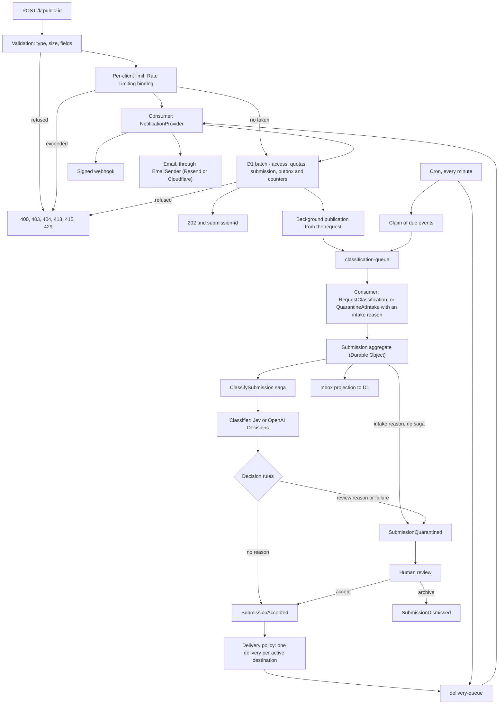

# Rondyr: technical architecture

> **Tagline:** *The gatekeeper for your forms.*
> **Status:** v0.1 in progress, document updated on 20 November 2026.
> **Production:** `https://rondyr.basaltbytes.com` (stage `prod`).

This document describes what is built and what remains to be done for v0.1. Each gap between the two refers to a GitHub issue. Section 12 gives the order of work.

## 1. Vision and scope

Rondyr is a form backend that you deploy in your own Cloudflare account. It receives the messages of a site, sets aside unwanted ones without deleting real requests, and keeps any doubtful message in quarantine for human review. The name comes from the *rondier*, the guard who screens who comes in.

An administrator deploys the application, creates an organization, then forms. Each form has a public URL that an HTML form or an application can use. An organization can describe its business (for example "pottery studio offering workshops"); the classifier uses it to judge whether a message is related to that business.

What distinguishes Rondyr from a SaaS form service: the filtering takes the organization's business into account, and the data stays in the operator's infrastructure.

### v0.1 status

| Capability | Status | Tracking |
| --- | --- | --- |
| Alchemy deployment, `staging` and `prod` stages, CI | Done | #12 for a fresh account |
| First account, sessions, closed sign-up | Done | |
| Organizations and forms | Done: adding, name, business context, suspension, success redirect and allowed origins per form | #11 for roles |
| JSON, `application/x-www-form-urlencoded` and `multipart/form-data` intake without files | Done, including JSON from a browser on another origin | |
| Intake limits | Done: size, schema, per-minute limits per client and per form, honeypot field, Turnstile and daily quotas per organization | |
| Durable storage and outbox | Done | |
| Classification and quarantine | Thresholds per classifier, policy per organization | #15 |
| Inbox and human review | Done | #9 |
| Deliveries: tables, queue, attempts and retries | Done | |
| Delivery history, manual retry, test send | Done, in the dashboard | #11 for roles |
| Signed webhook delivery | Done | |
| Email delivery | Resend by default, Cloudflare Email Sending on the stages that choose it | Recipient confirmation (#36) |
| Processing status and recovery procedures | Counters per organization, last successful Cron and runbook | #43 for the staging gate, #10 for stuck processing |

A form can have webhook destinations and email destinations, configured from the dashboard or the admin API. An email destination has 1 to 10 recipients; the message goes out as plain text through the stage's email provider (Resend or Cloudflare Email Sending). A form without a destination keeps its accepted messages in the Inbox only. Under the fields of an accepted message, the dashboard shows its deliveries and their attempts, and lets you retry a failed delivery; each destination can receive a test message.

A form can also have a list of allowed origins. A page served from another origin can then call it with `fetch`, and a browser on a site missing from the list gets `403`. An empty list allows every origin.

The dashboard adds a form to an organization, renames it, edits its business context, suspends and reactivates it; the public ID never changes. A suspended form refuses new messages and keeps the ones it has. A form can also have a success URL, to which Rondyr redirects an accepted HTML post; its origin must be in the list of allowed origins. Finally, a form can set a honeypot field, which visitors leave empty and bots fill in (section 8).

### Out of scope for v0.1

Form builder, CRM, attachments, visual automations, template engine, SaaS billing, marketing analytics and a model trained on customer data.

## 2. Stack and conventions

| Responsibility | Choice |
| --- | --- |
| Runtime, API, assets | A single Cloudflare Worker, `rondyr-<stage>` |
| Business logic, errors, concurrency | Effect 4 and Effect Schema |
| Domain model | Alchemy Domain (`@alchemy.run/domain`): aggregate, policy, saga and projection hosted in Durable Objects |
| Infrastructure as Code | Alchemy 2 (`alchemy-run.ts`) |
| Message and configuration storage | Cloudflare D1 |
| Schema and migrations | Drizzle Kit. Runtime queries are prepared SQL, and Effect Schema decodes every row read |
| Dashboard authentication | Better Auth, sessions in D1 |
| Asynchronous processing | Cloudflare Queues and a Cron every minute |
| Classifier | Jev (`typesafe/jev`, Workers AI binding) or OpenAI Decisions (`openai/decisions`, through AI Gateway), chosen per stage |
| Dashboard | React 19 and Vite, served as Worker assets |
| Quality | Oxlint with a local plugin, Oxfmt, `effect-tsgo`, Knip, Vitest in workerd |

The project's files and folders are in kebab-case, except names imposed by tools. Domain files have a suffix per type: `.aggregate.ts`, `.command.ts`, `.event.ts`, `.policy.ts`, `.saga.ts`, `.projection.ts`, `.query.ts`, `.external.ts`, `.api.ts`. SQL columns are in `snake_case`.

### Design principles

1. **Modular monolith.** One Worker, no microservices.
2. **Domain isolated from the platform.** `src/domain` imports neither `cloudflare:*`, nor Drizzle, nor the Alchemy IaC; an Oxlint rule checks this. It depends on Effect and on the Alchemy Domain modeling API.
3. **Ports and adapters.** The ports in `src/ports` declare the Effect services, the adapters provide the layers, and `src/worker-implementation.ts` composes them. Routes and jobs use ports only: an Oxlint rule forbids them from importing `src/adapters`, except in tests. The domain declares `InboxStore` and the external system `Classifier` itself, since it cannot import `src/ports`.
4. **Non-destructive AI.** A doubt, a technical error or an off-topic message leads to quarantine, never to deletion.
5. **At least once, with idempotency.** Queues can deliver the same message twice; each consumer tolerates it.
6. **Bounded cost.** The per-client and per-form limits and the daily submission quota apply before storage. The honeypot field, Turnstile, repetition and the daily classification quota apply before analysis.

## 3. Submission flow



`202 Accepted` means that D1 has stored the submission and its outbox event in the same transaction. The response says nothing about classification or about a delivery. A request refused before this write is not covered by the guarantee, including a `429`.

A submission whose honeypot field is filled follows the same path up to the `202`, and the response is identical: the bot learns nothing. The D1 batch stores the intake reason `honeypot` with it, then the consumer sends `QuarantineAtIntake` instead of `RequestClassification`, and the aggregate quarantines it without starting the saga.

An `application/x-www-form-urlencoded` or `multipart/form-data` post whose `Accept` header contains `text/html` gets an HTML confirmation page with the status `202`, with fixed text, in French or in English depending on the visitor's `Accept-Language` header. If the form has a success URL, it gets `303` to that URL instead.

## 4. Reliability: transactional outbox

D1 and Queues do not share a transaction, and Queues delivers messages at least once. Rondyr therefore writes the intent to publish in D1, then replays it until the domain model has taken it over.

### Intake

When the request contains a usable Turnstile token, the `SubmissionIntake` adapter reads the form's encrypted key from D1 and calls Siteverify if Turnstile is active. A single `db.batch` then reads the access conditions, decides on admission and on the intake reason, writes the submission and its event in `outbox_events`, then increments the daily counters. D1 runs the batch in a transaction. A test forces the outbox insert to fail with a trigger and checks that the submission does not exist and that the route answers `503`.

### Publication

`outbox_events` has one row per submission, with three state columns: `lease_until`, `published_at` and `handed_off_at`. An event is due when it has not been handed off, its lease has expired, and it has never been published or was published more than 5 minutes ago. Two paths publish it with the same claim: they set a 60-second lease on the due event, send it to `classification-queue`, then set `published_at` and release the lease. While one path has the lease, the other cannot claim the event.

- After the D1 batch, the intake route publishes its submission's event in the background, with `waitUntil` behind the `BackgroundTasks` port. The `202` response does not wait for this publication, and a failure shows up only in the logs.
- Every minute, the Cron claims up to 100 due events. This is the recovery path: after a send failure, the lease stays in place and the Cron picks the event up when the lease expires, at most two minutes later.

### Handoff to the domain model

The consumer reads batches of 10 messages. For each one, it reads the event that has not been handed off and the submission's intake reason, sends the aggregate `RequestClassification`, or `QuarantineAtIntake` if an intake reason is stored, with the `commandId` `submission-received:<id>`, then sets `handed_off_at` and acknowledges the message. A failure retries the message; after 3 retries, Queues moves it to the DLQ. A reason that the Worker does not know makes the read fail: the message is retried, then moved to the DLQ, without classification.

The intake reason is a column of `submissions`, written by the same statement as the submission. A message redelivered by Queues or republished by the Cron therefore reads the same value again and sends the same command, with the same `commandId`. Two mechanisms absorb duplicates: Alchemy Domain ignores a command whose `commandId` is already known, and the aggregate emits `ClassificationRequested` or the intake quarantine only from the `Unrecorded` state.

### Durable classification

The `Classification` policy starts the `ClassifySubmission` saga on each `ClassificationRequested`. The saga reads the organization's classification policy, then calls the classifier with a timeout of 12 seconds per call. It tries each of these two steps up to 3 times, waiting 10 then 30 seconds. A D1 outage while reading the policy is retried; an unknown value of `RONDYR_CLASSIFIER` or an unreadable stored policy is not. A non-retryable error or running out of attempts produces `SubmissionQuarantined` with the reason `classification-error`. The steps are durable activities: a restart of the Durable Object resumes the saga where it stopped.

### Delivery

The `Delivery` policy of the `Submissions` model reacts to each `SubmissionAccepted`, whether the acceptance is automatic or manual. It calls the external system `DeliveryScheduler`, whose adapter does two things in order:

1. It creates in `deliveries` one row per active destination of the form that belongs to the same organization as the submission and was created no later than the acceptance. The unique constraint on `(submission_id, target_id)` makes the creation idempotent; each delivery gets a UUID v4, its stable ID.
2. It publishes these deliveries to `delivery-queue` with the same claim as the submission outbox (60-second lease, then `published_at`). A publication failure is logged; the Cron picks the delivery up.

Without an active destination, the policy creates nothing and publishes nothing. An Alchemy Domain policy handles new events only: a deployment does not replay past acceptances, and a destination added later does not receive the messages accepted before it was created, even if the policy runs a second time. A projection would have been replayed by the backfill, which would have sent old messages. If D1 fails, the policy run fails and the platform retries it (30 seconds, then a doubled delay, then every hour).

Every minute, the Cron publishes up to 100 due deliveries: pending, retrying with an elapsed delay, or processing with an expired lease. A published delivery that no attempt has picked up after 5 minutes is republished.

The consumer reads batches of 10 messages and handles each delivery separately. For a delivery, it runs a D1 batch that starts the attempt: it sets the delivery to `processing`, increments `attempt_count`, sets a 2-minute lease and inserts the attempt in `delivery_attempts`. A delivery that is finished, waiting for a retry or already processing is not started, and the message is acknowledged. The consumer then calls the `NotificationProvider` port with the destination, the message fields and the delivery ID, with a timeout of 30 seconds, then records the result:

| Result | Effect |
| --- | --- |
| Success | `delivered` |
| Permanent failure | `failed`, with the error summary |
| Retryable failure | `retrying`, next attempt after 1 min, 5 min, 30 min, 2 h, then 6 h; `failed` after the sixth |
| No response within 30 seconds | Retryable failure |
| No provider for the destination type | Permanent failure: `No notification provider for target type "…".` |

If the Worker stops between the send and recording the result, the attempt stays open. When its lease expires, the Cron republishes the delivery; the next attempt marks the previous one `interrupted` and sends the message again with the same ID. An interrupted attempt counts toward the six; if it was the last one, the delivery moves to `failed`. The consumer retries a queue message only if D1 fails; after 3 retries, Queues moves it to the delivery DLQ.

The recipient can therefore receive the same delivery twice. Rondyr promises reliable retries and a deduplication ID, not exactly-once delivery end to end. The error summary, capped at 300 characters, comes from the provider, which must not put the message fields in it; the consumer logs contain only the IDs, the destination type and the result.

The Worker composition declares two providers, for the `webhook` and `email` types; section 8 describes their rules. A type without a provider always fails without a retry.

#### Manual retry

A `failed` delivery can be retried from the dashboard. The retry keeps the delivery ID and opens a new series of six attempts. A single D1 statement moves it from `failed` to `pending`, resets `attempt_count` to zero, clears `last_error` and makes it due at once; it does not change `delivery_attempts`. Any other delivery answers `409`, and two simultaneous retries count as one, since the second no longer finds the `failed` status. The route then publishes the delivery with the usual claim, and the Cron picks it up if this publication fails. The retry therefore goes through the same queue and the same start as an automatic attempt: if it coincides with the Cron or a duplicate message, a single attempt starts.

`attempt_count` counts the attempts of the current series; it decides the retry delay and the move to `failed`. The rows of `delivery_attempts` are numbered across the whole history: the first attempt after a retry has the number that follows the last one, and the number of attempts shown is the number of these rows. With Resend, the delivery ID stays the idempotency key, so a retry less than 24 hours after the first attempt, with other recipients, gets `409 invalid_idempotent_request`.

#### Test send

A test send goes through the `sendTest` method of the `NotificationProvider` port, with the provider for the destination's type and the same checks as a delivery: configuration, URL, secrets, email provider. Each test gets a new ID and creates no submission, delivery or attempt; the route waits at most 30 seconds for the answer, without a retry. The webhook receives version 1 of the payload with the type `test`, and the email has "Test message" ("Message d’essai" in French) in its subject and its text. One test at a time per destination: the route keeps the destinations under test in memory, which only applies within one Worker instance.

The `email` provider builds the message and calls the `EmailSender` port, which does not depend on any email provider: it receives the sender, the recipients, the optional `Reply-To`, the subject, the text and the idempotency key, and tells apart a success, a permanent rejection (`EmailRejected`) and a failure to retry (`EmailUnavailable`). `RONDYR_EMAIL_PROVIDER` chooses the stage's adapter in `src/adapters/email/email-sender.ts`. It is `resend` by default and also accepts `cloudflare`. Resend uses the delivery ID as the idempotency key for 24 hours, which covers the six automatic attempts. With Cloudflare, an attempt interrupted after acceptance can send a duplicate on retry. The delivery ID stays in the message.

### Known limitations

- The outbox does not count its attempts. An event that the consumer never manages to hand off is republished every 5 minutes without an alert (#10).
- The classification DLQ has no consumer (#10).
- The saga records only the final result; failed attempts leave no trace in the events.
- The delivery DLQ has no consumer either. It receives a message only after D1 failures, and the delivery state stays in D1, from where the Cron republishes it (#10).
- Test sends are limited only to one at a time per destination and per Worker instance. A member can send as many as they want, and each email counts against the quota of the stage's provider (#7).

## 5. Intelligent classification

The classifier assesses **spam**, **unsolicited sales outreach** and **relevance**. The spam question covers unsolicited marketing, phishing, mass solicitations and automated sends. The solicitation question asks whether the sender is trying to sell or pitch to the organization something of their own (product, service, content, guest post, lead list) instead of asking for what the organization offers. It counts indirect approaches: asking who handles a topic in order to send them a proposal, or asking for a meeting to present an offer. It excludes the prospect who describes their need, the shop that wants to buy, resell or take on consignment the organization's products, the quote request, the press, the job application, a peer's partnership and an exchange about an order or a service in progress. Both adapters send the same text, `solicitationInstruction` in `src/domain/submissions/classifier-input.ts`. Relevance measures the link between the message and the business that the organization describes. Without a business context, the classifier leaves this question out.

An off-topic message is not spam: "I found your keys outside your workshop" is genuine even though it says nothing about pottery.

### Decision rules

`reviewReason`, in `src/domain/submissions/classification.ts`, applies these rules in order. The current version is `rulesVersion = 7`. Version 2 truncates the business context without splitting a character. Version 3 adds the repetition rule and the new classifier input. Version 4 adds the comparison of the sender's domain. Version 5 asks for the solicitation score and quarantines a message whose score is above 0.50. Version 6 adds per-organization policies and raises the default low-relevance threshold. Version 7 adds the optional escalation of `ambiguous` decisions.

| Condition with the default settings | Result |
| --- | --- |
| Classifier failure or missing solicitation score | Quarantine, reason `classification-error` |
| Spam ≥ 0.70 | Quarantine, reason `probable-spam` |
| Spam ≥ 0.30 | Quarantine, reason `ambiguous` |
| Solicitation > 0.50 | Quarantine, reason `solicitation` |
| Context configured and relevance < 0.50 (Jev) or < 0.45 (OpenAI Decisions) | Quarantine, reason `low-relevance` |
| No reason | Automatic acceptance |

The organization can replace the four thresholds together and choose separately whether off-topic messages are handled in `review` or `accept` mode. Thresholds range from 0 to 1 inclusive, and the ambiguous threshold must be less than or equal to the probable-spam one. The `accept` mode accepts a message whose only quarantine reason would be low relevance, and labels it `off-topic`. The inbox shows the label, and deliveries follow the usual path.

The workflow reads the policy and the stage's classifier at the start of the analysis. It uses this policy during the classification attempts and passes it to the `RecordClassification` command. Automatic decisions record the resolved policy, the rules version and the scores when the model answers. If the policy is still unavailable after the attempts, or if it is unreadable, the submission waits in quarantine with the reason `classification-error`. Events recorded before version 6 stay readable.

The [evaluation report](docs/evaluation.md) counts the occurrences represented by `duplicates`. The 21 November measurement covers three runs of the synthetic corpus and of the maintainer's real corpus; with these thresholds, no legitimate message is quarantined. With Jev, the accepted spam lines go from 5 to 3 on the synthetic corpus and from 7 to 5 on the real corpus. With OpenAI Decisions, they go from 4 to 2 on the synthetic corpus and stay at 3 on the real corpus.

### Escalation to a second model

Escalation is off by default. The stage must declare a model different from the first one with `RONDYR_ESCALATION_CLASSIFIER`, and the organization must turn the setting on in **Classification**. The settings returned to the dashboard give this second model in `escalationClassifier`, or `null` if the stage declares none or declares the first one. In that case, the dashboard disables the switch and saving keeps the choice already stored. For the `ambiguous` reason only, `ClassifySubmission` makes a second logical call. Each model has 12 seconds per attempt and two retries after a retryable failure, at 10 then 30 seconds.

The second call counts against the organization's daily classification quota, like a submission admitted at intake. Before the call, the saga reserves a classification for the current UTC day with the activity `reserve-escalation-n` of the `Classifier.reserveEscalation` operation. A single D1 statement checks that the day's counter is under `daily_classification_limit` and increments it; a counter row of another day starts again from zero, as in the intake batch. Two escalations that target the last slot get only one between them. The reservation happens once per escalation, whatever the number of retries of the second call. Quota reached: the second model is not called, the reason stays `ambiguous` and the recorded evaluation has `skipped: "quota"`. A D1 outage during the reservation is retried at 10 then 30 seconds, like the policy read; if it persists, the second model is not called and the reason stays `ambiguous`, without `skipped`. If D1 records the increment but its response is lost, the retry counts a second slot: the error is on the side of the quota.

The second model settles only the spam doubt. It uses its default thresholds and the organization's choice for off-topic messages. If it finds a quarantine reason, or if the second call fails, the final reason stays `ambiguous`. If it finds nothing, `escalatedDecision` still applies to the first model's scores the rules that come after the spam rules, with the organization's policy: a solicitation score above the threshold gives the reason `solicitation`, and low relevance with the `review` choice gives `low-relevance`. Otherwise the submission is accepted, with the `off-topic` label if either model judges it off-topic. Escalation therefore accepts only a submission that the first model would have accepted without its spam score.

The decision event keeps the scores and the model of the first call, then, on escalation, the identity of the second classifier and its scores if it answered, or `skipped: "quota"` if the quota prevented the call. It records one rules version per evaluation. Older decisions and policies without this setting stay readable.

`pnpm evaluate --escalation` replays this rule on the cached scores of the 21 November measurement, three runs per corpus. On the synthetic corpus, escalation accepts no submission, in either direction. On the real corpus, with OpenAI Decisions first, it no longer accepts any spam: the spam line that the first version of the rule accepted on every run has a relevance of 0.20 according to OpenAI Decisions, under its threshold of 0.45, and goes to quarantine with the reason `low-relevance`. With Jev first, the accepted lines labeled ambiguous go from 1, 1 and 2 to 0, 1 and 1. The line accepted on all three runs goes to quarantine with the reason `solicitation` when Jev gives it 0.51 or 0.54, and stays accepted with 0.50, which does not exceed the threshold. The other line of the third run has neither solicitation nor low relevance according to Jev and stays accepted.

### Quarantine without a model call

Intake stores an intake reason in `submissions.intake_reason` when one of these conditions applies. `QuarantineAtIntake` passes the organization and the reason to the aggregate. From the `Unrecorded` state, the aggregate emits `SubmissionQuarantined` directly with the reason and the rules version, without scores. A reviewer can accept the message and trigger its deliveries, or archive it.

| Condition | Result |
| --- | --- |
| Form's honeypot field filled | Quarantine, reason `honeypot`, without a classifier call |
| Turnstile active and token missing or refused | Quarantine, reason `turnstile-failed`, without a classifier call |
| At least 2 earlier submissions with the same content or 3 from the same sender | Quarantine, reason `repetition`, without a classifier call |
| Daily classification quota reached | Quarantine, reason `quota`, without a classifier call |

The conditions apply in the order of the table. The repetition count covers the submissions already stored in the same organization, across all forms and statuses, within a 30-day window whose lower bound is included. A single double submission stays under both thresholds.

The `email` field is used to compare senders. The content groups the name–value pairs of the other fields, except `name`, sorted by name. Value normalization trims spaces at both ends, collapses runs of spaces, lowercases and applies Unicode NFC. An empty value produces no sender fingerprint and does not contribute to the content. The Worker computes the SHA-256 hash of the normalized value, and the indexes prefix it with the organization ID that the form provides. The hash itself does not contain this ID: D1 knows the organization only in the write batch, and its SQL does not offer SHA-256. Two organizations that receive the same value therefore have the same fingerprint. This choice is accepted: direct access to the database already gives `submissions.fields` in clear text, and the fingerprints reveal nothing more. Rows from before the migration stay readable with counters at zero and do not contribute to the repetition history.

`QuarantineReason` types the event, the projection and the API. A second delivery of the queue message reuses the reason written in `intake_reason` and the same command ID.

### Classifiers

`RONDYR_CLASSIFIER` chooses the classifier for a whole stage: `jev` by default, or `openai`. Both are adapters of the external system `Classifier` declared in the domain.

The Worker and the corpus build the same input in `src/domain/submissions/classifier-input.ts`, with the business context, the computed facts and the visitor's fields in that order. The facts include the two counters stored at intake and a flag for a link or an HTML tag in a field other than the longest one. On a tie, the first of the longest fields is the reference. No hash is sent to the model.

An organization can declare up to ten lowercase ASCII hostnames. When the domain of the `email` field matches a declared domain or one of its subdomains, both models receive the fact `sender_matches_organization_domain: true` and an empty `email` field; D1 keeps the submitted address. In every other case (an address on another domain, a missing or invalid address, an organization without a declared domain), the fact is left out and the model input is the version 3 input. A `false` sent with every message shifted the scores of legitimate messages that had nothing to do with the domain: on the synthetic corpus, Jev quarantined one legitimate message and OpenAI Decisions two. The comparison is on an address that the visitor declares, and it triggers no quarantine rule.

- **Jev** receives the input in a `state` object, with two or three named questions of type `noul` that return a score between 0 and 1. The call goes through the Workers AI binding.
- **OpenAI Decisions** receives the same data as JSON and questions of type `predicate`. The call goes through the AI Gateway `default` gateway with Cloudflare unified billing, without an OpenAI key in Rondyr.

The Alchemy stack creates no gateway. AI Gateway creates `default` on the account's first authenticated request, with log collection on; Jev calls made through the binding go through it too, and their logs contained the submission fields as long as the adapter did not opt out. Both adapters therefore turn off log collection and caching on every call, with the options in `src/adapters/ai/gateway.ts`, and one test per adapter checks these options. In local development, the `AI` binding is missing and every message goes to quarantine with the reason `classification-error`.

### AI pipeline security

Both adapters tell the model to read the input as data. The visitor's fields are in an object separate from the instructions. The body is limited to 16 KiB. The business context is limited to 2,000 UTF-16 code units without splitting a character. The daily quota per organization counts the submissions admitted to classification at intake, then each escalation to a second model, reserved by the saga before the call. Saga retries use the slot already reserved.

## 6. Data model

State is split between two stores. D1 contains the configuration, the message content and the Inbox view. The Alchemy Domain Durable Objects contain the event stream of each submission, which is the source of truth for its status.

### D1 tables

| Table | Content |
| --- | --- |
| `organizations` | `id`, `name`, `daily_submission_limit` (2,000 by default), `daily_classification_limit` (1,000 by default) |
| `organization_members` | `(organization_id, user_id)`, without a role |
| `organization_domains` | `(organization_id, domain)`, up to ten per organization |
| `organization_classification_policies` | Custom classification settings, at most one row per organization |
| `organization_daily_usage` | One row per organization with the last UTC day `day` and its counters: `submissions` (stored submissions other than junk), `classifications` and `junk` (stored junk, section 8) |
| `forms` | `id`, `organization_id`, unique `public_id`, `name`, `business_context`, `status` (`active` by default, or `suspended`), `success_url`, `honeypot_field`, `turnstile_site_key` (public) and `turnstile_secret` (encrypted). The last four fields are optional |
| `form_origins` | `(form_id, origin)`, `created_at`. `origin` is normalized: scheme, host and optional port, without a path or a trailing slash |
| `submissions` | `id` (UUID v4), `organization_id`, `form_id`, `fields` (JSON), `received_at`, `intake_reason` (optional), `sender_fingerprint` and `content_fingerprint` (optional), `prior_same_sender` and `prior_same_content` |
| `outbox_events` | `submission_id`, `lease_until`, `published_at`, `handed_off_at` |
| `submission_inbox` | `submission_id`, `version`, `status`, `reason`, `label` (optional) |
| `notification_targets` | `id`, `organization_id`, `form_id`, `type`, `configuration` (JSON read by the provider of the type), `active`, `created_at`. For a webhook, `configuration` contains `url`, `secret` (encrypted) and `previousSecret` (`null`, or the previous encrypted secret and the end of its validity). For an email, it contains `recipients`, the list of recipients |
| `deliveries` | `id` (stable UUID v4), `submission_id`, `target_id`, `status`, `attempt_count` (attempts of the current series), `last_error`, `next_attempt_at`, `lease_until`, `published_at`, `created_at`, `updated_at`; unique on `(submission_id, target_id)` |
| `delivery_attempts` | `(delivery_id, attempt)`, `started_at`, `finished_at`, `outcome`, `error`. `attempt` numbers the attempts across the whole history, manual retries included |
| `auth_*` | Better Auth accounts, sessions, verifications and rate limits |

The `form-administration` migration adds `status` and `success_url` with `ALTER TABLE`: existing forms become `active` through the default value. `status` has no `CHECK` constraint, because adding one would rebuild the table, and dropping `forms` on D1 would cascade to `form_origins`; the adapters write it only with the two values, and Effect Schema refuses any other value on read.

The `form-honeypot` migration adds `forms.honeypot_field` and `submissions.intake_reason` the same way, without a default value: an existing form has no honeypot field, and an existing submission has no intake reason. `intake_reason` has no `CHECK` constraint either; only the insert statement writes it, and the consumer reads it back with Effect Schema.

Two indexes serve frequent reads: `(organization_id, received_at, id)` for Inbox pagination and `(form_id, received_at)` for the per-form cap. The primary key `(form_id, origin)` of `form_origins` serves the origin check at intake. A partial index on `(next_attempt_at, lease_until)` serves the search for due deliveries.

The `submission-repetition` migration adds four columns with `ALTER TABLE` and two partial indexes for counting. Each index starts with `organization_id`, followed by the sender or content fingerprint, then `received_at`. Deleting a submission deletes its fingerprints and its counters.

The `turnstile-and-organization-quotas` migration adds the settings with `ALTER TABLE` and creates `organization_daily_usage`. The counters start at zero, including for existing organizations. The intake batch takes the time from D1 and uses the same UTC date to check the quotas and to count the submission. If the counter row belongs to another date, the API shows zero for the current day, and the first stored submission, or the first escalation reservation, initializes that day's counters.

The `junk-budget` migration adds `organization_daily_usage.junk` with `ALTER TABLE`, `NOT NULL` and a default of 0. On the day of the deployment, junk stored before the migration stays counted in `submissions`, so that day can refuse a little earlier than the next ones. Every statement that moves `day` to a new date must reset `junk` along with the other counters.

A delivery has one of the statuses `pending`, `processing`, `delivered`, `retrying` or `failed`. `next_attempt_at` says when an attempt can start: the creation, the end of the retry delay or the end of the current attempt's lease. An attempt has the outcome `delivered`, `retryable-failure`, `permanent-failure` or `interrupted`, or none while it runs. A manual retry opens a new series on the same delivery without erasing its attempts; the history and the retry needed no migration. The admin API creates webhook and email destinations; the existing `notification_targets` table is enough, without a migration. The adapter reads the recipient list back with the same schema as at creation: a row edited by hand that no longer follows the rule makes the delivery fail without a retry.

### `Submission` aggregate events

| Event | Data |
| --- | --- |
| `ClassificationRequested` | Organization |
| `SubmissionQuarantined` | Organization, reason, optional scores (absent for an intake reason or a classifier failure), rules version |
| `SubmissionAccepted` | Organization, then scores and rules version (automatic) or reviewer (manual) |
| `SubmissionDismissed` | Organization, reviewer |

The aggregate goes from `Unrecorded` to `Classifying`, then to `Quarantined` or `Accepted`. With an intake reason, it goes directly from `Unrecorded` to `Quarantined`. Only a `Quarantined` message can be accepted or archived by hand. The `Inbox` projection writes the latest status in `submission_inbox`, guarded by the event's sequence number. A submission without a projection row has the status `received`.

The visible statuses are `received`, `classifying`, `quarantined`, `accepted` and `archived`. The Inbox `reason` field contains the quarantine reason, including `turnstile-failed` or `quota` for these intake checks.

Message content exists only in `submissions.fields`, and leaves it only in the body of webhook requests and in the text of emails. Events contain only IDs, scores and the reviewer's ID, and deliveries only IDs, states and error summaries, which limits a purge to D1 rows (#9). Deleting a submission deletes its deliveries and their attempts.

### Planned tables

- Role in `organization_members` and invitations (#11).
- Retention periods (#9).

The `classification-attempts` and `audit-events` tables of the initial document are not planned: the aggregate's event stream records the decisions and who made them.

## 7. API and developer experience

### Public API

`POST /f/:public-id` accepts `application/json`, `application/x-www-form-urlencoded` and `multipart/form-data`. The body is at most 16 KiB and contains 1 to 32 text fields in addition to the optional `cf-turnstile-response` field. A field name has 1 to 100 characters, with no control character or line break (including U+0085, U+2028 and U+2029), and a message value at most 4,000. The names `__proto__`, `constructor` and `prototype` are still refused, and a name that starts with `_` has no special meaning.

A nested JSON object or a non-text value is refused. In a form body, a repeated name (checkboxes, multiple-choice list) is accepted: its values are joined with `, ` in the order received, and the joined value must fit in 4,000 characters. A `multipart/form-data` body contains only text fields: a part with a `filename` parameter, even an empty one like that of a file input left empty, gets the body refused with `400`, and nothing is stored. Effect's multipart parser (`MultipartParser`) reads the body already capped at 16 KiB. Messages received before the control-character rule stay readable: only intake applies it.

The fields are stored in a JSON object. Names that are JavaScript array indices (for example `"1"` and `"2"`) come first, in numeric order. Keeping the order of reception end to end would require changing the storage format and passing the order in the webhook payload.

| Status | Case |
| --- | --- |
| `202` | Submission stored; the JSON contains `submission-id` and `status: "received"`, or the confirmation page for an HTML post |
| `204` | CORS preflight request (`OPTIONS`) accepted |
| `303` | Submission stored, HTML post of a form that has a success URL; `Location` is that URL |
| `400` | Invalid body or fields, a file in a multipart body, or no message field after removing the token and the empty honeypot field |
| `403` | `Origin` header not in the form's list of allowed origins, or suspended form; nothing is stored |
| `404` | Unknown form, for `POST` as for `OPTIONS` |
| `413` | Body larger than 16 KiB |
| `415` | Another content type |
| `429` | The client or form reached its minute limit (`Retry-After: 60`), or the organization reached a daily quota: the submission quota for a submission that is not junk, the junk quota for junk (`Retry-After` in seconds until midnight UTC). Nothing is stored |
| `503` | D1 unavailable |

Responses reveal nothing about the anti-spam decision: a submission with a filled honeypot field gets the same `202`, the same page or the same redirect as any other. `GET /health` returns `{"status":"ok"}`.

There is one exception: once the organization's junk quota is reached for the day, junk gets `429` while other submissions still get `202`, so a bot can tell that it was caught. Without the refusal, junk would have to use the quota of real messages again (section 8).

#### Per-client limit and honeypot field

The route counts each valid submission from the client, identified by `CF-Connecting-IP`, on the form of the URL, before the D1 batch: 5 per 60-second window, with the Rate Limiting binding `CLIENT_RATE_LIMIT`. An IPv6 address counts as its `/64` network. The key is `<public-id>:<client>`; the counter is at Cloudflare and Rondyr keeps no address. A limited client gets `429` with `Retry-After: 60` and the CORS headers of an invalid request: without an `Origin` header, no CORS header and no D1 access; with `Origin`, the form's list, read in one round trip. The limit comes before the origin check: a limited client gets `429` even from a refused origin, and nothing is stored in either case. A request without `CF-Connecting-IP`, in local development or in tests, is not counted; if the binding fails, the submission goes through and the failure is logged. The cap of 30 per minute per form stays in the insert statement, for all clients together.

A form's honeypot field, if set, is applied in the insert statement. When empty, it is removed from the stored fields and reaches neither the classifier, nor a webhook, nor an email. When filled, it stays in the fields, so that the reviewer sees what was sent, and the submission gets the intake reason `honeypot` (section 5). A body whose only field is the empty honeypot field gets `400`. Without a honeypot field, a `_hp` field is an ordinary field.

#### Suspended form and success redirect

A suspended form answers `403` to every valid submission and stores nothing. Its CORS headers follow the list of origins, like those of a `429`: a page on an allowed origin can read the refusal. An origin missing from a non-empty list gets the origin refusal, which is checked first. An invalid request keeps its status (`400`, `413`, `415`), and the preflight request gets the same answer as for an active form. The messages already received, the destinations, the origins and the public URL do not change; reactivation restores intake.

An accepted submission sent as `application/x-www-form-urlencoded` or `multipart/form-data`, whose `Accept` header contains `text/html`, gets `303` to the form's success URL, with the same CORS headers and `Cache-Control: no-store` as the `202`. Without a success URL, it gets the confirmation page. A JSON client or a client that does not accept HTML always gets the `202` as JSON. The URL always comes from D1, never from the request: no field, parameter or header chooses it.

`parseSuccessUrl`, in `src/domain/forms/form.ts`, accepts an absolute HTTPS URL without credentials and normalizes it (`invalid-url`, `not-https`, `credentials`). The adapter stores it only if its origin is in the form's list (`origin-not-listed`), in the same `UPDATE` statement. Removing this origin from the list is refused with `409` while the success URL is set: silently removing the redirect would have changed the page that visitors see without the person editing the list noticing. The `DELETE` statement performs the check, so two simultaneous edits do not leave a success URL on a removed origin. At intake, the access query reads the success URL only if its origin is still in the list, and the `parseSuccessUrl` rule still applies: a row edited by hand that no longer follows it gives the confirmation page.

#### CORS and allowed origins

`OPTIONS /f/:public-id` answers preflight requests, and every response of the route has the CORS headers, errors included. The headers depend on the form's list of allowed origins:

| Case | Headers |
| --- | --- |
| Empty list, unknown form, D1 unavailable | `Access-Control-Allow-Origin: *` |
| `Origin` in the list | `Access-Control-Allow-Origin` equal to the received origin, and `Vary: Origin` |
| `Origin` not in the list, or request without `Origin` | `Vary: Origin` only |

The preflight allows `POST` and the `Content-Type` header, with `Access-Control-Max-Age: 7200`. No response has `Access-Control-Allow-Credentials`: a call with cookies fails in the browser. A `429` also exposes `Retry-After` through `Access-Control-Expose-Headers`.

A request without an `Origin` header (curl, a server) is handled as before, whatever the list. The same goes for `Origin: null`, which a browser sends when the page hides its origin (a `no-referrer` policy, a sandboxed iframe): refusing it would lose the messages of a site that is allowed. A request whose `Origin` is missing from a non-empty list gets `403` before anything is stored, whether it comes from `fetch` or from an HTML form posted from another site: a site missing from the list cannot fill the Inbox through its visitors' browsers. The comparison uses the exact value of the header, which browsers already send normalized. An invalid request (`400`, `413`, `415`) keeps its status; the list then decides only the headers.

The D1 batch checks the origin and the form's status, applies the caps and quotas, and reads the success URL. A submission without a usable Turnstile token takes one D1 round trip. With a usable token, reading the key first adds a D1 round trip, and Siteverify is called if Turnstile is active. A preflight request, or an invalid request that has an `Origin` header, reads the list in one round trip.

### Admin API

It serves the dashboard and is not published for third-party clients.

| Route | Purpose |
| --- | --- |
| `POST /api/setup` | Creates the first account, with the setup token |
| `GET /api/auth/get-session`, `POST /api/auth/sign-in/email`, `POST /api/auth/sign-out` | Better Auth session |
| `GET /api/organizations` | The account's organizations and their forms |
| `POST /api/organizations` | Creates an organization and its first form |
| `GET /api/organizations/:organizationId/domains` | Lists the declared domains in alphabetical order |
| `POST /api/organizations/:organizationId/domains` | Adds a domain (`{"domain":…}`). Answers `201` for a creation, `200` for a duplicate, `400` for an invalid name or `409` if the list is full |
| `DELETE /api/organizations/:organizationId/domains?domain=…` | Removes a domain and answers `204`, or `404` if the domain is not declared |
| `GET /api/organizations/:organizationId/classification-policy` | Returns the classifier, the second classifier that the stage offers for escalation or `null`, the default policy and the organization's settings, or `null` if it uses the default settings |
| `PUT /api/organizations/:organizationId/classification-policy` | Replaces the organization's settings. Accepts `thresholds`, `offTopic` and `escalation`, together or alone. Answers `204`, or `400` for an invalid setting |
| `DELETE /api/organizations/:organizationId/classification-policy` | Restores the classifier's settings and answers `204` |
| `GET /api/organizations/:organizationId/quotas` | Returns `{ "day", "limits", "used" }`. The day is in UTC. `limits` contains `submissions` and `classifications`; `used` contains them and `junk`, whose limit is `limits.submissions` |
| `PUT /api/organizations/:organizationId/quotas` | Replaces the quotas `{ "submissions", "classifications" }` and returns the updated usage and quotas. Accepts integers from 1 to 100,000 for submissions and from 0 to 100,000 for classifications. An invalid body answers `400` |
| `POST /api/organizations/:organizationId/forms` | Adds an active form (`{"name":…,"businessContext":…}`, optional context): `201` and the form |
| `PATCH /api/organizations/:organizationId/forms/:publicId` | Renames the form, edits its business context, or both (`{"name":…}`, `{"businessContext":…}`); an empty context clears it |
| `POST /api/organizations/:organizationId/forms/:publicId/suspend` or `/reactivate` | Suspends or reactivates the form |
| `PUT /api/organizations/:organizationId/forms/:publicId/success-url` | Sets the success URL (`{"url":…}`) |
| `DELETE /api/organizations/:organizationId/forms/:publicId/success-url` | Removes the success URL |
| `PUT /api/organizations/:organizationId/forms/:publicId/honeypot` | Sets the honeypot field name (`{"field":…}`) |
| `DELETE /api/organizations/:organizationId/forms/:publicId/honeypot` | Removes the honeypot field |
| `PUT /api/organizations/:organizationId/forms/:publicId/turnstile` | Turns Turnstile on or replaces both keys (`{ "siteKey", "secretKey" }`) if Siteverify recognizes the secret key. A refused key answers `400` with `{"error":"turnstile-secret-refused"}`, and an unreachable Siteverify `503` with `{"error":"siteverify-unavailable"}`; the stored keys do not change. Without an encryption key, answers `503` with `{"error":"secrets-key-missing"}` |
| `GET /api/organizations/:organizationId/forms/:publicId/turnstile` | Decrypts the stored secret key, asks Siteverify about it with `checkSecret`, and returns `{"state":…}`: `working`, `refused` (Siteverify no longer knows the key), `unreadable` (the key does not decrypt with the current `RONDYR_SECRETS_KEY`, or that variable is missing) or `unchecked` (Siteverify did not answer). Writes nothing. A form without Turnstile answers `404`, like another organization's form, and neither calls Siteverify |
| `DELETE /api/organizations/:organizationId/forms/:publicId/turnstile` | Turns Turnstile off and erases both keys |
| `GET /api/organizations/:organizationId/submissions` | Paginated list (`status`, `form`, `after`), 25 messages per page, each with a preview of its fields (`preview`): each value is cut at 240 characters, so that a page of long messages stays light. `form` is the public ID of a form and narrows the list to its messages |
| `GET /api/organizations/:organizationId/submission-counts` | Number of the organization's messages per status, and in `forms` the same count for each form that has at least one message (`[{"publicId", "counts"}]`) |
| `GET /api/organizations/:organizationId/submissions/:submissionId` | Message detail |
| `POST /api/organizations/:organizationId/submissions/:submissionId/approve` or `/dismiss` | Review decision |
| `GET /api/organizations/:organizationId/forms/:publicId/targets` | The form's webhook and email destinations, each with its `type`, without the secrets |
| `POST /api/organizations/:organizationId/forms/:publicId/targets` | Creates a webhook (`{"type":"webhook","url":…}`) and returns its secret, only once, or an email destination (`{"type":"email","recipients":[…],"language":"en"}`, language `en` or `fr`, `en` by default) |
| `POST /api/organizations/:organizationId/targets/:targetId/rotate-secret` | Returns a new webhook secret |
| `PUT /api/organizations/:organizationId/targets/:targetId/recipients` | Replaces the recipients of an email destination (`{"recipients":[…]}`), and its language if the body also contains `"language"` |
| `POST /api/organizations/:organizationId/targets/:targetId/activate` or `/deactivate` | Activates or deactivates the destination |
| `POST /api/organizations/:organizationId/targets/:targetId/test` | Sends a test message and returns `{"testId","outcome","summary"}`; `409` if a test of this destination is running |
| `GET /api/organizations/:organizationId/submissions/:submissionId/deliveries` | The message's deliveries, each with its destination (webhook URL or recipients), its status, its number of attempts, its next attempt if it is waiting for a retry, and its timestamped attempts |
| `POST /api/organizations/:organizationId/submissions/:submissionId/deliveries/:deliveryId/retry` | Retries a `failed` delivery and returns the list; `409` for another status |
| `GET /api/organizations/:organizationId/forms/:publicId/origins` | The form's allowed origins, `[{"origin", "createdAt"}]` |
| `POST /api/organizations/:organizationId/forms/:publicId/origins` | Adds an origin (`{"origin":…}`): `201`, or `200` if it is already in the list |
| `DELETE /api/organizations/:organizationId/forms/:publicId/origins?origin=…` | Removes an origin: `204`, `404` if it is not in the list, or `409` with `{"error":"origin-in-use"}` if it is the origin of the success URL |

`GET /api/organizations` returns the forms sorted by name with `name`, `publicId`, `status`, `businessContext`, `successUrl`, `honeypotField` and `turnstileSiteKey`. The form routes return the updated form with the same fields. Without Turnstile, `turnstileSiteKey` is `null`. The name has 1 to 100 characters and the context at most 2,000, after trimming leading and trailing spaces, as when creating an organization; an invalid body answers `400`. The honeypot field name follows the intake rule for field names, after trimming leading and trailing spaces: 1 to 100 characters, with no control character or line break, and not `__proto__`, `constructor` or `prototype` (`HoneypotField`, in `src/domain/forms/form.ts`). The name `cf-turnstile-response` is reserved for the token. A refused name answers `400`.

The submission routes go through `ReviewApi`, the domain model's API, called in the same process. The delivery routes go through the ports `DeliveryHistory` (read), `DeliveryStore` (retry) and `NotificationTargets` (destination to test); the error summary they return is the one in the database, without the message fields. The destination routes go through the `NotificationTargets` port, the origin routes through the `FormOrigins` port and the form routes through the `Forms` port; their D1 adapters join `organization_members` on every query. A resource of another organization answers `404`, like a resource that does not exist. A second decision on a message already handled answers `409`, as do two simultaneous rotations of the same secret.

A refused success URL answers `400` with `{"error":"success-url-refused","reason":…}`. A refused webhook URL answers `400` with `{"error":"destination-refused","reason":…}`. A refused origin answers `400` with `{"error":"origin-refused","reason":…}`; `parseAllowedOrigin`, in `src/domain/forms/allowed-origin.ts`, accepts HTTPS, and HTTP only for `localhost`, `127.0.0.0/8` and `[::1]`, then normalizes the origin. It refuses a path, query parameters, a fragment, credentials and wildcards (`invalid-origin`, `wildcard`, `not-https`, `credentials`, `not-an-origin`). Without `RONDYR_SECRETS_KEY`, creation and rotation answer `503` with `{"error":"secrets-key-missing"}`; listing and activation work. A refused recipient list answers `400` with `{"error":"recipients-refused","reason":…}` (`no-recipients`, `too-many-recipients`, `invalid-address`, `duplicate-address`). Without `RONDYR_EMAIL_FROM`, or without the key or binding of the chosen email provider, creating an email destination answers `503` with `{"error":"email-provider-missing"}`; listing, editing recipients and activation work. Responses that contain a secret have `Cache-Control: no-store`, like every admin API response. [docs/webhooks.md](docs/webhooks.md) documents the contract for recipients, and [docs/email.md](docs/email.md) the provider setup and the message format.

Still to add: members and roles (#11), search and export (#9).

## 8. Defenses and privacy

### Public intake

In place: size limit, field schema, refusal of the names `__proto__`, `constructor` and `prototype` and of names that contain a control character or a line break, refusal of files, a limit of 5 submissions per minute per client on a form, a cap of 30 submissions per minute per form, computed in D1 by the insert statement itself, and an optional honeypot field.

The per-form cap is shared by all visitors. Without another limit, a single client could fill it and get legitimate messages refused. The per-client limit therefore comes first: a single client reaches its own limit after 5 messages, well before the form's 30, which remain the last line of defense against sending spread across many addresses. Several clients behind the same address (corporate NAT, mobile network, privacy relay) share a limit; this is Cloudflare's warning for keys based on the IP address, accepted here for lack of another identifier for an anonymous visitor.

The Rate Limiting binding is approximate and local to each Cloudflare location: a client can go a little over its 5 messages, or further by going through several locations, and the window is fixed. It is not a guarantee; it is what keeps the form's cap available to other visitors. The counters stay at Cloudflare: D1 contains no IP address, and Rondyr's code does not log any.

The honeypot field costs one SQL statement and asks nothing of the visitor. It stops bots that fill in every field, not those that read the CSS or target Rondyr specifically. A filled field quarantines the message without deleting it: browser autofill or a poorly guided screen reader can fill in the field for a real person, and the reviewer then accepts their message.

Allowed origins serve browser integration and do not protect against abuse: a client outside a browser sends no `Origin` header, or chooses its value. They only prevent another site from having its visitors' browsers send messages. The limits apply whatever the origin.

#### Turnstile

Each form can use its own Cloudflare Turnstile widget. The dashboard shows the site key in the HTML snippet. The `SecretCipher` port encrypts the secret key in D1 with `RONDYR_SECRETS_KEY` and the owner `turnstile/<publicId>`. Admin responses contain only the site key.

Before storing the keys, the `Forms` adapter encrypts the secret key, checks that the form belongs to the account, then asks Siteverify whether it knows the key (`checkSecret` of the `TurnstileVerifier` port). The call sends the key and Cloudflare's dummy token, `XXXX.DUMMY.TOKEN.XXXX`, which production keys refuse and [test keys](https://developers.cloudflare.com/turnstile/troubleshooting/testing/) accept. A response that judges the token (`success`, or only `invalid-input-response` and `timeout-or-duplicate`) proves that Siteverify knows the key, and the keys are stored. Siteverify answers an unknown key with HTTP status 400 and `invalid-input-secret`: the key is refused, as for any other error code. A network error, a five-second timeout, another HTTP status or `internal-error` answer `503`. This check exists because intake treats a key unknown to Siteverify as an outage and lets the message through: a badly copied key would turn Turnstile off without any warning.

The Worker removes `cf-turnstile-response` before computing the fingerprints and storing, even if Turnstile is off. On an active, protected form, it sends the token of 1 to 2,048 characters and the secret key to Siteverify, with a five-second timeout and without passing the IP address. The Worker decides from the JSON body of an HTTP 200 or 400 response, since Cloudflare does not document the status of a refusal: a refused token, whatever the status, or the absence of a usable token leads to quarantine. Verification is unavailable on a network error, a timeout, another HTTP status, `internal-error` or `invalid-input-secret` (a key that Siteverify no longer recognizes); the Worker then logs the form and the source of the incident, and applies the other intake checks. If the keys change during verification, the earlier result cannot allow classification with the new configuration.

Intake keeps that behaviour for a key that Siteverify no longer knows and for a key that no longer decrypts: no visitor can cause either case, and quarantining every real message of the form until someone noticed would cost more than it protects. The owner learns about it in the dashboard instead. Each time the dashboard shows a form's Turnstile settings, it calls `GET …/forms/:publicId/turnstile`, and the `Forms` adapter decrypts the key and calls `checkSecret` at that moment. For `refused` and `unreadable`, the Turnstile card shows a warning that Turnstile is not protecting the form and that both keys must be saved again; for `unchecked`, it says that Cloudflare did not answer. Intake writes nothing about it, and no column stores the result.

#### Daily quotas

The storage quota covers all the forms of an organization. Junk is a submission that intake quarantines with the reason `honeypot`, `turnstile-failed` or `repetition` (`junkIntakeReasons` in `src/domain/organizations/organization-quotas.ts`). It has its own daily quota, equal to `daily_submission_limit` (2,000 by default), and does not count against the quota of the other submissions. A `quota` quarantine is not junk: those messages can be real, so they use the storage quota. An organization therefore stores at most twice its submission limit per UTC day.

Before this split, a bot wave at the form's cap of 30 per minute used up the day's storage quota in about an hour, and every real visitor then got `429` until midnight UTC. Now the wave fills the junk quota; after that, junk gets `429` with `Retry-After` until midnight UTC and nothing is stored, while other submissions are accepted until their own quota is reached. Refused junk is not stored, so it no longer takes slots in the form's cap of 30 per minute either.

The classification quota counts 1,000 slots per day by default. The intake batch computes the intake reason, then checks the quota of that reason, and the same batch increments `classifications` when no intake reason applies, `junk` for junk, and `submissions` for any other stored submission. D1 serializes admission, the write and the increments, including when several forms receive messages at the same time, and an accepted submission still takes one D1 round trip (two with a Turnstile token). The first statement of the batch reads the same state before the insert, so a refusal gets the `Retry-After` of the quota that applied. An escalation to a second model takes one more classification slot, reserved by the saga in a single D1 statement before the call (section 5); without a free slot, the message stays in quarantine with the reason `ambiguous`. When that statement finds a counter row of an earlier day, it starts every counter over, `junk` included.

### Authentication and isolation

- Public sign-up is closed. `/api/setup` requires `RONDYR_SETUP_TOKEN`, compared in constant time, and D1 refuses to create a second account through this path. The token is removed after setup.
- The authentication and admin routes refuse any request whose origin differs from `BETTER_AUTH_URL`. The session cookie is `Secure`, `HttpOnly` and `SameSite=Lax`.
- Better Auth rate-limits sign-in attempts, with a counter in D1.
- Every admin query is scoped to the account's organizations, and the aggregate checks this membership again before a review decision. Tests cover reads and writes from an account of another organization, for messages, destinations, allowed origins, forms, the delivery history, retries and test sends.

Today every member has all rights over their organization, including adding, editing and suspending its forms, and any signed-in account can create one (#11). For deliveries, `deliveryOperator`, in `src/http/delivery-routes.ts`, decides who reads the history, retries and sends a test: that is where #11 will check the role.

The success URL does not allow an open redirect: it comes from D1, its origin is an allowed origin of the form, and only a member of the organization can change it.

### HTTP headers

`public/_headers`, which Vite copies to `dist/client`, sets the headers of the dashboard assets. Alchemy and Wrangler read it at deployment and do not publish it as a file.

- A CSP with no inline script or style: `default-src 'none'`, then `'self'` for scripts, styles, images, fonts, the manifest and `fetch` requests, with `base-uri 'none'`, `form-action 'self'` and `frame-ancestors 'none'`. The production Vite build contains no inline script or style, and the Better Auth client calls `/api/auth/*` on the same origin.
- `X-Frame-Options: DENY`, `X-Content-Type-Options: nosniff`, `Referrer-Policy: no-referrer` and `Strict-Transport-Security: max-age=31536000; includeSubDomains`.

This file does not apply to the Worker's responses (`/health`, `/f`, `/api`). The Worker adds `X-Content-Type-Options: nosniff` to each of them, and a workerd test checks it. Sign-in and the review of a message were checked with this CSP in Chrome, on the production build served by `vite preview`.

The CORS headers of `/f` are described in section 7. `run_worker_first` covers `/f/*` for all methods, so a preflight request reaches the Worker and not the assets; this was checked with `wrangler dev` on the build, not by a workerd test, whose Worker has no assets. `vite preview` answers preflight requests itself and does not allow this check.

### Outputs and secrets

Webhook and email are the two outputs. `parseWebhookUrl`, in `src/domain/deliveries/webhook-destination.ts`, checks the URL at creation and before each attempt. It accepts HTTPS on the default port, without credentials, and refuses `localhost` and local names (`.localhost`, `.local`, `.internal`, `.home.arpa`, a name without a dot), IPv4 literals in reserved ranges (private, loopback, link-local, CGNAT, documentation, multicast), IPv6 literals outside `2000::/3` and the reserved blocks inside it, and the host of `BETTER_AUTH_URL`. A Worker does not resolve the name before `fetch`: a public name whose DNS record points to a private address passes the rule, and the documentation says so.

The provider sends a `POST` with `redirect: "manual"`. A `3xx` response is a permanent failure, like `4xx` responses other than `408`, `425` and `429`; those three, `5xx`, network errors and no response within 30 seconds are retried. The response body is never read, and the error summary contains only the status. The body sent is capped at 64 KiB.

Each request has `Rondyr-Delivery-Id`, `Rondyr-Timestamp` (Unix seconds) and `Rondyr-Signature`: `v1=` followed by the hexadecimal HMAC-SHA-256 of `<timestamp>.<body>`, computed with Web Crypto. The body is version 1 of the `WebhookPayload` schema: `version`, `type` (`submission.accepted`, or `test` for a test), `deliveryId`, `submission` (`id`, `receivedAt`, `fields`) and `form` (public `id`, `name`).

The signing secret is 32 random bytes, prefixed with `whsec_`. It appears only in the creation or rotation response. D1 stores it encrypted with AES-256-GCM under the key `RONDYR_SECRETS_KEY`, an optional Worker secret, with the destination ID as authenticated data: a secret copied to another row does not decrypt. After a rotation, the old secret also signs for 24 hours, and the header then contains two signatures, the new one first. A delivery whose secret does not decrypt fails without a retry. The platform's other secrets are Worker secrets, including `RESEND_API_KEY`.

#### Email

`EmailAddress`, in `src/domain/deliveries/email.ts`, accepts only a bare ASCII address: a dot-atom local part and a hostname of at least two DNS labels, with no space, quote, angle bracket, comma, semicolon, parenthesis or control character. A display name, two addresses in one entry and a line break are therefore refused. A destination has 1 to 10 distinct recipients, ignoring case; each recipient counts as one email in the Resend quota. `RONDYR_EMAIL_FROM` goes through the same rule at deployment and on every read by the Worker.

The headers contain no visitor input, except `Reply-To`: it is the field named exactly `email` when its value passes `EmailAddress`, and it is absent otherwise. The subject is `New message: <form name>` (or `Nouveau message : <form name>` in French), with no line break or control character, capped at 150 characters. The plain-text body starts with the fields whose name is a JavaScript array index, in numeric order, then lists the others in the order received. Line breaks in a name become spaces, and those in a value become `\n`. The form name, the date of reception in UTC and the delivery ID follow the fields. The text is in English or in French, depending on the destination's language, in the single module `src/domain/deliveries/email-message.ts`. No custom header is sent.

The Resend adapter sends `POST https://api.resend.com/emails` with `Idempotency-Key` equal to the delivery ID, `redirect: "manual"` and no trace propagation. `2xx` is a success. `429` (rate or quota), `5xx`, `409 concurrent_idempotent_requests`, a network error and no response within 30 seconds are retried; any other status, including `400`, `401`, `403` (unverified domain), `409 invalid_idempotent_request` and `422`, is a permanent failure. The error summary contains only the status and Resend's error code (`name`, checked against the pattern `[a-z_]{1,64}`), never its message, which can repeat a field of the request.

The Cloudflare adapter calls `CLOUDFLARE_EMAIL.send()` with the same plain-text email. It retries while the domain is being activated, after a rate or quota overrun, or on an internal or unknown error. Other documented codes and invalid arguments end the delivery. Only a known code goes into the summary, without error text or message content.

### Personal data

Message content is in D1, and the technical logs contain none of it: the consumer writes only the error type. Retention is unlimited until #9 adds retention periods, scheduled purge, export and deletion on request. Self-hosting does not exempt the operator from its GDPR obligations; the documentation must list the subprocessors, including the model provider and the stage's email provider, Resend or Cloudflare Email Sending. Resend keeps sent emails for the period of its plan; `docs/email.md` points this out.

## 9. Directory tree

```text
.
├── alchemy-run.ts                  # Alchemy stack: D1, queues, consumers
├── wrangler.json                   # local development, tests and dry run
├── drizzle-config.ts
├── database/migrations/            # Drizzle migrations and snapshots
├── src/
│   ├── worker.ts                   # Wrangler and workerd entry point
│   ├── alchemy-worker.ts           # Worker resource and bindings per stage
│   ├── worker-implementation.ts    # layer composition, fetch, queue, scheduled
│   ├── domain/submissions/         # aggregate, commands, events, policies, saga,
│   │                               # projection, queries, ReviewApi, shared schemas
│   ├── domain/deliveries/          # IDs, statuses, retry rules, webhook URL rule,
│   │                               # payload, email address rule, email text
│   │                               # and destination API contracts
│   ├── domain/forms/               # allowed origin rule, status, success URL rule
│   │                               # and form API contracts
│   ├── ports/                      # authentication, intake, outbox, classification-queue,
│   │                               # background-tasks, organization-directory,
│   │                               # stored-messages, storage, delivery-store,
│   │                               # delivery-queue, notification-provider,
│   │                               # notification-targets, secret-cipher, form-origins,
│   │                               # forms, email-sender, delivery-history,
│   │                               # client-rate-limit
│   ├── adapters/
│   │   ├── ai/                     # classifier, jev, openai-decisions
│   │   ├── authentication/         # better-auth, provider
│   │   ├── crypto/                 # secret-cipher (AES-GCM, RONDYR_SECRETS_KEY)
│   │   ├── email/                  # provider choice per stage, Resend and Cloudflare
│   │   ├── database/               # Drizzle schemas, d1, intake, outbox, inbox,
│   │   │                           # organization-directory, stored-messages, delivery-store,
│   │   │                           # notification-targets, form-origins, forms,
│   │   │                           # delivery-history
│   │   ├── notifications/          # providers per type, webhook, email, test adapter
│   │   ├── queues/                 # classification-queue, delivery-queue
│   │   └── workers/                # background-tasks (Alchemy's waitUntil), client-rate-limit
│   │                               # (Rate Limiting binding)
│   ├── http/                       # public, submission, authentication, review, target, origin,
│   │                               # form, delivery
│   └── jobs/
│       ├── submission-outbox.ts    # publication (intake and Cron), queue consumer
│       └── delivery-outbox.ts      # DeliveryScheduler, publication (policy and Cron),
│                                   # delivery consumer, retry, test send
├── dashboard/src/
│   ├── routes/
│   ├── features/                   # authentication, inbox, operations
│   ├── components/                 # text-field, and ui/: shadcn/ui (Base UI) components adapted to the theme
│   ├── hooks/                      # use-mobile
│   ├── lib/                        # HTTP clients
│   └── dashboard.css               # Tailwind theme
├── docs/                           # deployment, webhooks, email, evaluation, tested verification example
├── evals/                          # classifier evaluation harness, synthetic corpus
├── public/_headers                 # HTTP headers of the dashboard assets
├── scripts/                        # doctor, worker-budget, setup-owner
├── tooling/oxlint/                 # local lint rules and their tests
└── tests/integration/              # shared fixtures
```

Tests are next to the code they cover, in `src/**/*.test.ts` and `dashboard/src/**/*.test.ts`. The dashboard imports the domain schemas through the aliases `@rondyr/contracts` (submissions), `@rondyr/deliveries` (destinations) and `@rondyr/forms` (allowed origins and forms), which gives it the same contracts as the API. There is no `application/` layer: the use cases are the commands, the policy and the saga of the model.

## 10. Tests and quality criteria

`pnpm check` runs lint, formatting, type checking, tests, Knip, the migration check and `scripts/doctor.mjs` in sequence. Integration tests run in workerd against the built Worker, with D1, the queues and the Durable Objects emulated. A fake Workers AI, defined in `tests/integration/external-workers.ts` and used by Vitest and Playwright, answers according to the message's `fixture-verdict` field: `accept` gets acceptance scores, `solicitation` a solicitation score above the threshold, `ambiguous` an ambiguous spam score without solicitation, `ambiguous-solicitation` an ambiguous spam score and solicitation above the threshold, and `missing-solicitation` an answer without a solicitation score. For `ambiguous` and `ambiguous-solicitation`, OpenAI Decisions answers with low spam and solicitation scores and high relevance. Relevance is low if the business context contains `fixture-relevance: low`. Other messages get an invalid answer, which the classifier quarantines with the reason `classification-error`. The fake records the input it receives on each call. The tests read back the fields or the full input through a service binding, to check that the model never sees a message with a filled honeypot field and that it receives the repetition facts.

The test Worker gets the `CLIENT_RATE_LIMIT` binding from `wrangler.json`, which Miniflare simulates with fixed windows aligned on the clock. The test sends twice the limit plus one request: at least one window then exceeds the limit, even if a window ends during the test, and the first 5 requests always go through. It therefore does not depend on when it runs.

A recipient Worker, declared in the same place, records each request and answers according to the last path segment (`ok`, `fail-once`, `bad-request-once`, `bad-request`, `redirect`). The provider tests call it through a service binding; the test Worker reaches it through its `outboundService`, which receives all its outgoing `fetch` calls. The test URLs therefore have a public name, and no destination rule is relaxed for them. The recipient passes requests for `api.resend.com` to a fake Resend, declared in the same place, which records them and answers according to the local part of the first recipient (`once-<status>`, `always-<status>`, otherwise `200`), with the error body that Resend documents. The test Worker has a `RONDYR_SECRETS_KEY`, a `RESEND_API_KEY` and a `RONDYR_EMAIL_FROM`; the Worker that runs the tests does not.

### Current coverage

- `pnpm test:e2e` exercises the dashboard in Chromium, in a dedicated CI job. The suite covers the session cycle, creating an organization, managing forms and origins, HTML posts with confirmation or redirect, the CORS refusal of a JSON post and the review of a message with a filled honeypot field. It also covers creating destinations, tests and the retry of a failed webhook, and filtering a folder by form. A last test checks that the **Status** page counts a new message after a refresh. Playwright checks the CSP of `public/_headers` on the built dashboard and watches the browser console.
- Model stories: thresholds, order of the spam, solicitation and relevance rules, quarantine of a solicitation with its scores then acceptance by a reviewer, duplicate `RequestClassification`, three classifier failures, review allowed and refused; intake quarantine without a classifier call, duplicate `QuarantineAtIntake` with the same `commandId` or another one, `RequestClassification` ignored after it, intake quarantine ignored during a classification, acceptance and archiving of a message quarantined at intake.
- Escalation: stories for escalation turned off, for the second model that accepts, confirms the doubt or fails, for the first model's solicitation and relevance rules that still apply, for the classification quota reached and for a failed reservation. Through the built Worker, with two test Workers whose second classifier differs from the first or is identical to it: no escalation without a second classifier or with the same one, one more slot on the day's counter for an escalation, no second call at the quota, a single second call for two escalations that target the last slot; concurrent reservations and day change through the adapter. Second classifier returned by the settings route, switch disabled and choice kept in Playwright.
- Decoding of Jev and OpenAI Decisions answers, including invalid answers.
- Creation of the first account under concurrency, refusal of a foreign origin, session cycle.
- Intake atomicity, recovery through the outbox, double delivery of a queue message, isolation between organizations, concurrent review decisions.
- Publication at intake without republication by the Cron, send failure picked up by the Cron after the lease expires, Cron kept out during a direct publication.
- Turnstile: secret key encrypted and absent from responses; storage refused without `RONDYR_SECRETS_KEY`, for a key that Siteverify refuses (`400`) and when Siteverify does not answer or reports `internal-error` (`503`), without changing the stored keys; `404` for another account, without a Siteverify call; valid token, missing token, token refused with status 200 or 400, key that became unknown, service unavailable and timeout at intake, with a fake Siteverify defined in `tests/integration/external-workers.ts`. Daily quotas: exact boundary of both quotas under concurrency, duplicate queue message, reset at the UTC day change, bounds and isolation of the API. Junk quota: other submissions accepted once junk has used up its quota, junk quarantined and then refused once other submissions have used up theirs, exact boundary across concurrent posts on two forms, reset at the next UTC day, also when an escalation reservation opens the day, and no counter change on a duplicated queue message. Stored Turnstile key: `working`, `refused`, `unreadable` (a key encrypted with a previous `RONDYR_SECRETS_KEY`, and a Worker without that variable) and `unchecked`, then `404` for another organization's form and for a form without Turnstile, without a call to Siteverify. Playwright checks the warning for a key that Cloudflare no longer accepts and the junk count in Daily quotas.
- Intake responses `400`, `413`, `415` and `429`, including a body of exactly 16 KiB accepted, and `X-Content-Type-Options` on the Worker's responses.
- Per-client limit: a client over its limit gets `429` with `Retry-After`, `Access-Control-Expose-Headers` and the list's CORS headers, without storage, while another client and a request without an address go through; form cap reached by two clients under their limit; grouping of IPv6 addresses by `/64`.
- Honeypot field: name set, removed and refused through the admin API, `404` for another account; filled field with the same HTML page as a normal post, stored with the reason `honeypot` and a single event, without a call to the fake Workers AI; duplicate queue message without a second decision; acceptance by a reviewer, then creation of the delivery; empty field removed before storage, order of the other fields kept, message classified normally; body reduced to the empty honeypot field refused with `400`; form without a honeypot field unchanged.
- Webhook URL rule: each refused class, including numeric notations of IPv4 and reserved IPv6 addresses.
- Allowed origins: normalization and each refusal reason; preflight for an empty list, an origin in the list, a refused origin and an unknown form; JSON `fetch` accepted from an origin in the list, refused with `403` without storage from another one, accepted without `Origin`; HTML form posted from a refused origin; CORS headers on `400`, `404`, `413`, `415`, `429` and `503`; refusal of invalid origins by the admin API; refusal across organizations for listing, adding and removing.
- Forms: adding, renaming, business context, suspension, reactivation, setting and removing the success URL through the built Worker, with each validation refusal; public ID unchanged after each edit; `404` for a form or an organization of another account, without changing its settings; removal of the success URL's origin refused with `409`. Suspended form: `403` with the list's CORS headers, nothing stored, preflight unchanged, old messages readable in the Inbox, intake restored after reactivation. Classification of the next message with the edited context. `303` redirect for an urlencoded or multipart HTML post, to the stored URL despite a field, a parameter or a `Referer` that suggests another one; JSON `202` for a JSON client or one that does not accept HTML; confirmation page if the URL's origin is no longer in the list.
- Fields: values of a repeated name joined, in urlencoded and in multipart, joined value of 4,000 characters accepted and of 4,002 refused; text multipart body accepted, and file, empty file input, missing boundary and body over 16 KiB refused; control characters and line breaks in a name refused in JSON, urlencoded and multipart.
- Webhooks: signature verified by the example in `docs/examples/verify-webhook.ts`, refusal of an expired signature, another secret or a modified body; `500` then `200` with the same delivery ID; `400` and redirect without a retry, without following `Location`; private URL and secret encrypted with another key refused before sending; two signatures during rotation, a single one after 24 hours; creation through the API, sending through the deployed composition and verification of the received request; refusal across organizations for listing, creation, rotation and deactivation; creation and rotation refused without `RONDYR_SECRETS_KEY`. A test checks that `docs/webhooks.md` contains the tested example.
- Email: one request per delivery with the expected sender, recipients, subject, full text and idempotency key; `500` then `200` and `429` then `200` with the same key and the same body; `422`, `401` and `403` without a retry; `Reply-To` taken from a valid `email` field, absent for a multi-line value, a display name, two addresses or an invalid value; header injection attempt through a field name or value, with no effect on the headers or the subject; without a key or a sender, creation refused and delivery failed permanently without a request; a webhook and an email of the same form delivered independently, a failure of one not blocking the other. Through the built Worker: recipients refused with their reason, creation, listing of both types, replacement of recipients, deactivation and sending through the deployed composition; listing, creation, editing and deactivation refused with `404` for another organization; creation refused with `503` without a provider, listing and editing still possible.
- Deliveries: creation after an automatic acceptance and after a manual acceptance, through to the consumer; a single delivery per destination despite a policy run twice or a duplicate queue message; no delivery without an active destination, for a destination created after the acceptance or for a destination of another organization; new send with the same ID after a crash between the send and the record; a failed destination next to a delivered destination; six retryable failures up to `failed`, with the retry delays.
- History, retry and test, through the routes: history of a delivered delivery, a retrying delivery and a failed delivery, with destination, attempts and summaries, without any message field in the response; message without a delivery; retry of a failed delivery, then delivered with the same ID, both attempts and the same idempotency key; retry refused with `409` for a delivered or retrying delivery; two simultaneous retries that publish and start only one attempt, Cron and duplicate message included; new series after six attempts, numbered from 7; test of a webhook (signature verified, type `test`) and of an email destination, refused for a private URL, failed for a `400` or a `500`, without any row created; second simultaneous test of the same destination refused with `409`; read, retry and test refused with `404` for another organization.

### Missing coverage

- Concurrent submissions at the boundary of the per-form cap (#7).
- The per-client limit is checked only against Miniflare's simulation, which is exact and local. The behavior of the real binding (approximate count, per location, updated in the background) and the presence of `CF-Connecting-IP` in production are not tested.
- An event that the consumer never manages to hand off (#10).
- A public hostname that points to a private address: the rule does not see it, and no test simulates it.

### Filtering evaluation

The measurements recorded in #31 and #40 give the first results on real submissions. The criterion that comes first is to lose no real request.

`pnpm evaluate`, in `evals/`, reads a labeled JSON Lines corpus (`legitimate`, `spam`, `ambiguous`, `off-topic`) and the form's business context, in a `.context.txt` file next to it. It calls `scoreWithJev` and `scoreWithOpenAi` through the Workers AI REST API (`POST /ai/run`), with the options of `src/adapters/ai/gateway.ts` passed as `cf-aig-*` headers, then applies `reviewReason`. For each classifier, the report gives the legitimate messages quarantined, the spam accepted, the matrix of label against decision, weighted by `duplicates` or not, the precision and recall of the spam quarantine, the latency, the estimated cost, the failures and a threshold sweep computed on the recorded scores. It contains no field value. A cache per classifier, model, scoring version, line and input fingerprint avoids paying twice for the same call.

The synthetic corpus `evals/corpus/synthetic.jsonl`, under version control, covers the four labels in several languages. Real corpora stay in `evals/corpus/local/`, which Git ignores. For any measurement through Workers AI, the message content goes to the model provider, as in production. The `--dry` mode replaces Workers AI with fake scores. The harness tests run in Node, without network, in the `evals` Vitest project. See [docs/evaluation.md](docs/evaluation.md).

## 11. Deployment and operations

Alchemy creates and connects the Worker, D1, the two queues and their DLQs, the two consumers, the Cron, the Durable Objects and the Alchemy Domain backfill Workflow. The Rate Limiting binding `CLIENT_RATE_LIMIT` has no resource to create: the stack reads its declaration in `wrangler.json` (namespace `7001`, 5 requests per 60 seconds) and adds it to the Worker. The namespace is shared across the Cloudflare account; the stages do not share a counter, since each key starts with the public ID of a form. Queue names are generated per stage; the stack passes them to the Worker (`CLASSIFICATION_QUEUE_NAME`, `DELIVERY_QUEUE_NAME`), and the `queue` handler chooses the consumer from the queue name of the batch. A batch whose queue is not the delivery queue goes to the classification consumer; if its name is not the classification queue's either, the Worker logs it as an error. D1 migrations are versioned in `database/migrations` and applied at deployment.

Each stage has its own resources. `prod` uses a custom domain derived from `BETTER_AUTH_URL` and the other stages use `workers.dev`. A push to `main` runs `pnpm check`, `pnpm deploy:dry` and the dashboard browser tests (`pnpm test:e2e`), then deploys `prod` if both jobs pass. The staging gate is optional and off until it is configured: it is configured when the two variables `RONDYR_SMOKE_ORGANIZATION_ID_STAGING` and `RONDYR_SMOKE_FORM_ID_STAGING` and the two secrets `RONDYR_SMOKE_EMAIL_STAGING` and `RONDYR_SMOKE_PASSWORD_STAGING` are set in GitHub. CI then deploys `staging`, checks `/health` and the classification of a submission in the staging inbox, and deploys `prod` only if this check passes. Without these settings, CI deploys `prod` directly and reports it with a notice in the run. A partial configuration makes the run fail before any deployment. The **Deploy** workflow can also deploy `staging` or `prod` by hand, `prod` only from `main`. The setup is described in [docs/deployment.md](docs/deployment.md#staging-gate).

The authenticated route `GET /api/operations` feeds the **Status** section of the dashboard. For each organization of the account, it returns the number of outbox events not handed off and the age of the oldest one, the deliveries by status and the messages received in the last 24 hours, including those still in quarantine, by reason. A Durable Object per stage keeps the time of the last successful Cron run, after both publications. The diagnosis, recovery and secret rotation procedures are in [docs/operations.md](docs/operations.md).

`RONDYR_SECRETS_KEY` is optional, like `RONDYR_SETUP_TOKEN`: the stack passes it to the Worker only if the stage environment sets it. Without it, only creating and rotating webhooks and storing Turnstile keys are refused. `RONDYR_EMAIL_FROM` is optional. If it is set, it must be a bare address. `RONDYR_EMAIL_PROVIDER` is `resend` by default and the stack always passes it, like `RONDYR_CLASSIFIER`. The stack passes `RESEND_API_KEY` if the stage uses Resend and provides the key. It adds the `CLOUDFLARE_EMAIL` binding if the stage selects `cloudflare` and sets a sender. Without a sender, or without the key or binding of the selected provider, creating an email destination is refused and a delivery to an existing destination fails without a retry.

`wrangler.json` is used for local development, tests and the dry run; `alchemy-run.ts` and `src/alchemy-worker.ts` are used for deployment. The bindings, the consumer settings and the Durable Object classes are therefore declared twice. `scripts/doctor.mjs` checks part of this consistency, and `scripts/worker-budget.mjs` limits the Worker's JavaScript to 2 MiB.

### Pre-release dependencies

The project depends on Alchemy 2.0 beta, Drizzle 1.0 RC and Effect 4, pinned to exact versions. `@alchemy.run/domain` has a local patch, in `patches/`, that fixes the order between the Worker publication and the backfill. The event stream of each submission depends on this library: each version upgrade requires reading its migration notes and running the workerd tests again.

### To do

- Run a D1 restore and Worker rollback exercise on Cloudflare (#43).
- Alerts and recovery of stuck processing (#10).
- Installation guide verified on a fresh Cloudflare account, with the costs and limits, without promising zero cost (#12).

## 12. Order of work

In production on 20 November 2026: reliable intake, classification with Jev or OpenAI Decisions, quarantine and review, delivery by signed webhook and by email (Resend), delivery history and retry, JSON from a browser with allowed origins, form administration, per-client limit and honeypot field. `pnpm evaluate` measures the classifiers on a labeled corpus.

Each issue states what blocks it, in its "Order" section and through GitHub's "blocked by" relation. An issue with no open blocker can start.

**Migration queue.** One D1 migration at a time (label `migration`), in this order:

1. Repetition and classifier input (#31). The 20 November measurement shows that this is what the filtering lacks most.
2. Organization domains (#39).
3. Thresholds per classifier and policy per organization (#6).
4. Turnstile and quotas per organization (#7).
5. Email recipient confirmation (#36).
6. Roles and invitations (#11).
7. Search, export and purge (#9).
8. Stuck processing: outbox, dead-letter queues, reclassification (#10).

**After a step of the queue.** The "sales outreach" question after #31 (#40). Escalation to a second model after #6 (#15).

**Without a migration, at any time and in parallel.** Defects found in review (#41), dashboard browser tests (#42), operations status, runbook and the `staging` gate (#43), Cloudflare email adapter (#33).

**Needs a person.** Installation guide on a fresh Cloudflare account (#12).

## 13. Open decisions

| Decision | Tracking |
| --- | --- |
| Off-topic message: human review (current behavior) or acceptance with a label | #6 |
| Default retention periods, export and purge | #9 |

### Decisions made

- Rondyr is licensed under AGPL-3.0, like usine: anyone who offers a modified version as a service must publish its source, and a self-hoster has no obligation. The dependencies are under MIT or Apache-2.0, and the Oxlint plugin taken from usine is already under AGPL-3.0 (#21).
- A submission's status is an event stream in a Durable Object, projected into D1 for the Inbox.
- Runtime queries remain prepared SQL, in the adapters of `src/adapters/database`, and Effect Schema decodes the rows they return. Drizzle is used for the schema, the migrations and Better Auth (#23).
- Jev goes through the Workers AI binding; OpenAI Decisions goes through AI Gateway with unified billing. The choice is made per stage.
- Both classifiers go through the `default` gateway, which AI Gateway creates itself, and each call turns off log collection and caching there. The stack provisions no gateway (#22).
- The first account is created with a setup token and `scripts/setup-owner.sh`.
- An HTML post gets a confirmation page with the status `202`, or `303` to the form's success URL if one is set. Its origin must be an allowed origin of the form, and removing that origin is refused while the URL is set (#8).
- A suspended form answers `403` without storing anything and keeps its messages, its destinations and its public URL (#8).
- A repeated field name in a form body is accepted, with values joined by `, `. `multipart/form-data` is accepted without files; a part with a filename is refused with `400`. A field name with a control character or a line break is refused, whatever the content type (#8).
- Webhooks sign `<timestamp>.<body>` with HMAC-SHA-256 and send the delivery ID in `Rondyr-Delivery-Id`. After a rotation, the old secret also signs for 24 hours (#13).
- Destination secrets are encrypted in D1 with `RONDYR_SECRETS_KEY`, which is optional at deployment (#13).
- Each organization has two quotas per UTC day. Beyond the submission quota, intake answers `429` without storing anything. Beyond the classification quota, the message is stored and quarantined with the reason `quota`. This quota counts the submissions admitted to classification, reserved in the intake batch, and not each network attempt of the saga. An escalation to a second model reserves one more slot before the call; when the quota is reached, the reason stays `ambiguous` (#15). A submission that has a Turnstile token requires a D1 read of the encrypted key before the intake batch; any other accepted submission stays at one D1 round trip (#7).
- The `EmailSender` port offers two adapters selected per stage with `RONDYR_EMAIL_PROVIDER`. Resend stays the default choice and uses the delivery ID as the idempotency key (#14). Cloudflare Email Sending uses the `CLOUDFLARE_EMAIL` binding and a sender domain onboarded on Workers Paid. Cloudflare documents no deduplication key for this binding. A retry can therefore send a duplicate with the same delivery ID (#33).
- A form without an allowed origin accepts every origin (`Access-Control-Allow-Origin: *`). With a list, a browser on another origin gets `403` without a CORS header, and a request without `Origin` is still accepted. No response allows cookies (#19).
- Each client is limited to 5 submissions per minute on a form, with the Workers Rate Limiting binding and not a D1 counter, so that no IP address is kept. An IPv6 address counts as its `/64`. The cap of 30 per form remains the last line of defense (#7).
- A filled honeypot field gives the usual response and quarantines the message with the reason `honeypot`, without a model call; an empty honeypot field is removed before storage. The intake reason is stored with the submission, and the `QuarantineAtIntake` command passes it to the aggregate (#7).
- Junk (`honeypot`, `turnstile-failed`, `repetition`) has its own daily quota, equal to the submission limit, so a bot wave can no longer lock real visitors out until midnight UTC. Junk over that quota gets `429` and is not stored. `quota` quarantines stay in the submission quota (#7).
- A Turnstile key that Siteverify no longer knows, or that no longer decrypts, still lets messages go on to classification at intake. The dashboard checks the stored key each time it shows the form's Turnstile settings and warns the owner; intake records nothing about it (#7).

---

**Definition of success for v0.1:** a developer deploys Rondyr in their Cloudflare account, copies a form URL into their site, receives the real messages by email or webhook despite temporary outages, and can view or accept any suspicious message without running a server.
