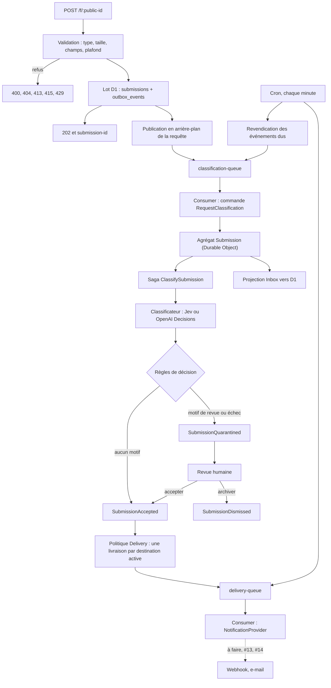

# Rondyr : architecture technique

> **Signature :** *The gatekeeper for your forms.*
> **Statut :** v0.1 en cours, document mis à jour le 20 novembre 2026.
> **Production :** `https://rondyr.basaltbytes.com` (stage `prod`).

Ce document décrit ce qui est construit et ce qui reste à faire pour la v0.1. Chaque écart entre les deux renvoie à une issue GitHub. La section 12 donne l’ordre des travaux.

## 1. Vision et périmètre

Rondyr est un backend de formulaires que l’on déploie dans son propre compte Cloudflare. Il reçoit les messages d’un site, écarte les indésirables sans supprimer les demandes réelles, et garde tout message douteux en quarantaine pour une revue humaine. Le nom vient du rondier, le gardien qui filtre les entrées.

Un administrateur déploie l’application, crée une organisation, puis des formulaires. Chaque formulaire a une URL publique utilisable depuis un formulaire HTML ou une application. Une organisation peut décrire son activité (par exemple « studio de poterie proposant des ateliers ») ; le classificateur s’en sert pour juger si un message est lié à cette activité.

Ce qui distingue Rondyr d’un SaaS de formulaires : le filtrage tient compte du métier de l’organisation, et les données restent dans l’infrastructure de l’opérateur.

### État de la v0.1

| Capacité | État | Suivi |
| --- | --- | --- |
| Déploiement Alchemy, stages `staging` et `prod`, CI | Fait | #12 pour un compte vierge |
| Premier compte, sessions, inscriptions fermées | Fait | |
| Organisations et formulaires | Création seulement | #8, #11 |
| Réception JSON et `application/x-www-form-urlencoded` | Fait, sauf JSON depuis un navigateur | #19 |
| Limites à l’entrée | Taille, schéma, 30 par minute et par formulaire | #7 |
| Enregistrement durable et outbox | Fait | |
| Classification et quarantaine | Fait, seuils fixes | #6, #15 |
| Inbox et revue humaine | Fait | #9 |
| Livraisons : tables, file, tentatives et reprises | Fait, sans fournisseur d’envoi | #16 |
| Livraison par e-mail et webhook | À faire | #13, #14 |
| Mesures et reprise après incident | À faire | #10 |

Aucune destination ne peut encore être configurée : #13 et #14 ajoutent les destinations webhook et e-mail avec leur fournisseur. D’ici là, un message accepté n’est consultable que dans l’Inbox.

### Hors périmètre de la v0.1

Form builder, CRM, pièces jointes, automatisations visuelles, moteur de templates, facturation SaaS, analytics marketing et modèle entraîné sur les données des clients.

## 2. Stack et conventions

| Responsabilité | Choix |
| --- | --- |
| Runtime, API, assets | Un seul Cloudflare Worker, `rondyr-<stage>` |
| Métier, erreurs, concurrence | Effect 4 et Effect Schema |
| Modèle de domaine | Alchemy Domain (`@alchemy.run/domain`) : agrégat, politique, saga et projection hébergés dans des Durable Objects |
| Infrastructure as Code | Alchemy 2 (`alchemy-run.ts`) |
| Persistance des messages et de la configuration | Cloudflare D1 |
| Schéma et migrations | Drizzle Kit. Les requêtes d’exécution sont du SQL préparé, et Effect Schema décode chaque ligne lue |
| Authentification du dashboard | Better Auth, sessions en D1 |
| Asynchronisme | Cloudflare Queues et un Cron chaque minute |
| Classificateur | Jev (`typesafe/jev`, binding Workers AI) ou OpenAI Decisions (`openai/decisions`, via AI Gateway), choisi par stage |
| Dashboard | React 19 et Vite, servi comme assets du Worker |
| Qualité | Oxlint avec un plugin local, Oxfmt, `effect-tsgo`, Knip, Vitest dans workerd |

Les fichiers et dossiers du projet sont en kebab-case, sauf les noms imposés par les outils. Les fichiers du domaine ont un suffixe par type : `.aggregate.ts`, `.command.ts`, `.event.ts`, `.policy.ts`, `.saga.ts`, `.projection.ts`, `.query.ts`, `.external.ts`, `.api.ts`. Les colonnes SQL sont en `snake_case`.

### Principes de conception

1. **Monolithe modulaire.** Un Worker, pas de microservices.
2. **Domaine isolé de la plateforme.** `src/domain` n’importe ni `cloudflare:*`, ni Drizzle, ni l’IaC Alchemy ; une règle Oxlint le vérifie. Il dépend d’Effect et de l’API de modélisation d’Alchemy Domain.
3. **Ports et adaptateurs.** Les ports de `src/ports` déclarent les services Effect, les adaptateurs fournissent les layers, et `src/worker-implementation.ts` les compose. Les routes et les jobs n’utilisent que des ports : une règle Oxlint leur interdit d’importer `src/adapters`, sauf dans les tests. Le domaine déclare lui-même `InboxStore` et le système externe `Classifier`, puisqu’il ne peut pas importer `src/ports`.
4. **IA non destructive.** Un doute, une erreur technique ou un message hors sujet mène à la quarantaine, jamais à une suppression.
5. **Au moins une fois, avec idempotence.** Queues peut remettre deux fois le même message ; chaque consumer le tolère.
6. **Coût borné.** Les protections s’appliquent avant l’appel au modèle. Les plafonds par organisation restent à faire (#7).

## 3. Parcours d'une soumission



`202 Accepted` signifie que D1 a enregistré la soumission et son événement outbox dans la même transaction. La réponse ne dit rien de la classification ni d’une livraison. Une requête refusée avant cet enregistrement n’entre pas dans la garantie, y compris un `429`.

Un envoi `application/x-www-form-urlencoded` dont l’en-tête `Accept` contient `text/html` reçoit une page de confirmation en HTML avec le statut `202`. La redirection de succès par formulaire est suivie dans #8.

## 4. Fiabilité : transactional outbox

D1 et Queues ne partagent pas de transaction, et Queues remet les messages au moins une fois. Rondyr écrit donc l’intention de publier dans D1, puis la rejoue jusqu’à ce que le modèle de domaine l’ait prise en charge.

### Ingestion

L’adaptateur D1 du port `SubmissionIntake` exécute un `db.batch` de deux instructions : l’insertion dans `submissions`, conditionnée à l’existence du formulaire et au plafond de 30 messages par minute, puis l’insertion dans `outbox_events`. D1 exécute le lot comme une transaction. Un test force l’échec de la seconde insertion avec un trigger et vérifie que la soumission n’existe pas et que la route répond `503`.

### Publication

`outbox_events` contient une ligne par soumission, avec trois colonnes d’état : `lease_until`, `published_at` et `handed_off_at`. Un événement est dû quand il n’est pas remis, que son bail a expiré et qu’il n’a jamais été publié, ou l’a été depuis plus de 5 minutes. Deux chemins le publient avec la même revendication : ils posent un bail de 60 secondes sur l’événement dû, l’envoient à `classification-queue`, puis renseignent `published_at` et libèrent le bail. Tant que l’un tient le bail, l’autre ne peut pas revendiquer l’événement.

- Après le lot D1, la route d’ingestion publie l’événement de sa soumission en arrière-plan, avec `waitUntil` derrière le port `BackgroundTasks`. La réponse `202` n’attend pas cette publication, et un échec n’apparaît que dans les journaux.
- Chaque minute, le Cron revendique jusqu’à 100 événements dus. C’est le chemin de reprise : après un échec d’envoi, le bail reste posé et le Cron reprend l’événement à son expiration, soit au plus deux minutes plus tard.

### Remise au modèle

Le consumer lit des lots de 10 messages. Pour chacun, il vérifie que l’événement n’est pas déjà remis, envoie `RequestClassification` à l’agrégat avec le `commandId` `submission-received:<id>`, puis renseigne `handed_off_at` et acquitte le message. Un échec relance le message ; après 3 reprises, Queues le place dans la DLQ.

Deux mécanismes absorbent les doublons : Alchemy Domain ignore une commande dont le `commandId` est déjà connu, et l’agrégat n’émet `ClassificationRequested` que depuis l’état `Unrecorded`.

### Classification durable

La politique `Classification` démarre la saga `ClassifySubmission` à chaque `ClassificationRequested`. La saga appelle le classificateur jusqu’à 3 fois, avec 10 puis 30 secondes d’attente et un délai maximal de 12 secondes par appel. Une erreur non réessayable ou l’épuisement des tentatives produit `SubmissionQuarantined` avec le motif `classification-error`. Les étapes sont des activités durables : un redémarrage du Durable Object reprend la saga là où elle s’est arrêtée.

### Livraison

La politique `Delivery` du modèle `Submissions` réagit à chaque `SubmissionAccepted`, que l’acceptation soit automatique ou manuelle. Elle appelle le système externe `DeliveryScheduler`, dont l’adaptateur fait deux choses dans l’ordre :

1. Il crée dans `deliveries` une ligne par destination active du formulaire, de la même organisation que la soumission, et créée au plus tard à l’acceptation. La contrainte d’unicité sur `(submission_id, target_id)` rend la création idempotente ; chaque livraison reçoit un UUID v4, son identifiant stable.
2. Il publie ces livraisons dans `delivery-queue` avec la même revendication que l’outbox de soumission (bail de 60 secondes, puis `published_at`). Un échec de publication est journalisé ; le Cron reprend la livraison.

Sans destination active, la politique ne crée rien et ne publie rien. Une politique Alchemy Domain ne traite que les nouveaux événements : un déploiement ne rejoue pas les acceptations passées, et une destination ajoutée plus tard ne reçoit pas les messages acceptés avant sa création, même si la politique s’exécute une seconde fois. Une projection aurait été rejouée par le backfill, ce qui aurait envoyé d’anciens messages. Si D1 échoue, l’exécution de la politique échoue et la plateforme la relance (30 secondes, puis un délai doublé, puis toutes les heures).

Chaque minute, le Cron publie jusqu’à 100 livraisons dues : en attente, en reprise dont le délai est écoulé, ou en cours dont le bail a expiré. Une livraison publiée qu’aucune tentative n’a prise après 5 minutes est republiée.

Le consumer lit des lots de 10 messages et traite chaque livraison séparément. Pour une livraison, il exécute un lot D1 qui démarre la tentative : il passe la livraison à `processing`, incrémente `attempt_count`, pose un bail de 2 minutes et insère la tentative dans `delivery_attempts`. Une livraison terminée, en attente de reprise ou déjà en cours n’est pas démarrée, et le message est acquitté. Le consumer appelle ensuite le port `NotificationProvider` avec la destination, les champs du message et l’identifiant de livraison, avec un délai maximal de 30 secondes, puis enregistre le résultat :

| Résultat | Effet |
| --- | --- |
| Succès | `delivered` |
| Échec permanent | `failed`, avec le résumé d’erreur |
| Échec réessayable | `retrying`, nouvelle tentative après 1 min, 5 min, 30 min, 2 h puis 6 h ; `failed` après la sixième |
| Pas de réponse en 30 secondes | Échec réessayable |
| Aucun fournisseur pour le type de destination | Échec permanent : `No notification provider for target type "…".` |

Si le Worker s’arrête entre l’envoi et l’enregistrement du résultat, la tentative reste ouverte. À l’expiration de son bail, le Cron republie la livraison ; la tentative suivante marque la précédente `interrupted` et renvoie le message avec le même identifiant. Une tentative interrompue compte dans les six ; si c’était la dernière, la livraison passe à `failed`. Le consumer ne relance un message de file que si D1 échoue ; après 3 reprises, Queues le place dans la DLQ de livraison.

Le destinataire peut donc recevoir deux fois la même livraison. Rondyr promet une reprise fiable et un identifiant de déduplication, pas un envoi unique de bout en bout. Le résumé d’erreur, borné à 300 caractères, vient du fournisseur, qui ne doit pas y mettre les champs du message ; les journaux du consumer ne contiennent que les identifiants, le type de destination et le résultat.

Aucun fournisseur n’existe encore : la composition du Worker n’en déclare aucun, et les tests utilisent un adaptateur de test. #13 ajoute le webhook et #14 l’e-mail.

### Limites connues

- L’outbox ne compte pas ses tentatives. Un événement que le consumer ne parvient jamais à remettre est republié toutes les 5 minutes sans alerte (#10).
- La DLQ de classification n’a pas de consumer (#10).
- La saga n’enregistre que le résultat final ; les tentatives échouées ne laissent pas de trace dans les événements.
- La DLQ de livraison n’a pas de consumer non plus. Elle ne reçoit un message qu’après des échecs de D1, et l’état de la livraison reste dans D1, d’où le Cron la republie (#10).
- Une livraison `failed` ne se relance pas encore à la main (#16).

## 5. Classification intelligente

Le classificateur évalue deux dimensions indépendantes. Le **spam** couvre le marketing non sollicité, le hameçonnage, les sollicitations de masse et les envois automatisés. La **pertinence** mesure le lien entre le message et l’activité décrite par l’organisation ; sans contexte métier, la question n’est pas posée.

Un message hors sujet n’est pas un spam : « J’ai trouvé vos clés devant votre atelier » est authentique même s’il ne parle pas de poterie.

### Règles de décision

`reviewReason`, dans `src/domain/submissions/classification.ts`, applique ces règles dans l’ordre. La version courante est `rulesVersion = 1`.

| Condition | Résultat |
| --- | --- |
| Spam ≥ 0,70 | Quarantaine, motif `probable-spam` |
| Spam ≥ 0,30 | Quarantaine, motif `ambiguous` |
| Contexte configuré et pertinence < 0,35 | Quarantaine, motif `low-relevance` |
| Aucun motif | Acceptation automatique |
| Classificateur en échec | Quarantaine, motif `classification-error` |

Ces seuils viennent d’une première estimation, pas d’une mesure. Les deux classificateurs les partagent alors que rien ne montre que leurs scores sont comparables. #6 ajoute un corpus de test, des seuils par classificateur et une politique par organisation ; #15 ajoute l’escalade facultative des cas `ambiguous` vers un second modèle.

Chaque événement de décision enregistre les scores, l’identifiant du modèle et la version des règles.

### Classificateurs

`RONDYR_CLASSIFIER` choisit le classificateur pour tout un stage : `jev` par défaut, ou `openai`. Les deux sont des adaptateurs du système externe `Classifier` déclaré dans le domaine.

- **Jev** reçoit les champs et le contexte dans un objet `state`, avec une ou deux questions de type `noul` qui renvoient un score entre 0 et 1. L’appel passe par le binding Workers AI.
- **OpenAI Decisions** reçoit les mêmes données en JSON et des questions de type `predicate`. L’appel passe par le gateway `default` d’AI Gateway avec la facturation unifiée de Cloudflare, sans clé OpenAI dans Rondyr.

La pile Alchemy ne crée aucun gateway. AI Gateway crée `default` à la première requête authentifiée du compte, avec la collecte de logs activée ; l’adaptateur OpenAI désactive donc la collecte et le cache à chaque appel, et un test vérifie ces options. Jev appelle Workers AI sans gateway. L’identifiant `default` est une constante de `src/adapters/ai/openai-decisions.ts`. En développement local, le binding `AI` est absent et chaque message part en quarantaine avec le motif `classification-error`.

### Sécurité du pipeline IA

Le texte d’un visiteur est transmis comme donnée à évaluer, dans un champ distinct des instructions, et il n’a aucun moyen de modifier les seuils. La taille du corps (16 Kio) borne l’entrée du modèle et le contexte métier est tronqué à 2 000 caractères. L’adaptateur OpenAI désactive la collecte de logs et le cache du gateway à chaque appel. Les plafonds d’appels par organisation restent à faire (#7).

## 6. Modèle de données

L’état est réparti entre deux stockages. D1 contient la configuration, le contenu des messages et la vue de l’Inbox. Les Durable Objects d’Alchemy Domain contiennent le flux d’événements de chaque soumission, qui fait foi pour son statut.

### Tables D1

| Table | Contenu |
| --- | --- |
| `organizations` | `id`, `name` |
| `organization_members` | `(organization_id, user_id)`, sans rôle |
| `forms` | `id`, `organization_id`, `public_id` unique, `name`, `business_context` |
| `submissions` | `id` (UUID v4), `organization_id`, `form_id`, `fields` (JSON), `received_at` |
| `outbox_events` | `submission_id`, `lease_until`, `published_at`, `handed_off_at` |
| `submission_inbox` | `submission_id`, `version`, `status`, `reason` ; écrite par la projection |
| `notification_targets` | `id`, `organization_id`, `form_id`, `type`, `configuration` (JSON lu par le fournisseur du type), `active`, `created_at` |
| `deliveries` | `id` (UUID v4 stable), `submission_id`, `target_id`, `status`, `attempt_count`, `last_error`, `next_attempt_at`, `lease_until`, `published_at`, `created_at`, `updated_at` ; unique sur `(submission_id, target_id)` |
| `delivery_attempts` | `(delivery_id, attempt)`, `started_at`, `finished_at`, `outcome`, `error` |
| `auth_*` | Comptes, sessions, vérifications et limites de débit de Better Auth |

Deux index servent les lectures fréquentes : `(organization_id, received_at, id)` pour la pagination de l’Inbox et `(form_id, received_at)` pour le plafond par formulaire. Un index partiel sur `(next_attempt_at, lease_until)` sert la recherche des livraisons dues.

Une livraison a l’un des statuts `pending`, `processing`, `delivered`, `retrying` ou `failed`. `next_attempt_at` indique quand une tentative peut démarrer : la création, la fin du délai de reprise ou la fin du bail de la tentative en cours. Une tentative a le résultat `delivered`, `retryable-failure`, `permanent-failure` ou `interrupted`, ou aucun tant qu’elle s’exécute. Aucune API ne crée encore de destination (#13, #14).

### Événements de l’agrégat `Submission`

| Événement | Données |
| --- | --- |
| `ClassificationRequested` | Organisation |
| `SubmissionQuarantined` | Organisation, motif, scores éventuels, version des règles |
| `SubmissionAccepted` | Organisation, puis scores et version des règles (automatique) ou relecteur (manuelle) |
| `SubmissionDismissed` | Organisation, relecteur |

L’agrégat passe de `Unrecorded` à `Classifying`, puis à `Quarantined` ou `Accepted`. Seul un message `Quarantined` peut être accepté ou archivé à la main. La projection `Inbox` écrit le dernier statut dans `submission_inbox`, protégée par le numéro de séquence de l’événement. Une soumission sans ligne de projection a le statut `received`.

Les statuts visibles sont `received`, `classifying`, `quarantined`, `accepted` et `archived`. `classification-error` est un motif de quarantaine, pas un statut.

Le contenu des messages n’existe que dans `submissions.fields`. Les événements ne contiennent que des identifiants, des scores et l’identifiant du relecteur, et les livraisons que des identifiants, des états et des résumés d’erreur, ce qui limite une purge aux lignes D1 (#9). Supprimer une soumission supprime ses livraisons et leurs tentatives.

### Tables à venir

- `form_origins` (#19).
- Rôle dans `organization_members` et invitations (#11).
- Statut des formulaires (#8), quotas (#7) et durées de conservation (#9).

Les tables `classification-attempts` et `audit-events` du document initial ne sont pas prévues : le flux d’événements de l’agrégat enregistre les décisions et leurs auteurs.

## 7. API et expérience développeur

### API publique

`POST /f/:public-id` accepte `application/json` et `application/x-www-form-urlencoded`. Le corps pèse au plus 16 Kio et contient de 1 à 32 champs texte ; un nom de champ a de 1 à 100 caractères et une valeur au plus 4 000. Un objet JSON imbriqué, une valeur non textuelle ou un nom de champ répété sont refusés.

| Statut | Cas |
| --- | --- |
| `202` | Soumission enregistrée ; le JSON contient `submission-id` et `status: "received"` |
| `400` | Corps ou champs invalides |
| `404` | Formulaire inconnu |
| `413` | Corps de plus de 16 Kio |
| `415` | Autre type de contenu |
| `429` | Plus de 30 soumissions en une minute sur ce formulaire, avec `Retry-After: 60` |
| `503` | D1 indisponible |

Les réponses ne révèlent rien de la décision anti-spam. La route ne répond pas aux prérequêtes CORS : un `fetch` JSON depuis un navigateur sur une autre origine échoue (#19). `GET /health` renvoie `{"status":"ok"}`.

### API d’administration

Elle sert le dashboard et n’est pas publiée pour des clients tiers.

| Route | Rôle |
| --- | --- |
| `POST /api/setup` | Crée le premier compte, avec le jeton d’installation |
| `GET /api/auth/get-session`, `POST /api/auth/sign-in/email`, `POST /api/auth/sign-out` | Session Better Auth |
| `GET /api/organizations` | Organisations du compte et leurs formulaires |
| `POST /api/organizations` | Crée une organisation et son premier formulaire |
| `GET /api/organizations/:organizationId/submissions` | Liste paginée (`status`, `after`), 25 messages par page |
| `GET /api/organizations/:organizationId/submissions/:submissionId` | Détail d’un message |
| `POST /api/organizations/:organizationId/submissions/:submissionId/approve` ou `/dismiss` | Décision de revue |

Les routes de soumissions passent par `ReviewApi`, l’API du modèle de domaine, appelée dans le même processus. Une ressource d’une autre organisation répond `404`, comme une ressource inexistante. Une seconde décision sur un message déjà traité répond `409`.

Restent à ajouter : l’administration des formulaires (#8), les membres et les rôles (#11), les destinations (#13, #14) et l’historique des livraisons (#16), la recherche et l’export (#9).

## 8. Défenses et confidentialité

### Entrée publique

En place : limite de taille, schéma des champs, refus des noms `__proto__`, `constructor` et `prototype`, et plafond de 30 soumissions par minute et par formulaire, calculé dans D1 par l’instruction d’insertion elle-même.

Ce plafond est commun à tous les visiteurs d’un formulaire, donc un seul client peut le remplir et faire refuser les messages légitimes. #7 ajoute une limite par adresse IP, le honeypot, Turnstile et les plafonds par organisation. Le CORS (#19) sert l’intégration navigateur et ne protège pas contre l’abus, puisqu’un client hors navigateur l’ignore.

### Authentification et isolation

- Les inscriptions publiques sont fermées. `/api/setup` exige `RONDYR_SETUP_TOKEN`, comparé en temps constant, et D1 refuse la création d’un second compte par ce chemin. Le jeton se retire après l’installation.
- Les routes d’authentification et d’administration refusent toute requête dont l’origine diffère de `BETTER_AUTH_URL`. Le cookie de session est `Secure`, `HttpOnly` et `SameSite=Lax`.
- Better Auth limite le débit des tentatives de connexion, avec un compteur en D1.
- Chaque requête d’administration est bornée par les organisations du compte, et l’agrégat revérifie cette appartenance avant une décision de revue. Un test couvre la lecture et l’écriture depuis un compte d’une autre organisation.

Tout membre a aujourd’hui tous les droits sur son organisation, et tout compte connecté peut en créer une (#11).

### En-têtes HTTP

`public/_headers`, que Vite copie dans `dist/client`, fixe les en-têtes des assets du dashboard. Alchemy et Wrangler le lisent au déploiement et ne le publient pas comme fichier.

- Une CSP sans script ni style en ligne : `default-src 'none'`, puis `'self'` pour les scripts, les styles, les images, les polices, le manifeste et les requêtes `fetch`, avec `base-uri 'none'`, `form-action 'self'` et `frame-ancestors 'none'`. Le build Vite de production ne contient ni script ni style en ligne, et le client Better Auth appelle `/api/auth/*` sur la même origine.
- `X-Frame-Options: DENY`, `X-Content-Type-Options: nosniff`, `Referrer-Policy: no-referrer` et `Strict-Transport-Security: max-age=31536000; includeSubDomains`.

Ce fichier ne s’applique pas aux réponses du Worker (`/health`, `/f`, `/api`). Le Worker ajoute `X-Content-Type-Options: nosniff` à chacune d’elles, et un test workerd le vérifie. La connexion et la revue d’un message ont été vérifiées avec cette CSP dans Chrome, sur le build de production servi par `vite preview`.

### Sorties et secrets

Aucune sortie n’existe encore. Les exigences sont fixées dans les issues : HTTPS, refus des destinations privées et des redirections, signature HMAC avec horodatage pour les webhooks (#13), validation des valeurs placées dans les en-têtes d’e-mail (#14). Les secrets de la plateforme sont des secrets du Worker ; un secret propre à une organisation est chiffré avant son écriture dans D1.

### Données personnelles

Le contenu des messages est dans D1, et les journaux techniques n’en contiennent pas : le consumer n’écrit que le type de l’erreur. La conservation est illimitée tant que #9 n’a pas ajouté les durées de rétention, la purge planifiée, l’export et la suppression à la demande. L’auto-hébergement ne dispense pas l’opérateur de ses obligations RGPD ; la documentation doit lister les sous-traitants, dont le fournisseur du modèle.

## 9. Arborescence

```text
.
├── alchemy-run.ts                  # pile Alchemy : D1, files, consumers
├── wrangler.json                   # développement local, tests et dry-run
├── drizzle-config.ts
├── database/migrations/            # migrations et snapshots Drizzle
├── src/
│   ├── worker.ts                   # entrée Wrangler et workerd
│   ├── alchemy-worker.ts           # ressource Worker et bindings par stage
│   ├── worker-implementation.ts    # composition des layers, fetch, queue, scheduled
│   ├── domain/submissions/         # agrégat, commandes, événements, politiques, saga,
│   │                               # projection, requêtes, ReviewApi, schémas partagés
│   ├── domain/deliveries/          # identifiants, statuts et règles de reprise
│   ├── ports/                      # authentication, intake, outbox, classification-queue,
│   │                               # background-tasks, organization-directory,
│   │                               # stored-messages, storage, delivery-store,
│   │                               # delivery-queue, notification-provider
│   ├── adapters/
│   │   ├── ai/                     # classifier, jev, openai-decisions
│   │   ├── authentication/         # better-auth, provider
│   │   ├── database/               # schémas Drizzle, d1, intake, outbox, inbox,
│   │   │                           # organization-directory, stored-messages, delivery-store
│   │   ├── notifications/          # fournisseurs par type, adaptateur de test
│   │   ├── queues/                 # classification-queue, delivery-queue
│   │   └── workers/                # background-tasks (waitUntil d’Alchemy)
│   ├── http/                       # public, submission, authentication, review
│   └── jobs/
│       ├── submission-outbox.ts    # publication (ingestion et Cron), consumer de file
│       └── delivery-outbox.ts      # DeliveryScheduler, publication (politique et Cron),
│                                   # consumer de livraison
├── dashboard/src/
│   ├── routes/
│   ├── features/                   # authentication, inbox
│   └── lib/                        # clients HTTP
├── public/_headers                 # en-têtes HTTP des assets du dashboard
├── scripts/                        # doctor, worker-budget, setup-owner
├── tooling/oxlint/                 # règles de lint locales et leurs tests
└── tests/integration/              # fixtures partagées
```

Les tests sont à côté du code qu’ils couvrent, dans `src/**/*.test.ts`. Le dashboard importe les schémas du domaine par l’alias `@rondyr/contracts`, ce qui lui donne les mêmes contrats que l’API. Il n’y a pas de couche `application/` : les cas d’usage sont les commandes, la politique et la saga du modèle.

## 10. Tests et critères de qualité

`pnpm check` enchaîne le lint, le format, le typage, les tests, Knip, la vérification des migrations et `scripts/doctor.mjs`. Les tests d’intégration tournent dans workerd contre le Worker construit, avec D1, les files et les Durable Objects émulés. Un faux Workers AI, déclaré dans `vitest.config.ts`, renvoie des scores d’acceptation pour un message qui contient `fixture-verdict: accept` et une réponse invalide pour les autres, que le classificateur met en quarantaine avec le motif `classification-error`.

### Couverture actuelle

- Stories du modèle : seuils, doublon de `RequestClassification`, trois échecs du classificateur, revue autorisée et refusée.
- Décodage des réponses de Jev et d’OpenAI Decisions, y compris les réponses invalides.
- Création du premier compte sous concurrence, refus d’une origine étrangère, cycle de session.
- Atomicité de l’ingestion, reprise par l’outbox, double remise d’un message de file, isolation entre organisations, décisions de revue concurrentes.
- Publication dès l’ingestion sans republication par le Cron, échec d’envoi repris par le Cron après l’expiration du bail, Cron écarté pendant une publication directe.
- Réponses `400`, `413`, `415` et `429` de l’ingestion, dont un corps d’exactement 16 Kio accepté, et `X-Content-Type-Options` sur les réponses du Worker.
- Livraisons : création après une acceptation automatique et après une acceptation manuelle, jusqu’au consumer ; une seule livraison par destination malgré une politique exécutée deux fois ou un message de file en double ; aucune livraison sans destination active, pour une destination créée après l’acceptation ou pour une destination d’une autre organisation ; nouvel envoi avec le même identifiant après une panne entre l’envoi et l’enregistrement ; une destination en échec à côté d’une destination livrée ; six échecs réessayables jusqu’à `failed`, avec les délais de reprise.

### Couverture manquante

- Soumissions concurrentes à la frontière du plafond par formulaire (#7).
- Événement que le consumer ne parvient jamais à remettre (#10).
- L’envoi réel par webhook et par e-mail (#13, #14).
- Le dashboard n’a aucun test.

### Évaluation du filtrage

Aucune mesure n’existe. #6 constitue le corpus et mesure les faux positifs, la précision, le rappel, la latence et le coût. Le critère qui prime est de ne perdre aucune demande réelle.

## 11. Déploiement et exploitation

Alchemy crée et relie le Worker, D1, les deux files et leurs DLQ, les deux consumers, le Cron, les Durable Objects et le Workflow de backfill d’Alchemy Domain. Les noms des files sont générés par stage ; la pile les transmet au Worker (`CLASSIFICATION_QUEUE_NAME`, `DELIVERY_QUEUE_NAME`), et le handler `queue` choisit le consumer d’après le nom de la file du lot. Les migrations D1 sont versionnées dans `database/migrations` et appliquées au déploiement.

Chaque stage a ses propres ressources. `prod` utilise un domaine personnalisé dérivé de `BETTER_AUTH_URL` ; les autres stages utilisent `workers.dev`. Un push sur `main` lance `pnpm check` et `pnpm deploy:dry`, puis déploie `prod`. `staging` se déploie à la main depuis le workflow **Deploy**, ce qui laisse la production sans étape de validation préalable (#10).

`wrangler.json` sert au développement local, aux tests et au dry-run ; `alchemy-run.ts` et `src/alchemy-worker.ts` servent au déploiement. Les bindings, les réglages du consumer et les classes de Durable Objects sont donc déclarés deux fois. `scripts/doctor.mjs` vérifie une partie de cette cohérence, et `scripts/worker-budget.mjs` limite le JavaScript du Worker à 2 Mio.

### Dépendances en préversion

Le projet dépend d’Alchemy 2.0 beta, de Drizzle 1.0 RC et d’Effect 4, épinglés à des versions exactes. `@alchemy.run/domain` a un patch local, dans `patches/`, qui corrige l’ordre entre la publication du Worker et le backfill. Le flux d’événements de chaque soumission dépend de cette bibliothèque : chaque montée de version demande de relire ses notes de migration et de rejouer les tests workerd.

### À faire

- Sauvegarde et restauration. Une restauration D1 ne ramène ni les Durable Objects ni l’état Alchemy au même instant ; la procédure reste à écrire et à exercer (#10).
- Rollback du Worker et mesures d’exploitation (#10).
- Guide d’installation vérifié sur un compte Cloudflare vierge, avec les coûts et les limites, sans promettre un coût nul (#12).

## 12. Ordre de réalisation

Les fondations, l’ingestion fiable, la classification initiale, l’authentification et la revue dans l’Inbox sont en production. La consolidation qui précède l’ajout de tables et d’une seconde file est faite : ports pour l’accès D1 (#23), publication dès le `202` (#20), gateway IA (#22). Le mécanisme de livraison est fait (#5), sans fournisseur d’envoi. La suite, dans l’ordre :

1. **Distribution.** E-mail (#14) et webhook signé (#13), chacun avec la configuration de ses destinations. C’est ce qui manque le plus pour remplacer un service de formulaires.
2. **Intégration.** JSON depuis un navigateur (#19) et administration des formulaires (#8).
3. **Protection.** Anti-abus et quotas (#7).
4. **Qualité du filtrage.** Corpus, seuils et politique par organisation (#6), puis escalade (#15).
5. **Équipe et messages.** Rôles et invitations (#11), historique des livraisons (#16), recherche, export et purge (#9).
6. **Exploitation et publication.** Mesures et reprise (#10), guide d’installation (#12), licence (#21).

## 13. Décisions ouvertes

| Décision | Suivi |
| --- | --- |
| Fournisseur d’e-mail initial : service Cloudflare ou adaptateur externe | #14 |
| Message hors sujet : revue humaine (comportement actuel) ou acceptation avec étiquette | #6 |
| Plafonds par organisation et comportement à la limite | #7 |
| Durées de conservation par défaut, export et purge | #9 |
| Origines autorisées quand la liste d’un formulaire est vide | #19 |
| Champs répétés et `multipart/form-data` sans fichiers | #8 |
| Déploiement de `staging` avant `prod` dans la CI | #10 |
| Licence : MIT, Apache-2.0 ou AGPL-3.0 | #21 |

### Décisions prises

- Le statut d’une soumission est un flux d’événements dans un Durable Object, projeté dans D1 pour l’Inbox.
- Les requêtes d’exécution restent du SQL préparé, dans les adaptateurs de `src/adapters/database`, et Effect Schema décode les lignes qu’elles renvoient. Drizzle sert au schéma, aux migrations et à Better Auth (#23).
- Jev passe par le binding Workers AI ; OpenAI Decisions passe par AI Gateway avec la facturation unifiée. Le choix se fait par stage.
- OpenAI Decisions utilise le gateway `default`, que AI Gateway crée lui-même, et la pile ne provisionne pas de gateway (#22).
- Le premier compte se crée avec un jeton d’installation et `scripts/setup-owner.sh`.
- Un envoi HTML reçoit une page de confirmation avec le statut `202`.

---

**Définition du succès de la v0.1 :** un développeur déploie Rondyr dans son compte Cloudflare, copie une URL de formulaire dans son site, reçoit les vrais messages par e-mail ou webhook malgré les pannes temporaires, et peut consulter ou accepter tout message suspect sans exploiter de serveur.
