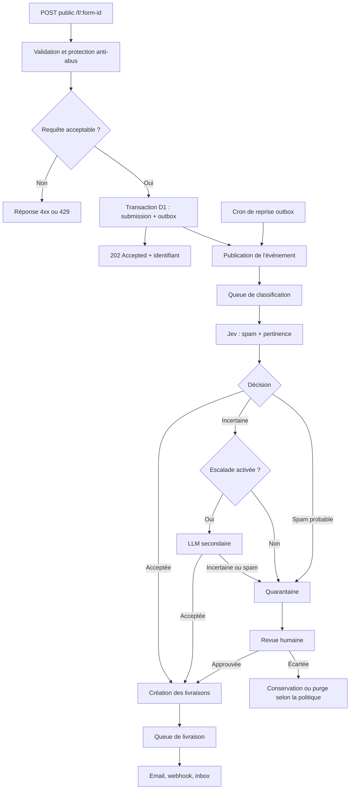

# Rondyr — Architecture technique

> **Nom du projet :** **Rondyr**  
> **Signature :** *The gatekeeper for your forms.*  
> **Statut :** proposition d'architecture pour une v0.1  
> **Objectif :** alternative à Formspree, multi-organisation, déployable dans **son propre compte Cloudflare**, avec classification anti-spam contextuelle, escalade IA facultative et livraison email/webhook.  
> **Principes :** simplicité du déploiement, fiabilité, confidentialité, coût prévisible, portabilité du métier.

## 1. Vision et périmètre

**Rondyr** est un backend de formulaires open source, auto-hébergeable sur Cloudflare, qui protège l'entrée des messages sans perdre les demandes légitimes. Son nom évoque le **rondier** : un gardien qui surveille, filtre et laisse passer les bonnes personnes. La marque reste indépendante des choix de modèles IA ou de fournisseurs.

**Positionnement (EN) :** *Open-source form backend with intelligent spam protection.*  
**Accroche (EN) :** *The gatekeeper for your forms.*

Un administrateur déploie l'application dans son compte Cloudflare, crée une ou plusieurs organisations, puis des formulaires. Chaque formulaire expose un endpoint public utilisable depuis un site statique, une application ou un formulaire HTML classique.

Chaque organisation peut définir :

- un **contexte métier** facultatif (ex. « studio de poterie proposant des ateliers ») ;
- ses paramètres de filtrage et ses quotas ;
- un modèle secondaire facultatif pour les cas ambigus ;
- les destinations des messages acceptés : **inbox, email et/ou webhooks** ;
- la politique de conservation des messages.

**Différenciation de Rondyr :** filtrage *context-aware* dans une infrastructure intégralement contrôlée par l'opérateur, sans dépendre d'un SaaS de formulaires.

### Inclus dans la v0.1

- Déploiement autonome via Alchemy sur Cloudflare.
- Organisations, utilisateurs administrateurs, formulaires et clés/secrets nécessaires.
- Réception HTML (`application/x-www-form-urlencoded`) et JSON ; prise en charge `multipart/form-data` **sans fichiers** si nécessaire.
- Limitation des abus : taille, validation, honeypot, quotas, rate limiting, Turnstile optionnel.
- Enregistrement durable des soumissions **avant** le traitement IA.
- Classification primaire avec Jev (spam + pertinence métier), puis escalade optionnelle.
- Quarantaine et revue humaine ; restauration et livraison des messages validés.
- Inbox d'administration, emails et webhooks signés, historique des livraisons.
- Réessais, reprise après incident, déduplication, audit et tests automatisés.

### Hors périmètre initial

Form builder, CRM, pièces jointes, automatisations visuelles, moteur de templates avancé, facturation SaaS, analytics marketing et modèle IA entraîné sur les données clients.

## 2. Stack et conventions

| Responsabilité | Choix |
| --- | --- |
| Runtime, API, assets | **Cloudflare Workers** (une application déployée) |
| Domaine, erreurs, dépendances, concurrence | **Effect** et `@effect/platform` / Effect HTTP |
| Contrats d'entrée/sortie | **Effect Schema** |
| Infrastructure as Code | **Alchemy** |
| Persistance | **Cloudflare D1** et **Drizzle ORM** |
| Authentification du dashboard | **Better Auth**, sessions en D1 |
| Asynchronisme | **Cloudflare Queues** et Cron Triggers |
| Classification primaire | **Jev** via Workers AI / AI Gateway selon l'intégration retenue |
| Escalade | Adaptateur configurable vers un LLM Cloudflare ou externe via AI Gateway |
| Dashboard | **React + Vite**, servi par le Worker |
| Tests | **Vitest** + runtime Workers et adaptateurs de test Effect |
| Pièces jointes (ultérieurement) | **R2** |

**Convention de nommage :** **tous les fichiers et dossiers créés par le projet sont en kebab-case**, par exemple `classification-service.ts` et `alchemy-run.ts`. Les noms des types et valeurs TypeScript suivent, eux, les conventions du langage. Les fichiers imposés par l'écosystème (`package.json`, etc.) conservent leurs noms obligatoires.

Pour le point d'entrée Alchemy, utiliser `alchemy-run.ts` et préciser le chemin de configuration dans le script de déploiement plutôt que de conserver le nom conventionnel `alchemy.run.ts`.

### Principes de conception

1. **Monolithe modulaire :** pas de microservices ; un Worker avec des modules de domaine isolés.
2. **Effect-first :** les cas d'usage orchestrent des services Effect (`Context`, `Layer`, erreurs typées).
3. **Adapters remplaçables :** le domaine ne dépend ni de D1, ni de Jev, ni d'Alchemy.
4. **IA non destructive :** une incertitude, une erreur technique ou un contenu hors sujet ne provoque pas une suppression automatique.
5. **Au moins une fois + idempotence :** ne jamais supposer que Queues livre un événement exactement une fois.
6. **Coût borné :** limitation des volumes et du nombre d'appels IA par formulaire et organisation.

## 3. Parcours d'une soumission



**Contrat important :** `202 Accepted` signifie que la soumission a été **enregistrée durablement dans D1** ; cela ne signifie ni que l'IA a terminé, ni qu'une notification a été livrée. Une requête rejetée **avant** sa création dans D1 n'entre pas dans cette garantie.

Pour les formulaires HTML, prévoir une redirection de succès configurée ou une page de confirmation, tout en conservant la même sémantique interne.

## 4. Fiabilité : transactional outbox

Cloudflare Queues délivre les messages *at least once* ; D1 et la publication d'une Queue ne forment pas une seule transaction distribuée.

- Dans **une transaction D1**, insérer la soumission et son événement `submission-received` dans `outbox-events`.
- Ne répondre `202` que si cette transaction est confirmée.
- Publier ensuite vers la Queue concernée, directement ou par un dispatcher.
- Exécuter périodiquement un **Cron** qui retrouve les événements non publiés et les republie.
- Utiliser une **revendication atomique** des événements (lease/expiration ou transition conditionnelle) pour réduire les publications concurrentes.
- Considérer malgré tout que deux publications identiques sont possibles ; les consumers doivent être **idempotents**.
- Acquitter le message de classification après l’enregistrement durable de `ClassificationRequested` dans l’agrégat. La saga reprend l’analyse et enregistre son résultat. Le Cron republie les événements dont la remise au modèle reste en attente.
- Mettre en place retry avec backoff, nombre maximum de tentatives, **dead-letter queue** et réexécution manuelle.

Deux Queues principales :

1. `classification-queue` : première classification, puis escalade si nécessaire.
2. `delivery-queue` : email et webhooks ; une destination défaillante ne bloque pas les autres.

**Limite assumée :** un webhook ou fournisseur email peut recevoir deux tentatives, notamment après une interruption réseau. Chaque livraison possède un identifiant stable, transmis au destinataire pour permettre la déduplication. On promet une **reprise fiable**, pas un *exactly once* de bout en bout.

Le modèle de classification et de revue tourne dans les Durable Objects du Worker applicatif via Alchemy Domain. D1 conserve les champs soumis et la projection de statut pour la boîte de réception. Les événements du domaine contiennent les identifiants et les données de décision nécessaires à l’audit.

## 5. Classification intelligente

### Deux dimensions indépendantes

- **Spam** : marketing non sollicité, tentative de fraude, robots, sollicitations massives, etc.
- **Pertinence métier** : proximité de la demande avec l'activité décrite par l'organisation.

Un message hors sujet **n'est pas automatiquement un spam** : « J'ai trouvé vos clés devant votre atelier » peut être authentique même s'il ne demande aucun cours de poterie.

### Politique de décision configurable

Le classificateur retourne des scores et leur contexte (modèle, version, règles, date). L'application évalue ces scores avec des **seuils calibrés** sur un corpus de test. Les probabilités renvoyées par le modèle ne sont pas présumées être des mesures parfaitement calibrées de certitude.

| Situation | Traitement par défaut |
| --- | --- |
| Spam peu probable, requête légitime | Accepter et déclencher les destinations |
| Cas ambigu | Lancer le second modèle **si activé**, sinon quarantaine |
| Spam probable | Quarantaine, sans suppression |
| Hors sujet mais non-spam | Accepter ou demander revue selon la politique de l'organisation |
| Jev ou second modèle indisponible | Réessayer ; après épuisement des tentatives, revue manuelle avec motif `classification-error` |

Le **contexte métier reste optionnel**. Sans contexte, la classification de pertinence est désactivée et le spam reste vérifié.

### Sécurité du pipeline IA

- Ne jamais interpréter le texte d'un visiteur comme une instruction système.
- Encadrer le texte soumis comme donnée non fiable ; ne jamais lui permettre de modifier les seuils ou destinations.
- Fixer une longueur maximale au contexte et aux messages envoyés au modèle.
- Conserver le minimum utile pour auditer une décision : résultat, scores, identifiant/version du modèle, version des règles, horodatage.
- Désactiver ou limiter la journalisation des corps de requête/prompts dans les passerelles et observabilités.
- Plafonner les coûts : appels IA, longueur d'entrée, escalades et messages par organisation.

Le choix de Jev doit rester **un adaptateur**, et non une dépendance structurante du domaine : un autre classificateur peut prendre sa place sans migration de la logique métier.

## 6. Modèle de données D1 (initial)

| Table | Responsabilité / contraintes principales |
| --- | --- |
| `organizations` | Nom, configuration, quotas, politique de rétention |
| `organization-members` | Utilisateur, organisation, rôle ; accès autorisé explicitement |
| `forms` | Organisation, identifiant public, statut, contexte métier, paramètres |
| `form-origins` | Origines autorisées pour le navigateur ; **pas** une authentification |
| `submissions` | Identifiant stable, `organization-id`, `form-id`, données, statut, date |
| `classification-attempts` | Modèle, version, scores, résultat, erreur éventuelle |
| `notification-targets` | Destinations configurées par formulaire, statut, options |
| `deliveries` | Destination, identifiant idempotent, tentatives, état, erreur |
| `outbox-events` | Type d'événement, charge utile minimale, publication, lease |
| `audit-events` | Modifications administratives, revue humaine, sans contenus sensibles inutiles |

**Remarque SQL :** la convention des noms de fichiers reste en kebab-case. Pour les colonnes SQL, privilégier `snake_case` (ex. `organization_id`) pour rester idiomatique avec Drizzle et SQL ; les noms logiques ci-dessus décrivent les entités, pas un schéma SQL définitif.

Toutes les requêtes administratives **doivent être bornées par l'organisation autorisée** ; un ID public ne suffit jamais à accéder à une soumission. Ajouter clés étrangères, index sur `(organization_id, form_id, created_at)` et contraintes d'unicité pour l'idempotence.

### États suggérés

- `submissions` : `received`, `classifying`, `accepted`, `quarantined`, `classification-error`, `archived`.
- `deliveries` : `pending`, `processing`, `delivered`, `retrying`, `failed`.
- Une validation manuelle crée les livraisons **une seule fois** si elles n'existent pas déjà.

## 7. API et expérience développeur

### API publique

- `POST /f/:form-id` : réception des soumissions.
- `GET /health` : santé applicative sans fuite de détails internes.

Supporter `application/json` et `application/x-www-form-urlencoded`, taille et champs bornés, noms de champs arbitraires limités par configuration ; une réponse JSON comporte `submission-id` et `status` pour les intégrations API.

### API d'administration (authentifiée)

- Organisations : créer, éditer, inviter, gérer les rôles.
- Formulaires : créer, éditer, suspendre, configurer contexte et destinations.
- Soumissions : consulter, filtrer, rechercher, approuver, classer, exporter/supprimer.
- Livraisons : voir les tentatives, relancer, tester les destinations.

La v0.1 n'a pas besoin de publier une API d'administration exhaustive à des clients tiers : elle sert d'abord au dashboard.

## 8. Défenses et confidentialité

### Entrée publique

- Limites strictes de taille, de champs, de fréquence et de consommation par formulaire/organisation.
- Honeypot et Turnstile **optionnels** ; toujours valider le token Turnstile côté serveur lorsqu'activé.
- CORS pour l'intégration navigateur, sans le traiter comme une défense contre l'abus (un client non-navigateur ignore CORS).
- Rate limiting natif Cloudflare utile mais **approximatif** ; combiner avec quotas persistants / mécanismes adaptés si un contrôle strict est requis.
- Ne pas révéler les décisions anti-spam détaillées dans les réponses publiques.

### Authentification et isolation

- Première installation : création explicite du compte administrateur ; inscriptions publiques fermées.
- Sessions sécurisées, rôles par organisation, contrôles d'accès systématiques.
- **Tests de non-divulgation entre organisations** pour toutes les routes et toutes les opérations.

### Sorties et secrets

- Webhooks HTTPS, URLs validées, redirects interdits ou revérifiés, protection SSRF, filtrage des destinations dangereuses.
- Webhooks signés HMAC avec timestamp, identifiant unique et politique de rotation de secret.
- Identifiants fournisseurs et clés API conservés dans les **secrets Workers**, pas dans le front-end.
- Pour des secrets propres à chaque organisation, prévoir du chiffrement applicatif et une stratégie de rotation.
- Les emails sortants ne doivent pas transformer les entrées visiteurs en en-têtes non validés.

### Données personnelles

- Rétention configurable pour messages acceptés et quarantaine ; purge planifiée et suppression à la demande.
- Export/suppression en tenant compte de l'historique de livraison et des sauvegardes.
- Logs techniques sans corps de message par défaut ; pas de prompts sensibles dans les logs AI Gateway.
- Documenter le traitement des données et les sous-traitants ; auto-hébergement ne supprime pas les obligations RGPD.

## 9. Arborescence proposée — uniquement kebab-case

```text
.
├── alchemy-run.ts
├── package.json
├── drizzle-config.ts
├── architecture.md
├── src/
│   ├── domain/
│   │   ├── submission.ts
│   │   ├── classification.ts
│   │   ├── delivery.ts
│   │   ├── organization.ts
│   │   ├── form.ts
│   │   └── domain-errors.ts
│   ├── ports/
│   │   ├── submission-repository.ts
│   │   ├── classification-provider.ts
│   │   └── notification-provider.ts
│   ├── application/
│   │   ├── accept-submission.ts
│   │   ├── classify-submission.ts
│   │   ├── prepare-deliveries.ts
│   │   ├── deliver-notification.ts
│   │   └── recover-outbox.ts
│   ├── adapters/
│   │   ├── database/
│   │   │   ├── d1-repository.ts
│   │   │   └── database-schema.ts
│   │   ├── ai/
│   │   │   ├── jev-classifier.ts
│   │   │   └── llm-classifier.ts
│   │   ├── email/
│   │   │   └── email-provider.ts
│   │   └── webhook/
│   │       └── webhook-provider.ts
│   ├── http/
│   │   ├── public-routes.ts
│   │   ├── admin-routes.ts
│   │   └── authentication.ts
│   ├── jobs/
│   │   ├── classification-consumer.ts
│   │   ├── delivery-consumer.ts
│   │   └── recovery-cron.ts
│   └── worker.ts
├── dashboard/
│   └── src/
│       ├── routes/
│       ├── components/
│       └── main.tsx
├── database/
│   └── migrations/
└── tests/
    ├── domain/
    ├── integration/
    └── fixtures/
```

L'emplacement final des fichiers générés par les frameworks peut nécessiter des exceptions imposées par leurs outils ; ne pas introduire arbitrairement de nouveaux noms PascalCase ni de mélange de styles.

## 10. Tests et critères de qualité

### Tests de domaine

- Spam, message légitime, message indirectement lié, hors sujet, langues multiples.
- Seuils exacts et comportement en cas de score manquant ou non valide.
- Échec du modèle et passage à `classification-error` avec revue humaine.
- Autorisations et invariants des transitions d'état.

### Tests d'intégration Workers / D1 / Queues

- Échec de publication après transaction D1 : le Cron rattrape l'événement.
- Queue livre **deux fois** le même événement : une décision logique, aucune livraison dupliquée dans D1.
- Panne après envoi externe mais avant accusé de réception : duplication possible, identifiant de déduplication stable.
- Erreurs `429`, `500`, timeout, DLQ et réexécution.
- Arrivée concurrente de soumissions, contention sur l'outbox, expiration des leases.
- Interdiction d'accès aux données d'une autre organisation (lecture **et** écriture).
- URL webhook dangereuse, mauvais secret, signature expirée, payload trop volumineux.

### Évaluation du filtrage

Constituer un corpus de test représentatif de messages légitimes, spams, demandes ambiguës et hors sujet. Mesurer les **faux positifs**, la précision/rappel, le coût et la latence ; versionner seuils et prompts. Le critère le plus important est de **ne pas perdre de demande réelle**.

### Observabilité

Compteurs de soumissions, taux de quarantaine, taux d'escalade, coût IA estimé, latences, taille du backlog, délais de livraison, DLQ et actions manuelles. Les mesures agrégées évitent de stocker le contenu personnel dans les logs.

## 11. Déploiement et exploitation

Alchemy crée et relie les ressources : Worker, D1, Queues, Cron, AI Gateway/Workers AI, assets et secrets requis. Les migrations D1 sont **versionnées** et appliquées explicitement pendant le déploiement ; ne pas les faire implicitement à chaque requête.

Prévoir :

- environnement local et environnement de préproduction distincts de la production ;
- configuration de déploiement reproductible et lockfile des dépendances ;
- validation du schéma et des migrations avant promotion ;
- sauvegarde/export de D1, politique de restauration testée et procédure de rollback ;
- guide d'installation à partir d'un compte Cloudflare vierge ;
- limites et tarifs Cloudflare documentés **sans promettre un coût universel de 0 €**.

La réduction des coûts passe par les protections **avant** l'IA, l'absence d'escalade systématique et le maintien d'un Worker applicatif unique.

## 12. Ordre de réalisation

1. **Fondations :** bootstrap Effect + Alchemy, Worker HTTP, D1/Drizzle, tests Workers, premier déploiement.
2. **Ingestion fiable :** endpoint public, validation, organisations/formulaires, transaction D1 + outbox, Cron de reprise.
3. **Classification :** queue, adaptateur Jev, contexte métier, politique de décision, quarantaine.
4. **Distribution :** email, webhooks signés, retries, idempotence, historique de livraison.
5. **Dashboard :** authentification, inbox, configuration, validation manuelle, logs d'exécution.
6. **Durcissement :** sécurité multi-tenant, quotas, tests de panne, mesures de qualité IA, documentation self-hosting.

## 13. Décisions ouvertes à trancher avant implémentation

- Fournisseur d'email initial : service Cloudflare lorsqu'adapté aux destinataires, ou adaptateur externe (ex. Resend).
- Invitations et rôles par organisation après la création du premier compte Better Auth.
- Politique exacte de pertinence hors sujet : revue humaine ou livraison avec étiquette.
- Liste et seuils des quotas par organisation, avec comportements en cas de dépassement.
- Rétention par défaut, restrictions sur les champs, politique d'export et purge.
- Licence open source (MIT, Apache-2.0 ou AGPL) et stratégie de contributions.

---

**Définition du succès de Rondyr v0.1 :** un développeur déploie le projet dans son compte Cloudflare, copie une URL de formulaire dans son site, reçoit les vrais messages malgré les pannes temporaires, et peut consulter/restaurer tout message suspect sans devoir exploiter un serveur traditionnel.
