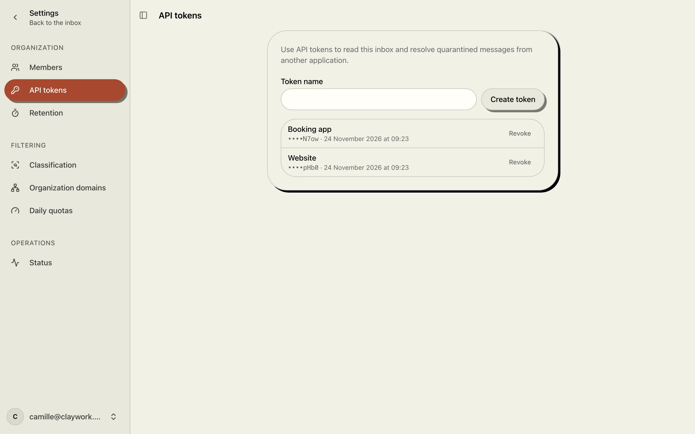

# HTTP API

Use the HTTP API to submit forms from browsers or backend servers, read your organization's inbox, and accept or archive quarantined messages from another application.

## Public form submission

Send form data to `POST https://<your-rondyr-host>/f/{publicId}` with no authentication header.

```sh
curl --json '{"email":"visitor@example.com","message":"Is there room in the Saturday class?"}' \
  https://forms.example.com/f/YOUR_PUBLIC_ID
```

```json
{ "submission-id": "73123ee4-40bf-4c5f-b8ff-1d56cdaa7640", "status": "received" }
```

### Request rules

- **Content types:** `application/json`, `application/x-www-form-urlencoded`, or `multipart/form-data` (text fields only; any file part returns `400`).
- **Limits:** body up to 16 KiB; 1 to 32 message fields; field names 1 to 100 characters with no control characters or line breaks (`__proto__`, `constructor`, and `prototype` are refused); field values up to 4,000 characters. JSON values must be strings; repeated form field names are joined with `, `.
- **Turnstile:** if Turnstile is enabled on the form, send the token in `cf-turnstile-response` (excluded from the 32-field count and removed before saving).
- **CORS:** `OPTIONS /f/{publicId}` answers preflight requests (`POST`, `Content-Type`, `Access-Control-Max-Age: 7200`). Cookies aren't allowed. A form with no allowed origins sends `Access-Control-Allow-Origin: *`; with a list, unlisted origins receive `403`.

### Responses

| Status | Meaning |
| --- | --- |
| `202` | Saved. JSON clients get `{"submission-id", "status": "received"}`; HTML form posts with `Accept: text/html` get the confirmation page |
| `303` | Saved, HTML form post on a form with a redirect URL (`Location` header points to that URL) |
| `400` | Invalid body or fields, a file part in multipart data, or no message fields left after stripping the Turnstile token and empty honeypot |
| `403` | Form is suspended, or `Origin` isn't in the form's allowed origins list |
| `404` | Unknown form |
| `413` | Body exceeds 16 KiB |
| `415` | Unsupported `Content-Type` |
| `429` | Visitor limit (5/min), form limit (30/min), or daily organization quota reached. Check `Retry-After` (seconds) |
| `503` | Storage temporarily unavailable; safe to retry |

## API tokens

Create an organization API token in **Settings → API tokens** (admins only) to call server intake and inbox review routes. Each organization can have up to 10 active tokens. Copy the token right after creation; Rondyr displays it once and never again.



Pass the token in the `Authorization` header as a Bearer credential:

```sh
curl --fail-with-body \
  -H "Authorization: Bearer ${RONDYR_API_TOKEN}" \
  https://forms.example.com/api/organizations
```

Tokens start with `rdr_`, have **Reviewer** permissions on their own organization only, and work with or without an `Origin` header. Revoking a token (or removing the admin who created it) makes subsequent requests return `401` immediately.

## Server intake

When your own server validates a form and forwards submissions to Rondyr, send `POST /f/{publicId}` with an `Authorization: Bearer` API token and a JSON body:

```sh
curl --fail-with-body -X POST \
  -H "Authorization: Bearer ${RONDYR_API_TOKEN}" \
  -H "Content-Type: application/json" \
  -H "Idempotency-Key: 01JD8Z3K9QX5M4V7T2N6B8C1RA" \
  --data '{"name":"Ada Lovelace","email":"ada@example.com","message":"Hello"}' \
  "https://forms.example.com/f/${FORM_PUBLIC_ID}"
```

Differences from public browser submissions:

- **Skipped checks:** allowed origins and the per-visitor rate limit (5/min).
- **Kept checks:** the form's 30/min cap, daily organization quotas, suspended status, and honeypot field still apply.
- **Format:** body must be `application/json` (flat object of strings), and the response is always `202` JSON with `{"submission-id", "status": "received"}`, never HTML or a redirect.
- **Auth errors:** any request to `/f/{publicId}` with an `Authorization` header is treated as server intake and never falls back to public intake. An invalid or revoked token returns `401`; a token from another organization returns `404`.

### Turnstile for forwarded submissions

Send `Rondyr-Turnstile: verify` with the visitor's token in the `cf-turnstile-response` JSON field. Rondyr verifies against the keys of the destination form. You can also send `Rondyr-Visitor-IP` with the visitor's IPv4 or IPv6 address. Rondyr passes it as `remoteip` to Siteverify. Browser intake ignores both headers.

Missing, refused, and expired tokens send messages to **To review** with `turnstile-failed`. The submission still gets `202` once stored. Without the opt-in header or when the form has no Turnstile keys, server intake skips verification. Rondyr removes the token before storing the message.

### Idempotency keys

Include an `Idempotency-Key` header (1 to 128 printable ASCII characters) on server intake requests so retries never create duplicate messages.

- A repeated request with the same key on the same form returns `202` with the original `submission-id` without creating a second submission or sending duplicate notifications (regardless of later form status or quota changes). Rondyr skips Siteverify for a stored key, even if the original token has since expired.
- Keys are scoped per form and last until that submission is deleted.
- Malformed keys return `400`. Public browser requests without `Authorization` ignore `Idempotency-Key`.

### Server intake errors

| Status | Meaning |
| --- | --- |
| `400` | Malformed `Idempotency-Key`, invalid JSON/fields, or no fields left after removing an empty honeypot |
| `401` | Invalid, malformed, or revoked Bearer token |
| `403` | Form is suspended |
| `404` | Form doesn't exist or belongs to another organization |
| `413` | Body exceeds 16 KiB |
| `415` | `Content-Type` isn't `application/json` |
| `429` | Form minute cap (`Retry-After: 60`) or daily organization quota (`Retry-After` in seconds until midnight UTC) |
| `503` | Service temporarily unavailable; retry with the same `Idempotency-Key` |

## Inbox and review routes

Start by calling `GET /api/organizations` to look up your organization's `id` and its `forms` list. Then use that `organizationId` in the routes below (paths starting with `/{organizationId}` are relative to `/api/organizations`):

| Method | Path | Description |
| --- | --- | --- |
| `GET` | `/api/organizations` | Array containing the token's organization (`id`, `name`, `role: "reviewer"`) and its forms |
| `GET` | `/{organizationId}/submissions` | Up to 25 submissions, newest first, with `cursor` for pagination. Query params: `status`, `form` (public ID), `q` (search text, 3 to 100 chars), `after` (cursor) |
| `GET` | `/{organizationId}/submission-counts` | Counts by status for the organization and per form (`forms: [{ publicId, counts }]`) |
| `GET` | `/{organizationId}/submissions/{submissionId}` | Full detail of one submission |
| `POST` | `/{organizationId}/submissions/{submissionId}/approve` | Accepts a quarantined submission (empty body) and forwards it to active destinations |
| `POST` | `/{organizationId}/submissions/{submissionId}/dismiss` | Archives a quarantined submission (empty body) |

Example: accept a quarantined submission:

```sh
curl --fail-with-body -X POST \
  -H "Authorization: Bearer ${RONDYR_API_TOKEN}" \
  "https://forms.example.com/api/organizations/${ORGANIZATION_ID}/submissions/${SUBMISSION_ID}/approve"
```

Every other `/api/*` endpoint (such as admin settings, exports, deletion, or reclassify) returns `403` to an API token.

### Submission object

List responses return `{"entries": [...], "cursor": "..."}` (`cursor` is `null` on the last page). Each list entry has `preview` (values trimmed to 240 characters); detail responses have `fields` (full values). Both share these fields:

| Field | Type / Values |
| --- | --- |
| `submissionId` | Submission UUID |
| `organizationId`, `formId` | Internal IDs |
| `formPublicId`, `formName` | Form public ID and dashboard name |
| `receivedAt` | Unix timestamp in milliseconds |
| `status` | `received`, `classifying`, `quarantined`, `accepted`, or `archived` |
| `reason` | `probable-spam`, `ambiguous`, `solicitation`, `low-relevance`, `classification-error`, `honeypot`, `repetition`, `turnstile-failed`, `quota`, or `null` |
| `label` | `off-topic` (for accepted off-topic messages) or `null` |

### Review route errors

| Status | Meaning |
| --- | --- |
| `400` | Invalid path parameter, query filter, or pagination cursor |
| `401` | Missing, invalid, or revoked Bearer token |
| `403` | Valid token, but the route isn't available to API tokens |
| `404` | Organization or submission doesn't exist or belongs to another organization |
| `409` | Submission is no longer quarantined (already accepted or archived) |
| `503` | Service temporarily unavailable |

Error responses on review routes have an empty body.
