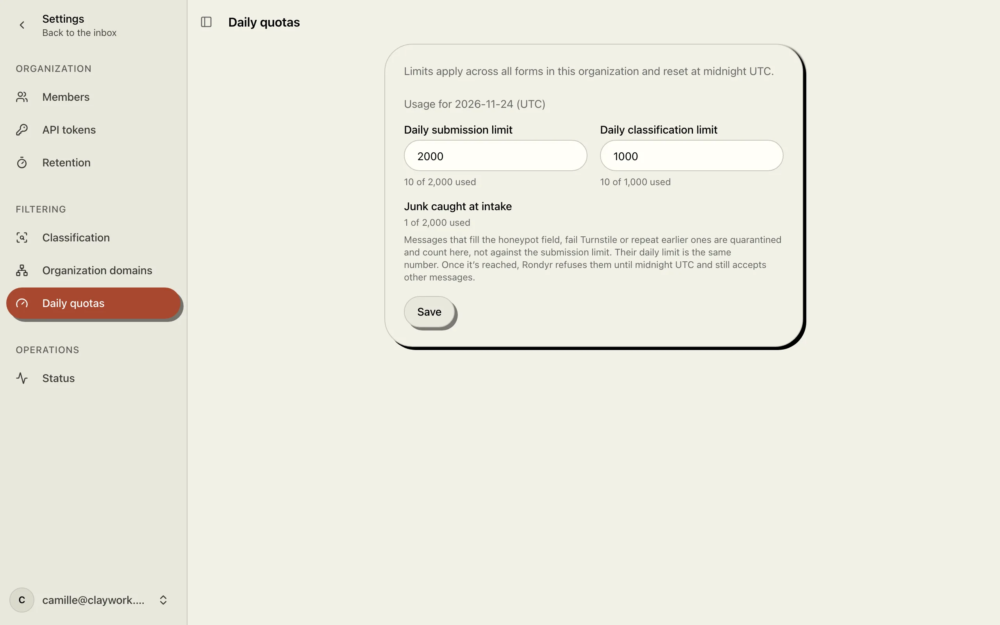

# Costs and limits

Rondyr itself is free and open source, so you only pay Cloudflare (and your email provider, if you use Resend) for what your instance uses. You need the **Workers Paid** plan ($5/month per Cloudflare account) to run Rondyr reliably.

For most small and medium sites, the $5/month Cloudflare plan plus the free email allowance covers everything with plenty of headroom.

## Workers Paid requirement

The Deploy to Cloudflare button works on a free account, but Rondyr doesn't run reliably on **Workers Free**:

- **Sign-in fails on the free CPU limit.** Workers Free caps each request at 10 ms of CPU time. Rondyr hashes passwords with scrypt, which intentionally uses more CPU than 10 ms, so creating the owner account and signing in can time out.
- **Free daily usage limits run out fast.** A busy form or a short spam burst can exhaust the free tier's daily background processing allowance in minutes, leaving messages waiting until midnight UTC.
- **Cloudflare Email Sending requires Workers Paid.** If you want Cloudflare to send your notification emails instead of Resend, the paid plan is mandatory.

## Cloudflare pricing

Cloudflare bills per account, not per form. Prices and included allowances change from time to time; check the linked Cloudflare pages before relying on the November 2026 numbers below.

| Service | Included with Workers Paid ($5/month) | Overage rate |
| --- | --- | --- |
| [Workers](https://developers.cloudflare.com/workers/platform/pricing/) | 10 million requests and 30 million CPU ms/month | $0.30 per million requests, $0.02 per million CPU ms |
| [Database storage](https://developers.cloudflare.com/d1/platform/pricing/) | 25 billion rows read, 50 million rows written, 5 GB storage/month | $0.001 per million reads, $1.00 per million writes, $0.75 per GB-month |
| [Background delivery & retries](https://developers.cloudflare.com/queues/platform/pricing/) | 1 million operations/month | $0.40 per million operations |
| [Workflow state](https://developers.cloudflare.com/durable-objects/platform/pricing/) | 1 million requests and 400,000 GB-s/month | $0.15 per million requests, $12.50 per million GB-s |
| [Workers AI](https://developers.cloudflare.com/workers-ai/platform/pricing/) (Jev classifier, default) | 10,000 Neurons/day | $0.011 per 1,000 Neurons |
| [AI Gateway unified billing](https://developers.cloudflare.com/ai-gateway/features/unified-billing/) (OpenAI Decisions, optional) | Prepaid credits, billed per call | Depends on model token usage |
| [Workers Logs](https://developers.cloudflare.com/workers/observability/logs/workers-logs/) | 20 million log events/month, 7-day retention | $0.60 per million events |

Even with zero form traffic, Rondyr runs a once-per-minute health and retry check (1,440 lightweight runs per day), which stays far below the included monthly allowances. Each trial copy you deploy in the same account adds its own baseline usage.

## Email provider costs

You only need an email provider if you want Rondyr to send notification emails, team invitations, or password resets.

- **Resend (default).** Free tier includes 3,000 emails per month (up to 100 per day) from up to 3 domains. Paid plans start at $20/month for 50,000 emails with no daily cap. Each recipient on an email destination counts as one email. See [Resend pricing](https://resend.com/pricing).
- **Cloudflare Email Sending.** Workers Paid includes 3,000 outbound emails per month per account, then $0.35 per 1,000 emails. Sends to addresses already verified in your Cloudflare account don't count toward the quota. See [Cloudflare Email Sending pricing](https://developers.cloudflare.com/email-service/platform/pricing/).

## Control spending with daily quotas

Your main lever over AI classification costs is **Settings → Daily quotas**, which caps how many submissions and AI classifications an organization can use per UTC day.

By default, each organization gets:

- **2,000 stored submissions per day** (configurable from 1 to 100,000)
- **1,000 AI classifications per day** (configurable from 0 to 100,000)
- **2,000 junk submissions caught at intake per day** (matches the submission limit)

Junk caught before AI analysis (messages that fill your honeypot field, fail Turnstile, or repeat earlier submissions) uses its own separate daily allowance so a bot attack doesn't lock out real visitors or burn your AI budget. Once an organization hits its daily classification limit, real submissions are still saved and placed in **To review** instead of calling the AI model.

To keep an eye on real spend, check usage in your Cloudflare dashboard under **Workers & Pages** and **AI**, and turn on Cloudflare billing notifications for your account.
