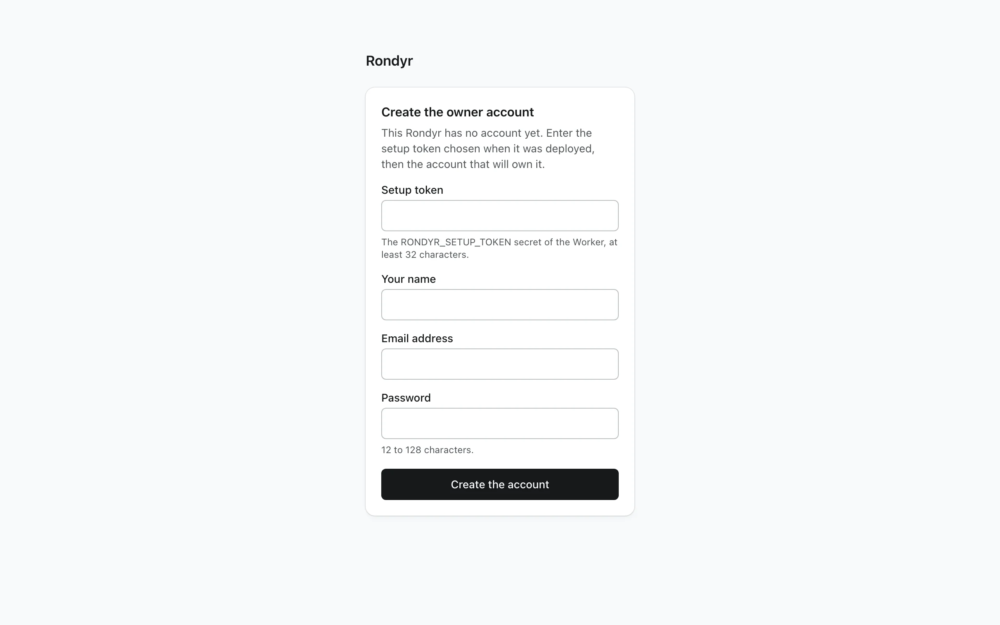

# Deploy Rondyr

Deploy Rondyr to your own Cloudflare account in a few minutes with the Deploy to Cloudflare button, then create your owner account in the browser. You don't need a terminal or a custom domain to get started.

[](https://deploy.workers.cloudflare.com/?url=https://github.com/basaltbytes/rondyr)

You need a Cloudflare account on the **Workers Paid** plan ($5/month per account) and a GitHub or GitLab account. [Costs and limits](./costs.md) explains why Workers Free isn't enough and lists what Cloudflare bills.

## Deploy with the button

1. Select **Deploy to Cloudflare** above, sign in to Cloudflare, and connect your GitHub or GitLab account when asked.
2. Keep the default names on the form (`rondyr` for the Worker and its resources), unless this Cloudflare account already runs another Rondyr instance. Cloudflare copies the repository into your GitHub or GitLab account.
3. For `RONDYR_SETUP_TOKEN`, enter a random passphrase of at least 32 characters, for example from your password manager or `openssl rand -hex 32`. Save it for the next step.
4. Select **Deploy**. Cloudflare sets up the required resources, generates the internal encryption and session secrets automatically, and deploys Rondyr.
5. Open your new Rondyr URL from **Workers & Pages → rondyr** in the Cloudflare dashboard (usually `https://rondyr.<your-subdomain>.workers.dev`).

## First account

Public sign-up is closed. Opening a new Rondyr instance shows the **Create the owner account** screen.



1. Paste the `RONDYR_SETUP_TOKEN` you chose during deployment.
2. Enter your name, email address, and a password of 12 to 128 characters, then select **Create the account**.
3. Create your first organization and your first form when prompted. Describing your business on the form lets the spam filter spot off-topic messages later.

Once the owner account exists, this page closes for good and switches to the sign-in screen. You can delete `RONDYR_SETUP_TOKEN` in **Workers & Pages → rondyr → Settings → Variables and Secrets** afterward, or leave it in place; Rondyr refuses to create a second account through setup either way. After 5 wrong token attempts in a minute, Rondyr asks you to wait a minute before trying again.

To invite teammates later, see [Team and accounts](./team.md). To put your new form on a website right away, go to [Put a form on your site](./forms.md), and to receive accepted messages in your mailbox, go to [Send messages by email](./email.md).

## Custom domain

Rondyr works on its `workers.dev` address right away, and you can attach your own domain at any time if the domain's DNS is on Cloudflare in the same account.

1. In the Cloudflare dashboard, open **Workers & Pages → rondyr → Settings → Domains & Routes → Add → Custom domain**.
2. Enter the hostname you want to use, such as `forms.example.com`. Cloudflare creates the DNS record and TLS certificate, which takes a few minutes.
3. Open the new HTTPS address and sign in again (sessions don't carry over between hostnames).

To lock sign-in to that single address so the `workers.dev` URL stops accepting logins, add a variable named `BETTER_AUTH_URL` set to your full HTTPS origin (for example `https://forms.example.com`, with no trailing slash or path) under **Settings → Variables and Secrets**. Invitation, password reset, and email confirmation links use whichever address you are signed in on.

## Optional settings

Every setting below is optional; Rondyr deploys without them and tells you in the dashboard if a feature needs one. Add or change variables and secrets in **Workers & Pages → rondyr → Settings → Variables and Secrets**. Saving a change deploys a new version immediately, and future updates keep your settings.

| Name | Kind | Purpose |
| --- | --- | --- |
| `BETTER_AUTH_URL` | Variable | Restricts sign-in to one HTTPS origin, such as `https://forms.example.com` |
| `RONDYR_EMAIL_FROM` | Variable | Bare sender address for outbound email, such as `forms@notifications.example.com`. See [Send messages by email](./email.md) |
| `RONDYR_EMAIL_PROVIDER` | Variable | `resend` (default) or `cloudflare` |
| `RESEND_API_KEY` | Secret | Resend API key with sending access (when using Resend) |
| `RONDYR_CLASSIFIER` | Variable | Spam classifier: `jev` (default) or `openai`. See [Classifier choice](#classifier-choice) |
| `RONDYR_ESCALATION_CLASSIFIER` | Variable | Optional second classifier (`openai` or `jev`) for uncertain messages |
| `RONDYR_SECRETS_KEY` | Secret | Generated on first deploy. See [Encryption key](#encryption-key) |
| `BETTER_AUTH_SECRET` | Secret | Generated on first deploy. Signs dashboard sessions |

### Classifier choice

Rondyr uses **Jev** on Workers AI by default, with no extra keys or accounts needed.

To use **OpenAI Decisions** instead, set `RONDYR_CLASSIFIER` to `openai`. Calls use [Cloudflare AI Gateway unified billing](https://developers.cloudflare.com/ai-gateway/features/unified-billing/) with your Cloudflare credits, so you don't need an OpenAI API key. This setting applies to every form on the instance.

You can also offer a second opinion for uncertain messages by setting `RONDYR_ESCALATION_CLASSIFIER` to the other model (`openai` when `jev` is primary, or `jev` when `openai` is primary). Each organization then turns that option on or off in **Settings → Classification**. Both classifiers disable AI Gateway log storage and caching on every call, so visitor messages stay out of gateway logs.

### Encryption key

`RONDYR_SECRETS_KEY` encrypts webhook signing secrets, Turnstile secret keys and the secret settings of [connectors](./connectors.md) (a webhook URL or a token) before saving them. The button deployment generates a random 32-byte base64 key on first deploy and never overwrites it on later deployments.

If you want your own key (for instance, to migrate an instance later), generate one with `openssl rand -base64 32` and set it before creating your first webhook, connector or Turnstile widget. Changing or removing `RONDYR_SECRETS_KEY` later makes existing webhook secrets, connector secrets and Turnstile keys unreadable: webhook deliveries fail until you rotate each webhook's secret, connector deliveries fail until you save the settings of each connector again, and Turnstile stops verifying tokens (with a warning on each form's Turnstile card) until you save both Turnstile keys again.

## Updates

Every push to the `main` branch of your copy deploys automatically. Cloudflare's Git integration builds other branches too by default, so turn branch builds off in **Workers & Pages → rondyr → Settings → Build → Branch control** if you don't want feature branches touching your live deployment.

### Update a copy created with the button

1. Open your Rondyr repository on GitHub and go to **Actions → Update Rondyr → Run workflow**. Leave `main` for the latest version, or type a release tag.
2. When the workflow finishes, open the pull request link shown in the run summary. The update keeps your Cloudflare resource names and any email sending setting in `wrangler.json`.
3. Review and merge the pull request. The merge to `main` deploys the new version automatically.

### Update a fork

If you deployed by forking `basaltbytes/rondyr` and importing the fork into **Workers & Pages → Create → Import a repository**, open your fork on GitHub and select **Sync fork → Update branch**. The push to `main` deploys the new version.

Note that a fork imported directly into Workers Builds has no `RONDYR_SETUP_TOKEN` yet: after the first deploy, add `RONDYR_SETUP_TOKEN` (at least 32 characters) in **Settings → Variables and Secrets** and reload the setup page.

## Trial copy

To test an upgrade or configuration without touching your live instance, select the **Deploy to Cloudflare** button again and pick different names for the Worker and its resources (resource names are unique per Cloudflare account). Each trial copy has its own setup token and counts separately toward your Cloudflare usage. When you finish, delete the trial Worker, its resources, and its repository.

## Deploy with Alchemy and GitHub Actions

If you prefer deploying from a GitHub fork with infrastructure managed in CI, on a custom domain, with all configuration stored in GitHub secrets and variables, use the Alchemy workflow. Don't import the same fork into Cloudflare Workers Builds at the same time, or both systems will race to deploy on every push.

### Prerequisites

- A Cloudflare account on **Workers Paid** with your domain active in the same account.
- A fork of [basaltbytes/rondyr](https://github.com/basaltbytes/rondyr) with GitHub Actions enabled.
- Node.js 24.22 or later and pnpm 11 on your machine for the one-time state setup.

### Setup steps

1. Clone your fork, install dependencies, and initialize Alchemy's Cloudflare state store once:

   ```sh
   pnpm install --frozen-lockfile
   pnpm --filter rondyr exec alchemy state bootstrap --backend cloudflare --config alchemy-run.ts
   ```

2. Create a Cloudflare API token for GitHub Actions following [Alchemy's Cloudflare token guide](https://alchemy.run/cloudflare/accounts-and-tokens/), granting write access for Workers scripts, database storage, and background jobs, plus `Account Settings Read` and **Account Secrets Store Edit** on the account, and `Zone Read` and `Workers Routes Write` on your domain's zone.
3. Add these secrets and variables in your fork's **Settings → Secrets and variables → Actions**:

   | GitHub name | Kind | Value |
   | --- | --- | --- |
   | `CLOUDFLARE_API_TOKEN` | Secret | The Cloudflare API token from step 2 |
   | `CLOUDFLARE_ACCOUNT_ID` | Secret | Your Cloudflare account ID |
   | `BETTER_AUTH_URL_PROD` | Variable | Your HTTPS origin, such as `https://forms.example.com` (no path or port) |
   | `BETTER_AUTH_SECRET_PROD` | Secret | At least 32 random characters (`openssl rand -hex 32`) |
   | `RONDYR_SETUP_TOKEN_PROD` | Secret, optional | At least 32 random characters, only until you create the owner account |
   | `RONDYR_SECRETS_KEY_PROD` | Secret, optional | 32 random bytes in base64 (`openssl rand -base64 32`), required for webhooks, connectors and Turnstile |
   | `RONDYR_CLASSIFIER_PROD` | Variable, optional | `jev` (default) or `openai` |
   | `RONDYR_ESCALATION_CLASSIFIER_PROD` | Variable, optional | `openai` or `jev` |
   | `RONDYR_EMAIL_PROVIDER_PROD` | Variable, optional | `resend` (default) or `cloudflare` |
   | `RONDYR_EMAIL_FROM_PROD` | Variable, optional | Bare sender address on your verified domain |
   | `RESEND_API_KEY_PROD` | Secret, optional | Resend API key (when using Resend) |

4. Start the **Deploy** workflow on `main` (or push a commit to `main`). The workflow runs checks, deploys Rondyr on your custom domain, and waits up to 15 minutes for `https://<your-domain>/health` to answer `ok`.
5. Open your domain and complete [First account](#first-account), then delete `RONDYR_SETUP_TOKEN_PROD` from your fork's secrets.

To update later, select **Sync fork → Update branch** on GitHub; the push to `main` runs checks and deploys automatically. To deploy a separate trial stage from your machine (such as `trial`), create `apps/rondyr/.env.trial` with the same variable names without `_PROD` and run:

```sh
pnpm --filter rondyr exec alchemy profile edit --config alchemy-run.ts --add Cloudflare
pnpm run deploy:alchemy --stage trial --env-file .env.trial
```

Remove a trial stage later with `pnpm --filter rondyr exec alchemy destroy --config alchemy-run.ts --stage trial --env-file .env.trial`.
