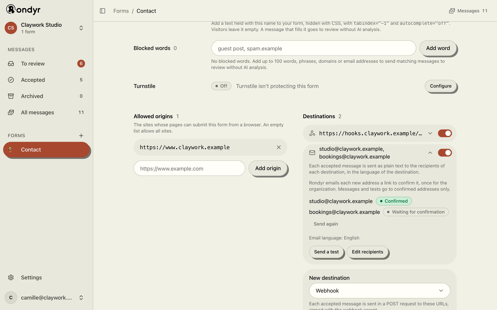

# Send messages by email

Configure an email provider once for your Rondyr instance, add recipients to a form under **Destinations**, and confirm each address. From then on, Rondyr emails every accepted message (and any quarantined message you accept later) to those recipients as plain text.

## 1. Set up an email provider

Rondyr supports **Resend** (the default) and **Cloudflare Email Sending**. Pick one for your instance.

### Option A: Resend (default)

You need a [Resend](https://resend.com) account and a domain whose DNS records you can edit.

1. In Resend, add a sending domain (a subdomain such as `notifications.example.com` keeps form mail separate from your main domain's reputation).
2. Add the SPF and DKIM DNS records Resend gives you, unproxied if your DNS is on Cloudflare, and wait for verification.
3. Create an API key in Resend with **Sending access** restricted to that domain, and copy it right away.
4. In your Cloudflare dashboard, open **Workers & Pages → rondyr → Settings → Variables and Secrets** and add:

   | Name | Kind | Value |
   | --- | --- | --- |
   | `RESEND_API_KEY` | Secret | Your Resend API key (`re_…`) |
   | `RONDYR_EMAIL_FROM` | Variable | A bare sender address on the verified domain, such as `forms@notifications.example.com` |

5. Save to deploy the settings.

On an Alchemy deployment, set `RESEND_API_KEY_PROD` and `RONDYR_EMAIL_FROM_PROD` in your fork's GitHub secrets and variables, then run the **Deploy** workflow.

Use a bare email address for `RONDYR_EMAIL_FROM` without a display name; values like `Rondyr <forms@example.com>` are rejected.

### Option B: Cloudflare Email Sending

Requires **Workers Paid** and a sender domain whose DNS is on Cloudflare in the same account.

1. In the Cloudflare dashboard, open **Compute → Email Service → Email Sending**, select **Onboard Domain**, and finish domain verification.
2. In your Rondyr repository's root `wrangler.json`, add this top-level field and push to `main`:

   ```json
   "send_email": [{ "name": "CLOUDFLARE_EMAIL" }],
   ```

   The **Update Rondyr** workflow preserves this entry when you update later. (If you deploy with Alchemy, skip editing `wrangler.json`; Alchemy adds this automatically when you set the variables below.)
3. Under **Settings → Variables and Secrets** (or `*_PROD` in GitHub for Alchemy), set `RONDYR_EMAIL_PROVIDER` to `cloudflare` and `RONDYR_EMAIL_FROM` to a bare address on your onboarded domain, such as `forms@notifications.example.com`.
4. Keep Cloudflare's **Drop suppressed recipients** option off if you want Rondyr to mark suppressed addresses as failed deliveries.

## 2. Add an email destination to a form

1. Open your form from **Forms** in the sidebar of the Rondyr dashboard (admins only) and go to **Destinations**.
2. Under **New destination**, choose **Email**, enter 1 to 10 bare email addresses (one per line, no display names or angle brackets), pick the **Email language** (**English** or **French**), and select **Add destination**.



Messages accepted before you create (or reactivate) an email destination aren't sent to it retroactively.

## 3. Confirm each recipient

Rondyr only sends form messages to addresses whose owners have opted in. When you add an address for the first time in an organization, Rondyr emails it a single-use confirmation link valid for 7 days.

1. The recipient opens the link and selects **Confirm my address**.
2. Once confirmed, their badge in the open destination switches from **Waiting for confirmation** to **Confirmed**.
3. If an email was missed or expired, select **Send again** next to the address (up to 3 confirmation emails per address per UTC day).

An address is confirmed once per organization and then works across all forms in that organization. Deliveries and test emails go only to confirmed recipients; if no recipient on a destination has confirmed yet, the delivery fails with a note explaining that nobody has confirmed.

## 4. Send a test email

Select **Send a test** on the email destination to send a clearly labeled test message to its confirmed recipients. Rondyr waits up to 30 seconds and displays whether the provider accepted it or returned an error. Test sends don't create an inbox message or a delivery record, and each destination allows up to 3 test sends per minute.

## Email format and `Reply-To`

Every message goes out as plain text with no HTML, formatted in the destination's chosen language:

```text
From: forms@notifications.example.com
To: studio@claywork.example
Reply-To: customer@example.com
Subject: New message: Contact

New message received through the form “Contact”.

email:
customer@example.com

message:
Is there room in the pottery class?

-- 
Form: Contact
Received: 20 November 2026 at 14:03:00 UTC
Delivery ID: 0f6c1a62-6b8e-4c43-9f5e-2d3a9b7c4e11

Rondyr may send the same delivery twice. Two messages with the same delivery ID are duplicates.
```

When a submission includes a field named `email` with a single valid address, Rondyr sets it as `Reply-To` so replying in your mail client writes straight back to the visitor.

## Retries, limits, and privacy

- **Automatic retries.** If Resend or Cloudflare returns a temporary error, hits a rate limit, or times out, Rondyr retries automatically over several hours. Permanent rejections (such as an unverified sender domain or an invalid API key) fail right away. Once you fix the problem, retry any failed delivery from the message's **Deliveries** section in **Accepted**.
- **Duplicates.** Resend deduplicates retries for 24 hours using the delivery ID; note that changing a destination's recipients or `RONDYR_EMAIL_FROM` while a retry is waiting causes Resend to reject that retry. Cloudflare Email Sending can occasionally send a duplicate if a request is interrupted; two emails with the same **Delivery ID** at the bottom are the same message.
- **Provider limits and cost.** See [Costs and limits](./costs.md#email-provider-costs) for Resend and Cloudflare quotas and pricing. Keep in mind that each recipient counts as one email toward Resend's 100/day free limit.
- **Account emails.** Once an email provider is configured, Rondyr also uses it to send team invitation links and email sign-in codes. Each address receives at most 5 codes per hour and 10 per day; see [Team and accounts](./team.md).
- **Privacy.** Your chosen email provider processes the contents of sent emails (Resend retains sent mail for 30 days on its free plan). If your forms collect personal data, list Resend or Cloudflare as a subprocessor ([Resend DPA](https://resend.com/legal/dpa), [Cloudflare DPA](https://www.cloudflare.com/cloudflare-customer-dpa/)).
