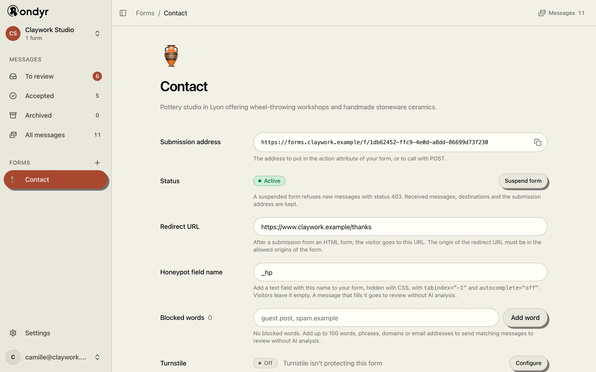
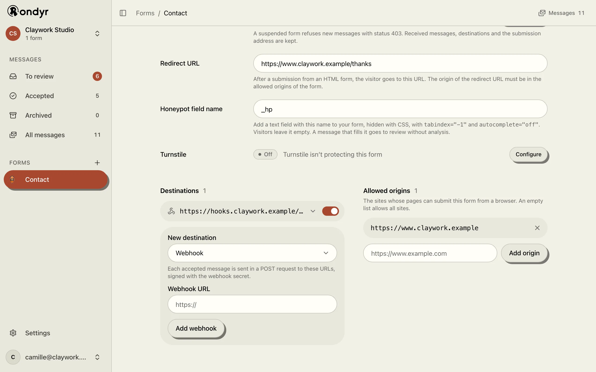

# Put a form on your site

Create a form in the dashboard, copy its submission address, and point your site's `<form>` or JavaScript code at it. Rondyr accepts plain HTML forms, `fetch` calls from another domain, and server-side submissions.

## 1. Create a form and copy its address

In the sidebar of the dashboard, **Forms** lists the forms of your organization. If you already created a form during initial setup, select it; otherwise select **+** next to **Forms**, pick an emoji, give the form a name, and describe your business so the spam filter knows what messages belong there. The emoji shows next to the form's name in the sidebar and, once you have several forms, on each message, so you can tell which form a message came from.

A form has one page, with its name and its settings at the top, then its **Destinations** and its **Allowed origins**. The name, the business description, the redirect URL and the honeypot field name save when you leave the field or press Enter.



Select the copy button in **Submission address** to copy your form's public URL. It looks like `https://forms.example.com/f/YOUR_PUBLIC_ID` and never changes, even if you rename the form later.

## 2. Add an HTML form to your page

Paste the copied URL into the `action` attribute of any standard HTML form:

```html
<form action="https://forms.example.com/f/YOUR_PUBLIC_ID" method="post">
  <label>
    Name
    <input type="text" name="name" required />
  </label>
  <label>
    Email
    <input type="email" name="email" required />
  </label>
  <label>
    Message
    <textarea name="message" required></textarea>
  </label>
  <button type="submit">Send</button>
</form>
```

You can choose any field names you like. Naming the visitor's address field `email` has two handy effects: Rondyr uses it as the `Reply-To` address on notification emails, and uses it to detect repeated spam from the same sender.

Send a test message from your page. Within a few seconds, it shows up in **Accepted** or **To review** in the dashboard. Next, set up [email](./email.md), [webhooks](./webhooks.md) or a [connector](./connectors.md) to Discord, Slack or Airtable, so accepted messages reach your team automatically, and add basic [spam protection](./spam-protection.md).

## Redirect visitors after submission

By default, visitors who submit an HTML form see Rondyr's built-in confirmation page (in English or French, matching their browser language). To send them back to your own thank-you page instead:

1. Open your form from **Forms** in the sidebar and, under **Allowed origins**, add your site's origin (for example `https://www.example.com`).
2. On the same page, enter your full HTTPS thank-you URL in **Redirect URL** (such as `https://www.example.com/thanks`) and press Enter.

Rondyr requires the redirect URL's origin to be in the form's allowed origins list so nobody can point your visitors elsewhere. To go back to the confirmation page, empty **Redirect URL** and press Enter. To remove that origin later, remove the redirect URL first.

## Submit with JavaScript (`fetch`)

If you want to submit without leaving the page, send a JSON `POST` request to the same form URL. Rondyr handles cross-origin requests automatically, so browser scripts on your site can call it directly:

```js
const response = await fetch("https://forms.example.com/f/YOUR_PUBLIC_ID", {
  method: "POST",
  headers: { "content-type": "application/json" },
  body: JSON.stringify({
    name: "Daniel",
    email: "daniel@example.com",
    message: "Could you send a quote for 40 stoneware cups?",
  }),
});

if (!response.ok) {
  throw new Error(`Submission failed with status ${response.status}`);
}

const { "submission-id": submissionId } = await response.json();
```

Don't pass `credentials: "include"` in `fetch`; Rondyr doesn't use cookies on form submissions, and browsers block credentialed requests to it.

A `202` response confirms that Rondyr saved the message and started spam screening. If your server validates the form first and forwards it on the visitor's behalf, use [server intake](./api.md#server-intake) with an API token instead.

For a server that forwards the visitor's Turnstile token, send `Rondyr-Turnstile: verify` and put the token in `cf-turnstile-response`. You can include `Rondyr-Visitor-IP` so Siteverify checks the token with the visitor's address. Configure the keys on the Rondyr form. Messages with missing, refused, or expired tokens go to **To review**.

## Restrict which websites can submit

By default, a form accepts browser submissions from any origin. To make sure only pages on your own website can submit to it:

1. Open your form from **Forms** in the sidebar and go to **Allowed origins**, at the end of its page.
2. Enter your site's origin, such as `https://www.example.com`, and select **Add origin**.



An origin is just the scheme, host, and optional port, with no path or wildcard. Origins must use `https://`, except `http://localhost` and loopback addresses (`http://127.0.0.1:8080`) for local testing. Once a form lists at least one origin, browsers on any other site are refused. Keep in mind that allowed origins stop other websites from submitting through their visitors' browsers, not automated scripts outside a browser; see [Fight spam](./spam-protection.md) for bot defenses.

## Field rules and limits

- **Formats:** `application/x-www-form-urlencoded`, `multipart/form-data` (text fields only), and `application/json`.
- **No file uploads:** If a `multipart/form-data` form includes a file input (even one left empty), Rondyr refuses the submission.
- **Size and field count:** Up to 16 KiB per submission, 1 to 32 fields, field names up to 100 characters (no line breaks or control characters), and values up to 4,000 characters.
- **Checkboxes and multi-select fields:** When an HTML form sends the same field name more than once (such as checkboxes), Rondyr joins the values with `, ` in the order received (for example `topic: "glaze, kiln"`). JSON submissions accept string values only.
- **Rate limits:** Each visitor can submit up to 5 times per minute to a form, and each form accepts up to 30 submissions per minute across all visitors. See [HTTP API](./api.md#public-form-submission) for exact status codes and error handling.

## Suspend a form

To pause submissions without deleting the form or losing its history, open your form from **Forms** in the sidebar, select **Suspend form** next to **Status**, and confirm. A suspended form refuses new submissions while keeping its existing messages, destinations, allowed origins, and submission address intact. Select **Reactivate form** whenever you want to accept messages again.
