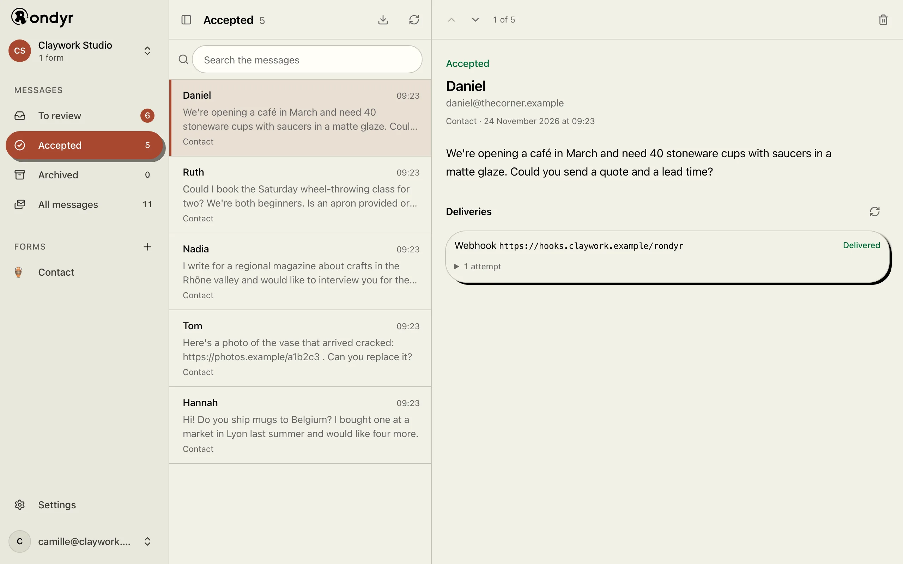
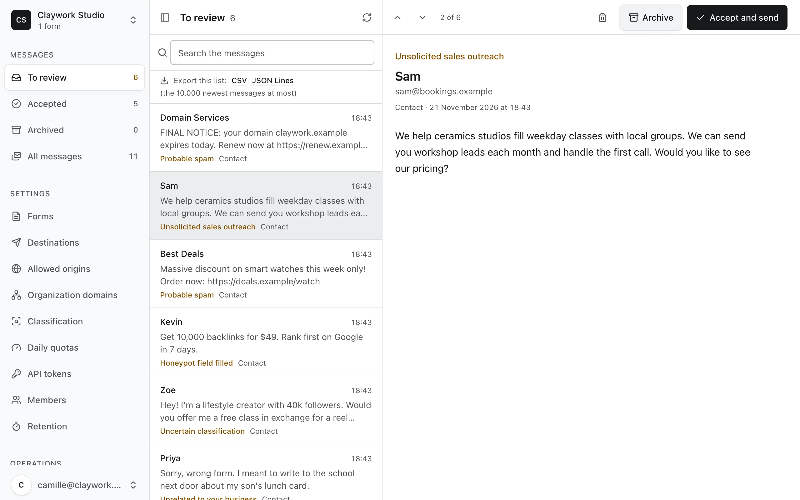
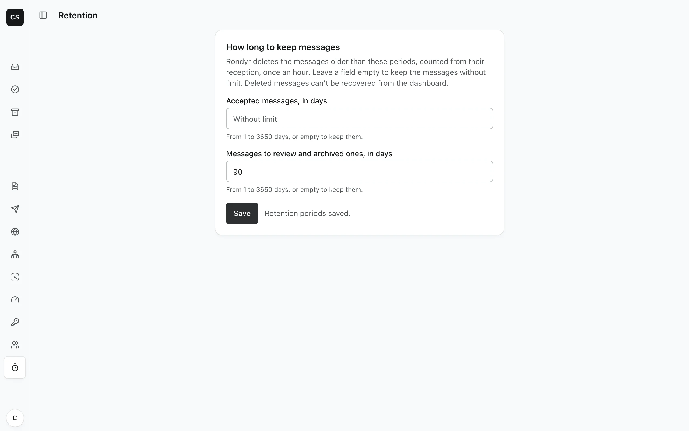

# Read and sort messages

Every organization has its own inbox split into four folders: **To review**, **Accepted**, **Archived**, and **All messages**. Accepted messages are forwarded automatically to your email, webhook and connector destinations; anything suspicious waits in **To review** until someone decides.

## Review quarantined messages

Open **To review** to check messages the spam filter or intake checks set aside. Each item shows why Rondyr held it:

| Reason | Cause |
| --- | --- |
| **Probable spam** | High spam score from the classifier |
| **Uncertain classification** | Borderline spam score that needs human judgment |
| **Unsolicited sales outreach** | Classifier detected a sales pitch or cold outreach |
| **Unrelated to your business** | Low relevance against the form's business description |
| **Honeypot field filled** | The hidden honeypot field wasn't empty |
| **Turnstile verification failed** | Turnstile token was missing or rejected by Cloudflare |
| **Repeated submissions** | Repeat message content or repeat sender within 30 days |
| **Daily classification quota reached** | Organization hit its daily AI classification limit |
| **Analysis unavailable** | Classifier couldn't answer when the message arrived |

Open a message and choose an action:

- **Accept and send** (or **Accept** if the form has no active destination): moves the message to **Accepted** and sends it to all active destinations of that form: emails, webhooks and connectors.
- **Archive**: moves the message to **Archived** without sending any notification.
- **Reclassify** (shown only on **Analysis unavailable** messages): sends the message back to the AI classifier once service is back. Each reclassification uses one slot of your organization's daily classification quota; if the quota is full for the day, try again after midnight UTC or raise the limit in **Settings → Daily quotas**.

If two reviewers decide on the same message at the same moment, Rondyr records the first decision and notifies the other reviewer that the message was already handled.

## Search and filter

Use the search bar above the message list to search across field values (3 to 100 characters; field names aren't searched). Search ignores uppercase and lowercase for plain ASCII letters (so `cup` finds `Cup`, while accented letters like `é` match literally).

Combine search with any folder and click a form name under a folder to narrow the list to one form.

## Check deliveries and retry failures

Open any message in **Accepted** to see its **Deliveries** section below the message text. Each destination shows its current status (**Pending**, **Sending**, **Delivered**, **Retry scheduled**, or **Failed**), the next scheduled retry time if it's waiting, and an expandable list of attempts with timestamps and error summaries.

If a delivery stops as **Failed** after automatic retries (for example, your webhook server was down for a full day), fix the issue on the destination side, then select **Retry delivery** (admins only). Rondyr keeps the same delivery ID so receiving apps can ignore duplicates, and tries sending again.

## Export messages

Admins can download the currently filtered list at any time from the top of the message list:

- **CSV**: ready for spreadsheets, with columns for the most common field names (up to 100 columns; extra rare field names go into an `other_fields` column). Values that could run as spreadsheet formulas are escaped automatically.
- **JSON Lines**: one JSON object per line containing `submissionId`, `receivedAt`, `form`, `status`, `reason`, `label`, and `fields`.

Exports include the full message fields for up to the 10,000 newest matching messages.

## Delete messages and set retention

### Delete one message

Admins can permanently delete an open message with the trash icon (**Delete this message**). After confirmation, Rondyr removes the message and its delivery history immediately; only a minimal deletion record (who deleted which ID and when, with no message text) remains. Deleted messages can't be restored from the dashboard, and copies already sent by email or webhook stay with their recipients.

### Automatic retention

To clean up old messages automatically, open **Settings → Retention** (admins only).

Set a number of days (1 to 3,650) for **Accepted messages** and separately for **Messages to review and archived ones**, then select **Save**. Leave a field empty to keep those messages indefinitely (the default). Rondyr removes expired messages once an hour based on when they were received.
