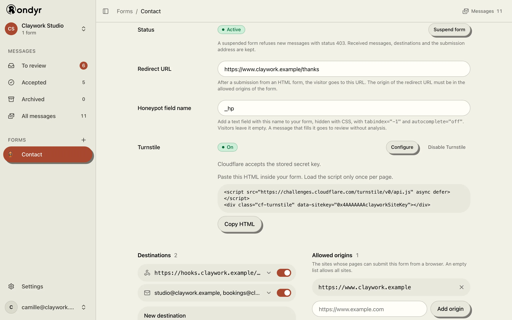
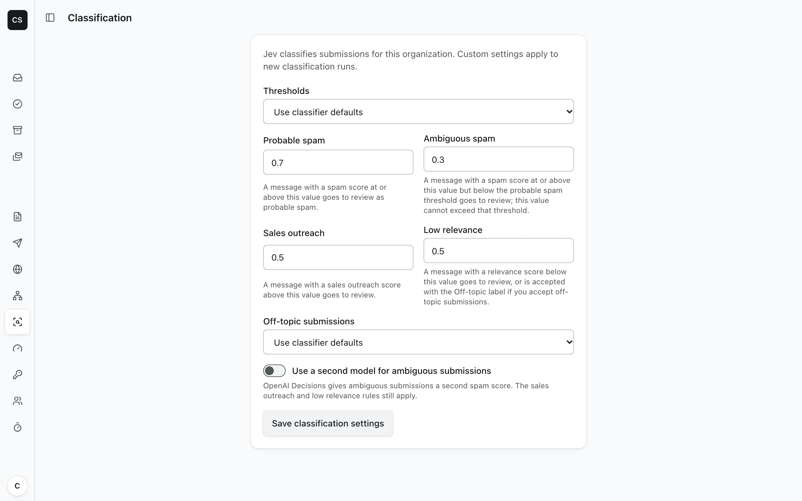

# Fight spam

Rondyr filters every message automatically with a classifier model (Jev or OpenAI Decisions), never deleting a real inquiry on a model's guess. To stop bots and repeat spam patterns before they reach the classifier, layer four settings: a business description, a honeypot field, Cloudflare Turnstile, and blocked words.

## 1. Describe your business

Open your form from **Forms** in the sidebar and type, under its name, one or two plain sentences about what you do (for example, *"Pottery studio in Lyon offering wheel-throwing workshops and handmade stoneware ceramics."*).

With a business description in place, the classifier checks three things on every message:

- **Spam:** mass solicitations, phishing, automated junk.
- **Unsolicited sales outreach:** someone trying to sell or pitch their own product, agency, guest post, or lead list to you, including indirect messages asking who handles marketing. Genuine quote requests, wholesale buyers, press inquiries, job applications, and peer partnerships aren't flagged as sales outreach.
- **Relevance:** whether the message relates to your business. Without a business description, Rondyr skips the relevance check.

Anything that trips one of those checks goes to **To review** with a clear label instead of being deleted, so a real off-topic note (like *"I found your keys outside your shop"*) is still waiting for you.

### Recognize your own domains

If teammates or colleagues occasionally test your forms or write from your company's domain, open **Settings → Organization domains** and add up to 10 lowercase domain names (such as `claywork.example`). When a message arrives from that domain or one of its subdomains, Rondyr lets the classifier know it matches your organization's domain.

## 2. Add a honeypot field

A honeypot is a field that real visitors never see and leave blank, while simple spam bots fill every input on the page. It adds zero friction for visitors.

1. Open your form from **Forms** in the sidebar.
2. Enter a field name (for example `_hp`) in **Honeypot field name** and press Enter.
3. Add a matching text input inside your site's `<form>`, hidden with CSS rather than `type="hidden"`, with `tabindex="-1"` and `autocomplete="off"`:

```html
<form action="https://forms.example.com/f/YOUR_PUBLIC_ID" method="post">
  <input type="email" name="email" required />
  <textarea name="message" required></textarea>
  <div aria-hidden="true" style="position: absolute; left: -10000px">
    <label>Leave this field empty <input type="text" name="_hp" tabindex="-1" autocomplete="off" /></label>
  </div>
  <button type="submit">Send</button>
</form>
```

When a visitor leaves `_hp` blank, Rondyr strips it out before saving the message. When a bot fills it in, Rondyr still returns the normal confirmation page or redirect (so the bot learns nothing), skips the AI classifier, and places the message in **To review** labeled **Honeypot field filled**. If a browser's autofill accidentally fills it for a real person, you can still accept and forward the message from **To review**.

## 3. Add Cloudflare Turnstile

For persistent bots that ignore honeypots, attach a [Cloudflare Turnstile](https://developers.cloudflare.com/turnstile/get-started/) widget to your form.



1. In your Cloudflare dashboard, create a Turnstile widget for your website's hostname and copy its **Site key** and **Secret key**.
2. In Rondyr, open your form from **Forms** in the sidebar, select **Configure** next to **Turnstile**, paste both keys, and select **Save Turnstile keys**. Rondyr checks the secret key with Cloudflare right away so typos are caught before saving.
3. Select **Copy HTML** and paste the two lines inside your `<form>` (load the Turnstile `<script>` only once per page). If you submit via JavaScript JSON, send the token in the `cf-turnstile-response` field. If your server forwards the post on the visitor’s behalf, [opt in to Turnstile on server intake](./api.md#turnstile-for-forwarded-submissions).

Rondyr removes the Turnstile token before saving the message. Submissions with a missing or invalid token go to **To review** labeled **Turnstile verification failed** without calling the AI classifier, while still returning the usual confirmation response to the visitor.

If Cloudflare's verification service has a brief outage, Rondyr doesn't block real visitors; messages fall back to normal AI classification. Each time you open a form's page, Rondyr re-checks your saved Turnstile secret key with Cloudflare and warns you under **Turnstile** if the widget was deleted or the key stopped working.

## 4. Block words, phrases, and domains

If a recurring spam wave keeps using the same phrase, domain, or sender address, add it to a blocked list so matching messages skip the AI classifier.

- **One form:** open your form from **Forms** in the sidebar and add entries under **Blocked words**.
- **All forms in an organization:** open **Settings → Blocked words**.

Each list accepts up to 100 entries of up to 100 characters. Words, multi-word phrases, domains (such as `spam.example`), and full email addresses all work. Rondyr checks every field value on whole-word boundaries, ignoring case, accents, and punctuation:

- `societe` matches `société`, and `casino` matches `cásino`.
- `seo` does not match `museo`, and a phrase never matches across two separate fields.
- `spam.example` matches `promo@spam.example` and `https://spam.example/offer`.

When a message matches either the form's list or the organization's list, Rondyr returns the normal confirmation page or redirect (revealing nothing to the sender), skips the AI classifier, and places the message in **To review** labeled **Blocked word or phrase**. Admins opening the message in the inbox see which current list entry matched, making it easy to spot a term that caught a real inquiry.

## Repeat detection

Rondyr automatically spots repetitive spam across all forms in your organization over a rolling 30-day window. If Rondyr already received at least 2 earlier submissions with the same message content, or 3 from the same `email` address, new repeats skip the AI classifier and go straight to **To review** labeled **Repeated submissions**. A single accidental double-click stays under both limits.

## Tune classification rules

Open **Settings → Classification** to adjust how strict the spam filter is for your organization. Changes apply to new messages only.



Each classifier scores a message from `0` to `1` on spam, sales outreach, and relevance. By default, a message is accepted automatically when:

- **Spam** is below `0.30` (`0.30` to `0.69` goes to review as **Uncertain classification**; `0.70` and above as **Probable spam**).
- **Sales outreach** is `0.50` or lower (above `0.50` goes to review as **Unsolicited sales outreach**).
- **Relevance** (when a business description is set) is at least `0.50` with Jev, or `0.45` with OpenAI Decisions (below that goes to review as **Unrelated to your business**).

From **Settings → Classification**, an admin can:

- **Set custom thresholds** for all four rules (values from `0` to `1`; ambiguous spam can't exceed probable spam).
- **Accept off-topic messages automatically** by switching **Off-topic submissions** to **Accept with the Off-topic label**. Messages that only failed the relevance check are then accepted, forwarded to your destinations, and tagged **Off-topic** in your inbox. Spam and sales outreach rules still apply first.
- **Turn on a second model for ambiguous messages**, when your instance has `RONDYR_ESCALATION_CLASSIFIER` configured (see [Classifier choice](./deployment.md#classifier-choice)). The second model re-checks messages whose spam score fell in the uncertain range, using one extra slot from your daily classification quota. If the second model clears the spam doubt and the message passes sales outreach and relevance checks, Rondyr accepts it; otherwise it stays in **To review**.

## Rate limits and daily quotas

Even without extra configuration, Rondyr enforces built-in caps to keep spam waves from overwhelming your forms or your bill:

- **5 submissions per minute per visitor** on each form (counted by Cloudflare without Rondyr storing visitor IP addresses).
- **30 submissions per minute per form** across all visitors.
- **Daily organization quotas** under **Settings → Daily quotas** (default: 2,000 submissions, 1,000 AI classifications, and 2,000 junk submissions caught at intake per UTC day).

Junk caught at intake (honeypot, failed Turnstile, repeated submissions, or blocked words) counts against its own daily allowance rather than your regular submission limit, so a bot wave can't block real visitors. Once your daily AI classification quota is full, real submissions are still accepted by your form and placed in **To review** labeled **Daily classification quota reached** instead of being lost. See [Costs and limits](./costs.md#control-spending-with-daily-quotas) for adjusting these limits.
