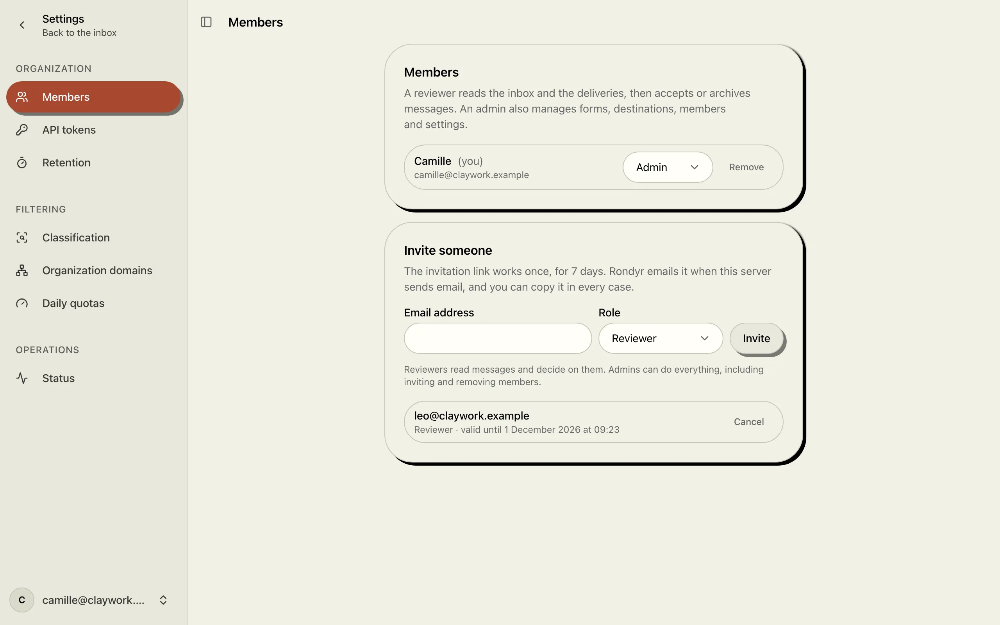

# Team and accounts

Public sign-up is closed on every Rondyr instance. After you create the owner account, invite teammates from the dashboard and assign each person the **Reviewer** or **Admin** role.

## Invite someone

1. Open **Settings → Members** in the dashboard (only an admin can open this section).
2. Enter the person's email address, pick a role (**Reviewer** or **Admin**), and select **Invite**.
3. If your instance sends email (see [Send messages by email](./email.md)), Rondyr emails them an invitation link automatically. Either way, Rondyr shows the link once right after creation so you can copy it and send it yourself.

Each invitation link works once and expires after 7 days. An organization can have up to 20 pending invitations at a time, and an address receives at most 3 invitation emails in 24 hours across the instance; past that limit, copy the link from the dashboard and send it directly.

When the invited person opens the link:

- If they don't have an account on this Rondyr instance yet, they enter their name and a password of 12 to 128 characters to create one and join.
- If they already have an account at that address, they sign in and join the organization.
- If they are signed in under a different email address, Rondyr asks them to sign out first.

Pending invitations stay listed under **Invite someone**, where an admin can cancel them at any time. Creating a new invitation for the same email address replaces the previous pending link.

## Roles

Each member has one role per organization. A single account can belong to several organizations with different roles in each, and an admin of any organization can create a new one (becoming its admin). On a new instance, the first account creates the first organization. An account that belongs to no organization, for example after its removal from the last one, cannot create one: the dashboard tells it to ask an admin for an invitation.

| Role | Permissions |
| --- | --- |
| **Reviewer** | Read messages, search the inbox, accept or archive quarantined messages, reclassify messages that failed analysis, and view delivery history |
| **Admin** | Everything a reviewer can do, plus manage forms, allowed origins, honeypot and Turnstile settings, destinations, delivery retries, test sends, classification rules, daily quotas, API tokens, members, exports, message deletion, retention, and the **Status** page |

## Change a role or remove a member

In **Settings → Members**, use the role dropdown next to a member to switch between **Admin** and **Reviewer**, or select **Remove** to revoke their access to the organization.

Keep three rules in mind before making changes:

- **Last admin protection.** Every organization keeps at least one admin; promote someone else before stepping down or removing the last admin.
- **Stepping down.** If you switch your own role from Admin to Reviewer, Rondyr asks you to confirm, because only another admin can promote you back.
- **API tokens and pending invitations.** Removing a member immediately revokes every API token they created in that organization and cancels any pending invitations they sent. Before you confirm, Rondyr tells you how many active tokens will stop working, so you can give affected websites or scripts a token created by another admin first. Demoting an admin to reviewer cancels their pending invitations, while their existing API tokens keep working.

Removing a member removes them from the organization only; their account still exists, and an admin can invite them again later. When it was their last organization, Rondyr also signs them out on every device.

## Reset a forgotten password

When your instance has email configured, the sign-in screen shows a **Forgot your password?** link.

1. Select **Forgot your password?**, enter your account's email address, and select **Email me a link**.
2. Open the link from your inbox and choose a new password (12 to 128 characters).

Reset links work once and expire after one hour, and an account can request at most 3 reset emails in 24 hours. Saving a new password signs the account out of every active session. For privacy, the sign-in page shows the same confirmation message whether or not an account exists for that address.

If your instance doesn't have an email provider configured, Rondyr can't send password reset emails; configure email first in [Send messages by email](./email.md).

## Rotate instance secrets

To replace a secret on an instance deployed with the button, open **Workers & Pages → rondyr → Settings → Variables and Secrets** in the Cloudflare dashboard, update the value, and save. On an Alchemy deployment, update the matching `*_PROD` secret in your GitHub fork and run the **Deploy** workflow.

- **`BETTER_AUTH_SECRET`**: set a new random string of at least 32 characters (`openssl rand -hex 32`). Everyone will be signed out and will need to sign in again.
- **`RESEND_API_KEY`**: create a new sending key in Resend, replace the secret, send a test email from **Destinations** to confirm it works, then revoke the old key in Resend.
- **`RONDYR_SECRETS_KEY`**: set a new 32-byte base64 key (`openssl rand -base64 32`). Afterward, rotate each webhook's signing secret in **Destinations** (and update the receiving apps) and re-save the Turnstile keys on any form that uses Turnstile.
