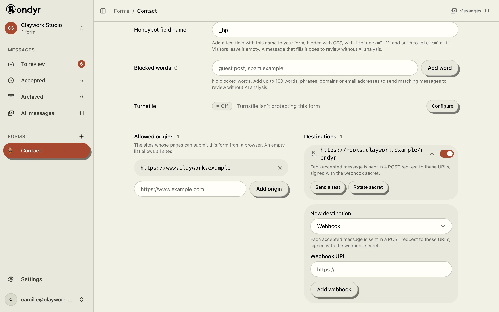

# Send messages to a webhook

Add a webhook URL to a form under **Destinations** to forward every accepted message to your own app or automation as a signed HTTPS `POST` request.

Rondyr encrypts webhook signing secrets with `RONDYR_SECRETS_KEY`, which button deployments generate automatically. On an Alchemy deployment, make sure you set `RONDYR_SECRETS_KEY_PROD` first; see [deployment.md](./deployment.md#encryption-key).

## 1. Add a webhook in the dashboard

1. Open **Settings → Destinations** (admins only) and select your form.
2. Under **Webhooks**, paste your HTTPS endpoint URL (for example `https://hooks.claywork.example/rondyr`) and select **Add webhook**.
3. Copy the signing secret (`whsec_…`) shown immediately after creation and save it in your receiving app's configuration. Rondyr shows a secret once and never again.



Only messages accepted after you create (or reactivate) a webhook are sent to it; quarantined messages go out only when someone accepts them.

## 2. Verify the signature

Every request includes `Rondyr-Timestamp` (Unix seconds) and `Rondyr-Signature` (`v1=<hex>`, or two comma-separated values during secret rotation). Rondyr signs `<Rondyr-Timestamp>.<raw body>` with HMAC-SHA-256 using the full secret string, `whsec_` prefix included.

In your endpoint:

1. Reject timestamps more than 5 minutes away from your clock.
2. Verify the HMAC over the raw request body before parsing JSON.
3. Accept the request if any `v1=` signature matches in constant time.

Copy this Web Crypto helper (also at [docs/examples/verify-webhook.ts](./examples/verify-webhook.ts)); it runs in Cloudflare Workers, Node.js 20+, Deno, and Bun:

```ts
const toleranceSeconds = 300;
const encoder = new TextEncoder();

function hexBytes(hex: string) {
  if (!/^[0-9a-f]{64}$/u.test(hex)) return null;
  return Uint8Array.from(hex.match(/../gu) ?? [], (pair) => Number.parseInt(pair, 16));
}

/**
 * Returns the raw body of a Rondyr webhook request when one of its signatures
 * matches `secret` and its timestamp is at most five minutes away from `now`,
 * in milliseconds. Returns null otherwise.
 */
export async function verifyRondyrWebhook(request: Request, secret: string, now = Date.now()) {
  const timestamp = request.headers.get("rondyr-timestamp") ?? "";
  const header = request.headers.get("rondyr-signature") ?? "";
  if (!/^\d+$/u.test(timestamp)) return null;
  if (Math.abs(now / 1000 - Number(timestamp)) > toleranceSeconds) return null;

  const body = await request.text();
  const key = await crypto.subtle.importKey(
    "raw",
    encoder.encode(secret),
    { name: "HMAC", hash: "SHA-256" },
    false,
    ["verify"],
  );
  const signed = encoder.encode(`${timestamp}.${body}`);
  for (const part of header.split(",")) {
    const [scheme, value = ""] = part.trim().split("=", 2);
    const signature = scheme === "v1" ? hexBytes(value) : null;
    // crypto.subtle.verify compares in constant time.
    if (signature !== null && (await crypto.subtle.verify("HMAC", key, signature, signed))) {
      return body;
    }
  }
  return null;
}
```

Example handler in a receiving Worker:

```ts
import { verifyRondyrWebhook } from "./verify-webhook.ts";

export default {
  async fetch(request: Request, env: { RONDYR_WEBHOOK_SECRET: string }) {
    const body = await verifyRondyrWebhook(request, env.RONDYR_WEBHOOK_SECRET);
    if (body === null) return new Response(null, { status: 401 });
    const payload = JSON.parse(body);
    if (payload.type === "test") return new Response(null, { status: 204 });
    // Store payload.deliveryId so duplicate deliveries are ignored.
    return new Response(null, { status: 204 });
  },
};
```

## 3. Send a test request

Select **Send a test** on your webhook in **Destinations** (up to 3 tests per minute per destination). Rondyr signs and sends one request with `"type": "test"`, waits up to 30 seconds without retrying, and reports whether your endpoint returned a `2xx` status or an error. Make sure your receiver skips storing messages when `payload.type === "test"`.

## Payload and headers

```http
POST /rondyr HTTP/1.1
Content-Type: application/json
User-Agent: Rondyr-Webhook/1
Rondyr-Delivery-Id: 1b4e28ba-2fa1-4d2b-883f-0016d3cca427
Rondyr-Timestamp: 1795190400
Rondyr-Signature: v1=5f2b…
```

```json
{
  "version": 1,
  "type": "submission.accepted",
  "deliveryId": "1b4e28ba-2fa1-4d2b-883f-0016d3cca427",
  "submission": {
    "id": "73123ee4-40bf-4c5f-b8ff-1d56cdaa7640",
    "receivedAt": "2026-11-20T13:20:00.000Z",
    "fields": {
      "email": "visitor@example.com",
      "message": "Is there room in the pottery class?"
    }
  },
  "form": { "id": "YOUR_PUBLIC_ID", "name": "Contact" }
}
```

- `version`: always `1` for this shape; ignore unknown fields so future additions don't break your receiver.
- `type`: `"submission.accepted"` for real messages, `"test"` for dashboard tests.
- `deliveryId`: same UUID as `Rondyr-Delivery-Id`; stays identical across every retry of that delivery.
- `submission.id`: the `submission-id` returned when the form was submitted.
- `submission.receivedAt`: UTC ISO 8601 timestamp of when Rondyr saved the submission.
- `submission.fields`: flat object of strings (1 to 32 fields).
- `form.id` and `form.name`: the form's public ID and dashboard name.

## Rotate a signing secret

Select **Rotate secret** next to a webhook in **Destinations** to generate a new secret. For the next 24 hours, Rondyr sends two signatures in `Rondyr-Signature` (new secret first, previous secret second) so you can update your receiver without downtime. After 24 hours, only the new secret signs requests. If a secret leaked, rotate it and update your receiver immediately so it stops accepting the old secret.

## Retries and deduplication

Rondyr checks only your HTTP status code and ignores response bodies:

| Receiver response | Result |
| --- | --- |
| `2xx` | Delivered |
| `408`, `425`, `429`, `5xx`, network error, or no reply in 30 seconds | Retried |
| `3xx` (redirects aren't followed) or any other `4xx` | Failed immediately |

Rondyr retries temporary failures automatically over several hours. If a delivery still ends as **Failed**, open the message in **Accepted** and select **Retry delivery** after fixing your endpoint.

Delivery is at-least-once and messages can arrive out of order. Always record `Rondyr-Delivery-Id` (or `payload.deliveryId`) so a retried delivery isn't processed twice, and order messages by `submission.receivedAt` if order matters.

## Allowed webhook URLs

Webhook URLs must use `https://` on the default port (443) with no username or password, and must not target `localhost`, `.local`/`.internal`/`.home.arpa` hostnames, bare hostnames without a dot, private or reserved IP literals, or your Rondyr instance's own host.
